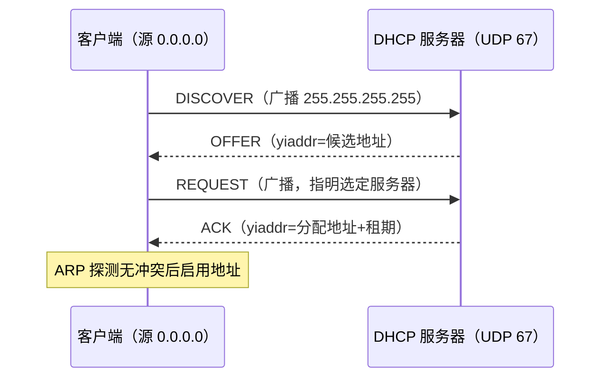

> **位置**：[总索引](/posts/872-index/) ｜ **上游**：[总览：体系结构与性能指标](/posts/872-net-01-overview/)（应用层地位；RTT 的定义见 01 篇 §3.6）
> **下游**：UDP 端口 53/67/68→传输层 06 ｜ 广播地址与路由→网络层 11 ｜ ARP→12 ｜ 全链路填表→13

## 1. 这一篇会怎么考

| 考法问句 | 题型 | 频次 |
|---|---|---|
| 递归查询与迭代查询的区别？谁替谁跑腿？ | 选择/简答 | 高频 |
| 域名服务器分哪几类？本地域名服务器的地位？ | 简答/选择 | 高频 |
| DNS 用 UDP 还是 TCP？什么情况用 TCP？ | 选择 | 高频陷阱 |
| 资源记录 A/NS/CNAME/MX 各表示什么 | 选择 | 中频 |
| 从输入域名到拿到 IP 的完整解析流程 | 大题/画图 | 高频 |
| DHCP 四步交互，每步报文的源/目的 IP、yiaddr 字段 | 大题填表 | 高频 |
| DHCP 中继代理解决什么问题 | 简答/选择 | 中频 |
| DNS 会遭受哪些攻击？如何防御？ | 简答 | 中频（新热点） |

## 2. DNS 与 DHCP 的骨架

```
DNS  —— 域名空间（树）→ 域名服务器（根/TLD/权限/本地）→ 解析流程（递归/迭代）→ 资源记录
DHCP —— 目的（即插即用）→ 四步 DORA → 报文字段 → 中继代理 → 租期与其他报文
安全 —— DNS：劫持/投毒 → 反射放大 → 隧道（§3 末）｜ARP：欺骗投毒 → 中间人（12 篇 §3 末）
```

- 都是应用层的客户-服务器协议。DNS 走 UDP 53（为主），DHCP 也走 UDP：服务器 67、客户端 68
- 时序关系：主机入网先经 DHCP（或静态配置）拿到地址，再经 DNS 解析域名，之后才有 HTTP 等会话。综合题里两者的出场顺序经常一起考

## 3. 要背的定义

### 必背（定义直接考）

- **DNS**：域名系统是因特网使用的命名系统，用来把便于人们使用的机器名字转换为 IP 地址。它是由分层的域名服务器实现的分布式数据库，同时也是一个应用层协议。
- **递归查询 vs 迭代查询**：递归查询中，服务器代替客户端继续向其他服务器查询，最终返回结果或报错；迭代查询中，服务器只返回它认为合适的下一台服务器地址，由客户端（通常是本地域名服务器）自己继续查询。主机对本地域名服务器一般用递归，本地域名服务器对根/顶级/权限服务器一般用迭代。
- **域名服务器四类**：根域名服务器知道全部顶级域名服务器的地址；顶级域名服务器管理注册在该顶级域名下的二级域名；权限域名服务器负责一个区的域名解析；本地域名服务器是主机进入 DNS 系统的入口，主机的 DNS 查询首先发给它。
- **DHCP**：动态主机配置协议，提供即插即用的主机配置机制，使计算机加入新网络时能自动获取 IP 地址、子网掩码、默认网关、DNS 服务器地址等参数。客户-服务器模式，基于 UDP。
- **DORA 四步**：①DHCPDISCOVER，客户端广播寻找可用服务器；②DHCPOFFER，服务器提供候选配置（含候选地址 yiaddr）；③DHCPREQUEST，客户端广播，指明选定的服务器，同时隐式拒绝其他服务器的提议；④DHCPACK，选定服务器提交绑定并确认，附带租期。REQUEST 步的 **yiaddr 字段回填 OFFER 提供的候选地址**（虽然客户端尚无地址、理论上可填 0.0.0.0，872 口径要求写 OFFER 给的 yiaddr）；客户端身份仍靠 chaddr（MAC）+ xid 标识。

### 辨析（选择题考对比）

- 资源记录类型：
  - A：域名 → IPv4 地址，如 www.x.edu.cn A 202.x.x.x
  - NS：该域的授权域名服务器，如 x.edu.cn NS dns.x.edu.cn
  - CNAME：别名 → 规范域名，如 www → web1.x.edu.cn
  - MX：邮件交换服务器，如 x.edu.cn MX mail.x.edu.cn
- DNS 的传输层选择：查询响应用 UDP 53；区域传送（主从服务器同步数据库）用 TCP 53，响应超过 512B 也可能用 TCP
- DHCP 其他报文：NAK=服务器拒绝（客户端网络判断错误或租期失效）；DECLINE=客户端报告地址已被占用；RELEASE=客户端放弃地址；INFORM=客户端已有地址，只要其余参数
- **租期与续租**：ACK 附带的租期到期后地址收回。客户端在**租期用到一半**时主动发 DHCPREQUEST 请求续租（教材口径广播；RFC 口径先单播原服务器，T2=87.5% 时改广播），服务器同意则回 ACK、租期重新起算；若续租无响应，到 T2 再广播请求；租期彻底届满仍未续上，则回到 DISCOVER 重新申请。
- 中继代理：客户端与 DHCP 服务器不在同一网段时，由中继代理（DHCP/BOOTP relay，通常在路由器上）代为转发；服务器根据报文里的 giaddr 判断客户端所在网段，再决定分配哪个地址池的地址

### 了解（低频背景）

- 根域名服务器逻辑上 13 套（a~m），实际在全球多副本部署
- 顶级域名分类：国家/地区域、通用域（com/org/net/edu 等）、反向域 arpa
- 域名缓存：本地域名服务器缓存查询结果，按 TTL 老化，能大幅减少根服务器流量

### DNS 的安全（简答）

答题骨架：先说 DNS 为什么天然是攻击面（**UDP 明文**、响应无签名无认证、递归服务器可被当作放大器），再逐条给攻击手段和防御，防御分软件/协议侧与硬件/部署侧两栏写。

| 攻击 | 手段 | 防御（软件 / 协议侧） | 防御（硬件 / 部署侧） |
|---|---|---|---|
| 劫持与缓存投毒 | 伪造 DNS 应答，把域名解析到恶意 IP。一次投毒在 TTL 周期内影响所有查询 | **DNSSEC** 给记录签名，防伪造与投毒（不加密）；**DoT(853) / DoH(443)** 加密查询与应答 | 解析器做源端口 + 事务 ID 随机化，关闭开放递归；权威服务器 **Anycast + 全球多副本** |
| 反射放大 DoS | 以受害者 IP 作源地址发查询，响应比查询大几十倍，打向受害者 | 关闭开放递归，限制同一源的**响应速率** | **Anycast 集群**、流量清洗 / 黑洞路由、边界设备限速 |
| DNS 隧道 | 把数据编码进 DNS 查询 / 响应，绕过防火墙外传或做 C2 通道 | 出口侧检测：**周期性 TXT 查询、超长域名、高熵值**；DNS 日志审计与 DLP | 出口只允许经批准的解析器，**IPS / 防火墙**做 DNS 深度检测 |

单点问题补一句即可：本地域名服务器是**单点**，被 DoS 或入侵则该范围解析全断。对策是多 resolver 冗余、权威服务器 Anycast 集群、故障切换，都属部署 / 硬件侧。

## 4. 对比与速查

### 4.1 递归 vs 迭代：先分清"谁替谁跑腿"

| 维度 | 递归查询 | 迭代查询 |
|---|---|---|
| 谁继续查 | 服务器替客户端继续问 | 客户端自己拿线索继续问 |
| 服务器返回什么 | 最终结果或错误 | 下一台服务器的地址 |
| 典型位置 | 主机 → 本地域名服务器 | 本地域名服务器 → 根/TLD/权限 |
| 服务器负担 | 大（跑完全程） | 小（只答自己管辖的部分） |

### 4.2 DHCP 相关的三个概念

- DHCP vs 静态配置：静态手工填、无协议交互、管理成本高；DHCP 自动获取、支持即插即用
- DHCP vs ARP：ARP 解决"已知 IP 找 MAC"，DHCP 解决"连 IP 都还没有"。DHCP ACK 之后客户端还会发 ARP 探测地址是否被占用

### 4.3 报文字段速查

DHCP 报文结构（BOOTP 格式，固定 236 B + 选项）：

| 字段 | 长度 | 作用 |
|---|---|---|
| op | 1 B | 报文类型：1=请求、2=应答 |
| htype | 1 B | 硬件地址类型，以太网 = 1 |
| hlen | 1 B | 硬件地址长度，MAC = 6 |
| hops | 1 B | 经中继代理的跳数 |
| xid | 4 B | 事务 ID，匹配请求与各应答 |
| secs | 2 B | 客户端已用时间 |
| flags | 2 B | 最高位 = 广播标志（BROADCAST） |
| ciaddr | 4 B | 客户端已有 IP（无则 0） |
| yiaddr | 4 B | 服务器分配给客户端的 IP |
| siaddr | 4 B | 下一步引导服务器地址 |
| giaddr | 4 B | 中继代理 IP（跨网段时用） |
| chaddr | 16 B | 客户端硬件地址（MAC） |
| sname | 64 B | 服务器名（可选） |
| file | 128 B | 启动文件名（可选） |
| options | 可变 | 以魔术 cookie `0x63825363` 起始，含子网掩码、网关、DNS、租期等 |

DNS 报文结构（查询与响应同一格式）：

| 部分 | 字段 | 长度 | 作用 |
|---|---|---|---|
| 首部 | ID | 16 位 | 标识，匹配查询与响应 |
| 首部 | 标志 | 16 位 | QR（0 查询/1 响应）、Opcode、AA、TC、RD、RA、RCODE |
| 首部 | QDCOUNT | 16 位 | 问题数 |
| 首部 | ANCOUNT | 16 位 | 回答记录数 |
| 首部 | NSCOUNT | 16 位 | 授权记录数 |
| 首部 | ARCOUNT | 16 位 | 附加记录数 |
| 正文 | 问题部分 | 可变 | 查询名 + 查询类型 + 查询类 |
| 正文 | 回答/授权/附加 | 可变 | 若干资源记录 RR：NAME、TYPE、CLASS、TTL、RDLENGTH、RDATA |

## 5. 填表题与画图题

### 5.1 DHCP 四步报文字段表（填表题套路）

默认情形：客户端尚无地址、与服务器同网段、报文 BROADCAST 位置 1。

| 步 | 报文 | 源 IP | 目的 IP | yiaddr | UDP 端口 |
|---|---|---|---|---|---|
| 1 | DISCOVER | 0.0.0.0 | 255.255.255.255 | — | 68→67 |
| 2 | OFFER | 服务器 IP | 255.255.255.255（或单播到 yiaddr） | 候选地址 | 67→68 |
| 3 | REQUEST | 0.0.0.0 | 255.255.255.255 | OFFER 提供的候选地址（872 口径） | 68→67 |
| 4 | ACK | 服务器 IP | 255.255.255.255（或单播到 yiaddr） | 分配地址 | 67→68 |

填字段先问三个问题：客户端此刻有没有 IP（没有则源填 0.0.0.0）？这步是不是广播（找服务器、或让落选服务器知道已落选，则目的填 255.255.255.255）？地址字段给谁（OFFER/ACK 由服务器填 yiaddr；REQUEST 按口径回填 OFFER 给的候选地址）？跨网段时中继代理改写 giaddr，IP 层就是普通单播路由。



### 5.2 DNS 解析全流程（画图题模板）

自编例子：客户端要访问 www.example.com，本地无缓存。

1. 客户端 → 本地域名服务器：递归查询
2. 本地 → 根：迭代，根返回 .com 顶级域名服务器地址
3. 本地 → .com TLD：迭代，返回 example.com 权限服务器地址
4. 本地 → 权限服务器：返回 www.example.com 的 A 记录
5. 本地缓存结果并交给客户端

变式：题面若要求全程递归，则本地服务器把"继续问"交给根服务器逐层代查；有缓存时可直接从命中处继续。画完流程标注每一段用 UDP 53。

**RTT 计数口径**（大题常问"共几个 RTT"）：上例中主机→本地服务器是递归（1 RTT），本地→根/TLD/权限各一次迭代（3 RTT），**无缓存全程共 4 个 RTT**；本地缓存在哪一级命中，迭代段就省到第几步，从命中处只加"本地→权限"一跳或直接 0 迭代。答案返回方向的报文一般不再计入 RTT。

## 6. 最容易写错的八处

- "DNS 全用 UDP"：查询用 UDP，区域传送用 TCP
- DISCOVER 源 IP 写 127.0.0.1：是 0.0.0.0
- REQUEST 的 yiaddr 写 0.0.0.0：872 口径应回填 OFFER 提供的候选地址；客户端身份靠 chaddr + xid，不靠 yiaddr
- 默认 OFFER/ACK 一定广播：RFC 按 BROADCAST 位可单播到 yiaddr，按题面条件走
- **递归、迭代各朝哪边走？** 先想"谁替谁跑腿"：替你一路问到底、把结果拿回来的是递归（服务器代查）；只给你下一条线索、让你自己再去问的是迭代
- "DNSSEC 能加密 DNS 查询"：错。DNSSEC 只提供真实性与完整性（签名验证），不提供机密性；要加密得用 DoT/DoH
- "反射放大攻击的根源是 DNS 服务器被入侵"：错。根源是 UDP 无连接加开放递归解析器被当作放大器使用
- "缓存投毒只影响发起查询的那台主机"：错。投毒改的是递归服务器的缓存，TTL 周期内所有经它解析的客户端都会被导向恶意 IP，受害范围比想象的大

---

**出处汇总**：谢希仁《计算机网络（第7版）》第6章；黑书《自顶向下方法》第2章；RFC 1034/1035（DNS）；RFC 2131（DHCP）
