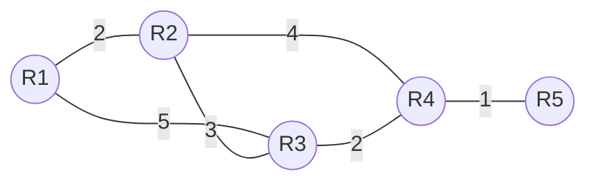
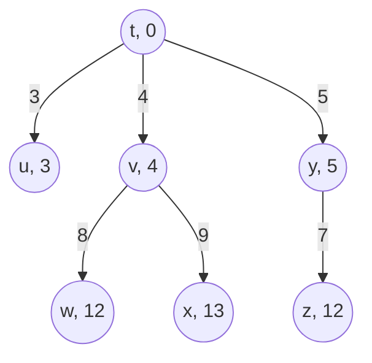

> **位置**：[总索引](/posts/872-index/)｜**上游**：[传输层（UDP 与 TCP）](/posts/872-net-06-transport/)｜**下游**：[IP 与 CIDR](/posts/872-net-08-ip-cidr/)（08）

## 1. 这一篇会怎么考

| 考法问句 | 题型 | 频次 |
|---|---|---|
| RIP/IGRP/OSPF/BGP 多协议横向对比？ | 选择/简答 | 极高频 |
| 给出相邻路由器距离向量，更新路由表 | 大题/计算 | 极高频 |
| RIP 最大跳数 15/16 的含义？ | 选择 | 高频 |
| OSPF 五种分组类型？ | 选择/简答 | 高频 |
| IGRP 与 RIP 同属哪类协议？本质区别是什么？ | 选择/简答 | 低频，常与 RIP/OSPF 并列小题 |
| IGRP 靠什么选路？度量由哪些分量组成？ | 选择/小计算 | 低频 |
| RIP 坏消息传得慢（计数到无穷）怎么解决？ | 简答/选择 | 中频 |
| BGP 为什么用路径向量、找什么"可行"路由？ | 简答 | 中频 |

## 2. 路由选择的骨架

```
路由选择：为分组确定从源到目的的路径
├─ 两个动作
│    转发（forwarding）：本地、查表、把分组从合适端口送出
│    路由选择（routing）：全局、算路、生成路由表
├─ 路由算法
│    静态路由：手工配置，不随流量变化
│    动态路由：路由器自动交换信息、适应拓扑变化
│      ├─ 全局式（链路状态 LS）：每台路由器掌握全网拓扑，独立算路
│      └─ 分散式（距离向量 DV）：每台路由器只知邻居，迭代算路
├─ 组织框架：层次路由
│    互联网规模太大 → 划分自治系统 AS
│    ├─ AS 内：内部网关协议 IGP（追求最优、收敛快）
│    │    DV 算法 → RIP（跳数）、IGRP / EIGRP（复合度量）
│    │    LS 算法 → OSPF（Dijkstra）
│    └─ AS 间：外部网关协议 EGP（追求策略可控、可达）
│         路径向量 PV → BGP
└─ 计算挂在算法下
     DV：路由表更新（Bellman-Ford）、计数到无穷
     LS：Dijkstra 手算最短路径树
```

## 3. 路由问题与层次路由

### 3.1 转发与路由选择

网络层在做两件不同的事：

- **转发（forwarding）**：路由器收到一个分组，查路由表，把它从合适的端口送出去——这是**本地、短期、硬件执行**的动作；
- **路由选择（routing）**：网络中所有路由器协同，确定每条路径、生成并维护路由表——这是**全局、长期、由路由协议完成**的动作。

路由表的来源分两种：

- **静态路由**：管理员手工配置，简单、开销小，但拓扑变化（链路断、设备加）时不会自动调整，适合小网络或稳定的默认路由；
- **动态路由**：路由器运行路由协议、自动交换信息，能适应拓扑和流量变化，是互联网的主流。

### 3.2 全局式与分散式

动态路由算法按"每台路由器掌握多少信息"分两类：

- **全局式（链路状态 LS）**：假设每台路由器都能掌握全网拓扑和所有链路代价，各自独立计算——前提是通过泛洪把信息扩散到全网；
- **分散式（距离向量 DV）**：每台路由器只知道自己到邻居的链路代价，通过和邻居反复交换、迭代，逐步得到全网路由——没有任何一台路由器掌握完整拓扑。

### 3.3 层次路由与自治系统

当网络规模增大，让所有路由器两两交换、各自维护全网拓扑在通信和存储上都不可行。解决办法是**层次路由**：把互联网划分为若干**自治系统（Autonomous System，AS）**，一个 AS 由同一管理机构（如一所大学、一家运营商）控制，内部自行选择路由协议。

- **AS 内**：运行**内部网关协议（IGP）**，网络拓扑和链路代价可见，追求路径最优与收敛快——RIP、IGRP、EIGRP、OSPF 都是 IGP；
- **AS 间**：运行**外部网关协议（EGP）**，各 AS 不向对方暴露内部拓扑，且路由受政策、安全、计费等策略约束，先保证可达与可控、再谈最优——互联网唯一的 EGP 是 **BGP-4**。

这一划分是后面所有协议的总开关：讨论 RIP/OSPF 时默认在一个 AS 内，讨论 BGP 时默认在 AS 边界。

## 4. 距离向量算法及其协议

### 4.1 距离向量机制

**距离向量（Distance Vector，DV）算法**：每个节点维护一张到所有目的网络的距离向量表，周期性地把**整张表发给邻居**；收到邻居的表后，按 Bellman-Ford 方程重新计算：

$$R_x(y) = \min_v \{ c(x,v) + R_v(y) \}$$

其中 R_x(y) 是节点 x 到目的 y 的最短距离估计，c(x,v) 是 x 到邻居 v 的链路代价，R_v(y) 是邻居 v 通告的到 y 的距离。对每个目的取所有邻居给出的"邻居代价 + 邻居距离"中的最小值，记录下一跳。

优点：简单、通信开销小（只和邻居交换）；缺点：没有全局视野，收敛慢，存在"坏消息传得慢"问题。

### 4.2 距离向量路由表更新计算

**更新规则（三句话）**：

1. 把邻居发来的向量各项**加上到该邻居的链路代价**：R_v(y) + c(x,v)；
2. 逐项与本表比较：
   - 本表**没有**该目的 → **新增**：距离 = 新值，下一跳 = 该邻居；
   - 本表**下一跳就是该邻居** → **无条件替换**（哪怕变大，因为原路由就来自这条路）；
   - 新距离**更小** → **替换**：距离 = 新值，下一跳 = 该邻居；
3. 其余项不变。

**例题 1**：路由器 R 的当前路由表与邻居 G 发来的向量如下。

| 目的网络 | R 原距离 | 下一跳 |
|---|---|---|
| N1 | 2 | A |
| N2 | 5 | G |
| N3 | 7 | F |
| N4 | 4 | G |

G 的向量：N1=3, N2=2, N3=4, N4=8。G 的向量各项 +1（R 到 G 的代价为 1）：N1=4, N2=3, N3=5, N4=9。

逐项处理：

- N1：新 4 vs 原 2，下一跳 A≠G，4>2 不更新 → **保持 2, A**；
- N2：下一跳是 G → **无条件更新为 3, G**；
- N3：新 5 vs 原 7，5<7 → **更新为 5, G**；
- N4：下一跳是 G → **无条件更新为 9, G**。

更新后：N1=2(A), N2=3(G), N3=5(G), N4=9(G)。

> **易错**：N4 变大也必须更新，"下一跳是发来向量的邻居"时没有比较资格；这是本题型第一失分点。

**例题 2（RIP 多邻居更新）**：R1、R2、R3、R4 是 4 台运行 RIP 距离向量路由算法的路由器，互相之间交换路由表。R1 收到 R2、R3、R4 传来的路由表如下：

| 路由器 R2 的路由表 |  | 路由器 R3 的路由表 |  | 路由器 R4 的路由表 |  |
|---|---|---|---|---|---|
| 目的 | 延迟 | 目的 | 延迟 | 目的 | 延迟 |
| R1 | 2 | R1 | 3 | R1 | 1 |
| R2 | 0 | R2 | 3 | R2 | 2 |
| R3 | 3 | R3 | 0 | R3 | 2 |
| R4 | 2 | R4 | 2 | R4 | 0 |
| E | 3 | E | 1 | E | 2 |
| F | 5 | F | 3 | F | 3 |

更新前 R1 的本地路由表：

| 目的 | 延迟 | 后继路由器 |
|---|---|---|
| R1 | 0 | R1 |
| R2 | 2 | R2 |
| R3 | 5 | R3 |
| R4 | 1 | R4 |
| E | ∞ | — |
| F | 8 | R3 |

> **读表提示（本题最容易懵的一处：R3→R1=3 而 R1→R3=5）**：① 表里的"延迟"是**每台路由器各自视角的单向代价**，本就不要求对称，R3 报的 R1=3 是"R3 认为的 R3→R1"，R1 表里的 R3=5 是"R1 认为的 R1→R3"，两者是不同目标函数的取值，同时成立不矛盾（链路代价本就随方向而异：上下行带宽、排队时延不同）。② R1 的 5 还是个**陈旧值**：R1 自己知道 R1→R4=1，R4 表里 R4→R3=2，1+2=3<5，交换路由表之前 R1 就已经错过更优路径了，这正是要交换的意义。③ 更新后 R1 选 R4 而不选直连的 R3，是因为**距离向量只比代价数值、不看是否直连**（3<5）；但要记住真实 RIP 的度量是**跳数**（每条链路恒为 1），那样直连 1 跳永远优于绕路 2 跳，本题属于教材抽象出的**加权距离向量**版本，按"延迟"算即可。

先把邻居路由表各项加上 R1 到该邻居的直连延迟。由 R1 原表可知 R1–R2 = 2、R1–R3 = 5、R1–R4 = 1，于是：

- R2 的路由表各项 +2：R1=4、R2=2、R3=5、R4=4、E=5、F=7；
- R3 的路由表各项 +5：R1=8、R2=8、R3=5、R4=7、E=6、F=8；
- R4 的路由表各项 +1：R1=2、R2=3、R3=3、R4=1、E=3、F=4。

逐目的取最小，并按规则处理"原下一跳就是发来路由表的邻居"：

| 目的 | R2 表 +2 | R3 表 +5 | R4 表 +1 | 取值 |
|---|---|---|---|---|
| R1 | 4 | 8 | 2 | 0, R1（本机） |
| R2 | 2 | 8 | 3 | 2, R2 |
| R3 | 5 | 5 | 3 | **3, R4** |
| R4 | 4 | 7 | 1 | 1, R4 |
| E | 5 | 6 | 3 | **3, R4** |
| F | 7 | 8 | 4 | **4, R4** |

更新后 R1 的路由表：

| 目的 | 延迟 | 后继路由器 |
|---|---|---|
| R1 | 0 | R1 |
| R2 | 2 | R2 |
| R3 | 3 | R4 |
| R4 | 1 | R4 |
| E | 3 | R4 |
| F | 4 | R4 |

> **易错**：R3 原为"5, R3"（直连），但经 R4 只有 3，必须改走 R4；F 同样由 8 降到 4。只有原下一跳就是发来路由表的邻居（本题的 R2、R4）才无条件接受对方的值，哪怕数值变大。

### 4.3 计数到无穷与坏消息传得慢

DV 算法的典型故障：链路断开后，旧路径信息仍在邻居间循环刷新，距离逐次 +1、缓慢攀升到上限才判不可达，称为**计数到无穷（count to infinity）**。

**例题**：R1 直连网络 X（延迟 1），R2 经 R1 到达 X（延迟 2），R1–R2 链路延迟 1。现 R1 到 X 的链路断开。

- R1 发现直连链路断，把 X 的距离置为 16（不可达）；R2 尚未察觉，仍向 R1 通告"X = 2"；
- R1 收到后按 2 + 1 = 3 计算，3 < 16，误以为可经 R2 到达 X，把 X 改为"3, R2"；
- 下一轮 R2 收到 R1 通告的 X = 3，按 3 + 1 = 4 改为"4, R1"；再下一轮 R1 收到 4 改为 5……如此往复，两个路由器的 X 距离每轮各 +1，从 3 一直涨到 16 才判不可达。

| 交换轮次 | R1 的 X（后继） | R2 的 X（后继） |
|---|---|---|
| 断链前 | 1（直连） | 2（R1） |
| 检测到断链 | 16（—） | 2（R1） |
| 第 1 轮 | 3（R2） | 2（R1） |
| 第 2 轮 | 3（R2） | 4（R1） |
| 第 3 轮 | 5（R2） | 4（R1） |
| 第 4 轮 | 5（R2） | 6（R1） |
| 第 5 轮 | 7（R2） | 6（R1） |
| 第 6 轮 | 7（R2） | 8（R1） |
| 第 7 轮 | 9（R2） | 8（R1） |
| 第 8 轮 | 9（R2） | 10（R1） |
| 第 9 轮 | 11（R2） | 10（R1） |
| 第 10 轮 | 11（R2） | 12（R1） |
| 第 11 轮 | 13（R2） | 12（R1） |
| 第 12 轮 | 13（R2） | 14（R1） |
| 第 13 轮 | 15（R2） | 14（R1） |
| 第 14 轮 | 15（R2） | 16（—） |
| 第 15 轮 | 16（—） | 16（—） |

RIP 每 30 s 交换一次，约 15 轮即 7.5 min 才收敛，这就是"坏消息传得慢"。

**缓解措施**：

- **水平分割（split horizon）**：不从学来该路由的接口再把该路由通告回去，从源头避免来回刷新；
- **毒性逆转（poison reverse）**：把断链路由以 16（不可达）反向通告，上例中 R2 收到 16 + 1 = 17 即判不可达，一轮收敛；
- **触发更新**：路由变化时不等周期、立即通告；
- **抑制（holddown）**：某路由标记不可达后一段时间内不接受关于它的新路由，防止抖动。

### 4.4 RIP（路由信息协议）

**RIP** 是基于距离向量算法的内部网关协议，是 DV 算法最直接的实现：

- **度量 = 跳数**：直连网络距离为 1，每经过一个路由器加 1；**最大跳数 15，16 表示不可达**，这限制了 RIP 只能用于小网络；
- **交换方式**：每 **30 秒**向相邻路由器广播自己的**整个路由表**；
- **传输**：使用 **UDP（端口 520）**传送，因此 RIP 名义上是**应用层协议**（工作在应用层、借 UDP 传输），但功能服务于网络层；
- **定时器**：180 s（6 个周期）未收到某路由器报文则把其路由标记为不可达（距离置 16）；再经过 120 s 仍未收到更新，才从路由表删除该条目；
- 优点：简单；缺点：收敛慢、坏消息传得慢、限跳数约束规模。

### 4.5 IGRP 与 EIGRP

**IGRP（内部网关路由协议）**：Cisco 私有的内部网关协议，和 RIP 同属**距离向量**算法，每 **90 秒**向邻居广播整张路由表。它与 RIP 的本质区别在**度量结构**：

- RIP 只数跳数；IGRP 用**复合度量**——默认取"路径最小带宽 + 累计延迟"，还可把负载、可靠性纳入（MTU 与跳数只随度量向量携带、不参与计算），因此能区分快慢链路、适用于更大网络；
- 默认最大跳数 **100**（可调 1–255）；直接封装在 IP 数据报中（**协议号 9**）；属于**有类路由协议**，不支持 VLSM；
- **定时器**：270 s（3×90）未收到更新判无效；280 s（3×90+10）为抑制时长；630 s（7×90）刷新、从表中删除；靠抑制 + 触发更新 + 水平分割 + 毒性逆转防计数到无穷。

**EIGRP（增强内部网关路由协议）**：IGRP 的后继，仍是 Cisco 私有，采用 **DUAL（扩散更新算法）**，被称为"高级距离向量"；支持无类/VLSM、最大 255 跳、**协议号 88**、管理距离 90（内部）/170（外部）。

**IGRP 复合度量速算（低频小题）**：默认只启用带宽和延迟（K1=K3=1，K2=K4=K5=0），此时：

```text
IGRP 度量 = 带宽项 + 延迟项

带宽项 = 10^7 / 路径最小带宽(kbps)      ← 取整条路径最慢的一段，不相加
延迟项 = 累计延迟(μs) / 10              ← 各段延迟相加

两项都是"越小越好"，合成一个 24 位整数
```

**例题**：路径为 10 Mb/s 以太网（延迟 100 μs）+ 1 Mb/s 串行链路（延迟 20000 μs），求 IGRP 度量。

- 最小带宽 = 1 Mb/s = 1000 kbps → 带宽项 = 10⁷ / 1000 = **10000**；
- 累计延迟 = 100 + 20000 = 20100 μs → 延迟项 = 20100 / 10 = **2010**；
- 度量 = 10000 + 2010 = **12010**。

> **易错**：① 带宽取最小、延迟取累加，方向相反——写成"带宽相加"或"延迟取最小"都错；② 带宽单位先换成 kbps（10 Mb/s = 10000 kbps）；③ IGRP 的 24 位度量 **×256** 就是 EIGRP 的 32 位度量。

若题目显式给出 K 值、负载或可靠性，完整式为：

```text
度量 = [K1×BW + (K2×BW)/(256−load) + K3×delay] × [K5/(reliability+K4)]
```

> 不同教材对可靠性项的位置写法略有差异，但默认 K2=K4=K5=0 时该项不参与，考题几乎都落在"带宽项 + 延迟项"这一退化形式上。

## 5. 链路状态算法与 OSPF

### 5.1 链路状态机制

**链路状态（Link State，LS）算法**分三步：

1. **发现邻居、测量代价**：每台路由器探测直连邻居，获取各链路代价；
2. **泛洪链路状态通告（LSA）**：把"我有哪些邻居、各链路代价"封装成 LSA，用洪泛法发给**本 AS 内所有路由器**（不是只发邻居）；
3. **独立计算最短路径**：每台路由器收集到相同的 LSA，建立全网拓扑图（链路状态数据库 LSDB），独立运行 **Dijkstra** 算法，得到以自己为根的最短路径树，据此生成路由表。

"同一张地图、各算各的"，所以收敛快，没有距离向量"坏消息传得慢"的毛病；代价是洪泛通信、全网拓扑存储和 Dijkstra 计算开销都大于 RIP。

### 5.2 Dijkstra 手算最短路径

在 OSPF 里，每台路由器以自己为源点，根据 LSDB 独立跑 Dijkstra：$V$ 是区域内所有路由器节点，$S$ 是已确定最短路径树的节点集合，$dist[v]$ 是从本路由器到 v 的当前最小开销估计，每轮从未确定节点中选 dist 最小者 u 加入 S，再用 u 松弛邻居：若 dist[u]+w(u,v) < dist[v]，就更新 dist[v] 并记录下一跳；最多 n−1 轮后生成最短路径树。

**步骤**：

1. 初始化：源点距离记 0，直连邻居距离记为链路代价、来源记为源点，其余节点距离记 ∞；
2. **选点**：在未确定节点中挑距离最小者，标记为已确定；
3. **松弛**：用这个新确定的节点检查其直接邻居，若「该节点距离 + 链路代价」更小，就更新邻居距离并改来源；
4. 重复 2~3 直到全部确定；沿"来源"回溯得最短路径，来源链首段就是下一跳。

> **松弛只归"本轮新加入的节点"管**：每轮只检查新入选节点的直接邻居；经暂定节点的更短路，要等那个节点自己入 S 时再改。手算大忌：一轮把好几个节点的邻居都顺手松弛了。

**例题 1（五节点）**：以 R1 为源，链路代价为 R1—R2 = 2、R1—R3 = 5、R2—R3 = 3、R2—R4 = 4、R3—R4 = 2、R4—R5 = 1，求 R1 到各路由器的最短距离。



**拓扑文字描述**：R1 直连 R2（2）、R3（5）；R2 直连 R1（2）、R3（3）、R4（4）；R3 直连 R1（5）、R2（3）、R4（2）；R4 直连 R2（4）、R3（2）、R5（1）；R5 只与 R4 直连，R1 到 R5 必须经 R2/R3/R4 中转。R2—R3—R4 构成一个环，是"绕远不如直连"的陷阱所在。

**逐轮更新 R1 的路由表**（每格写"开销，下一跳"；✅ 表示该条目本轮定稿）：

| 轮次 | 本轮加入 S | 到R2 | 到R3 | 到R4 | 到R5 |
|---|---|---|---|---|---|
| 初始 | R1 | 2，R2 | 5，R3 | ∞，— | ∞，— |
| 第 1 轮 | R2（2） | **2，R2 ✅** | 5，R3 | 6，R2 | ∞，— |
| 第 2 轮 | R3（5） | 2，R2 ✅ | **5，R3 ✅** | 6，R2 | ∞，— |
| 第 3 轮 | R4（6） | 2，R2 ✅ | 5，R3 ✅ | **6，R2 ✅** | 7，R2 |
| 第 4 轮 | R5（7） | 2，R2 ✅ | 5，R3 ✅ | 6，R2 ✅ | **7，R2 ✅** |

**逐轮松弛过程**：

- **初始**：S={R1}，R1 直连 R2、R3，先写 2、5；R4、R5 记 ∞；
- **第 1 轮**：R2 最小（2）加入 S。经 R2 到 R3 为 2+3=5，与直连打平，不更新；经 R2 到 R4 为 2+4=6 < ∞，更新为 6，R2；
- **第 2 轮**：R3（5）加入 S。松弛 R4：5+2=7 > 6，不更新；R5 仍 ∞；
- **第 3 轮**：R4（6）加入 S。松弛 R5：6+1=7 < ∞，更新为 7，前驱 R4；因 R4 下一跳是 R2，故 R5 下一跳也记 **R2**；
- **第 4 轮**：R5（7）加入 S，结束。

**最终 R1 的路由表**：

| 目的 | 开销 | 最短路径 | 下一跳 |
|---|---|---|---|
| R2 | 2 | R1→R2 | R2 |
| R3 | 5 | R1→R3 | R3 |
| R4 | 6 | R1→R2→R4 | R2 |
| R5 | 7 | R1→R2→R4→R5 | R2 |

> **易错**：① R3 直连 5 与经 R2 的 5 打平，取谁都行；但 R4 别按 5+2 走，从 R3 绕是 7，不如 R2 给的 6。② **"前驱"和"下一跳"不是一回事**：R5 前驱是 R4，可 R1 路由表里 R5 的下一跳是 R2（路径第一跳），要沿路径回溯到 R1 的直连邻居。

**例题 2（七节点综合）**：由 7 台路由器组成的无向带权连通网络，链路旁数字为链路开销；源点为 `t`，用 Dijkstra 求 t 到其余各节点的最短路径。


记法：N′ 为已确定最短路径的节点集合（从不在此集合的节点里找新目的）；D(·) 为源点 t 到该节点的当前最短距离；p(·) 为前驱；∞ 表示不可达。

**（1）逐步填表（第 1 步已给出）**

| 步骤 | N′ | D(x), p(x) | D(u), p(u) | D(v), p(v) | D(w), p(w) | D(y), p(y) | D(z), p(z) |
|---|---|---|---|---|---|---|---|
| 1 | t | ∞ | 3, t | 4, t | ∞ | 5, t | ∞ |
| 2 | t, u | ∞ | 3, t | 4, t | 13, u | 5, t | ∞ |
| 3 | t, u, v | 13, v | 3, t | 4, t | 12, v | 5, t | ∞ |
| 4 | t, u, v, y | 13, v | 3, t | 4, t | 12, v | 5, t | 12, y |
| 5 | t, u, v, y, w | 13, v | 3, t | 4, t | 12, v | 5, t | 12, y |
| 6 | t, u, v, y, w, z | 13, v | 3, t | 4, t | 12, v | 5, t | 12, y |
| 7 | t, u, v, y, w, z, x | 13, v | 3, t | 4, t | 12, v | 5, t | 12, y |

第 5、6 步说明：w 与 z 距离同为 12，先确定谁都行。第 5 步取 w，松弛 x 得 12+11=23 > 13，不更新；第 6 步取 z，松弛 x 得 12+8=20 > 13，也不更新。

**（2）源点 t 的最短路径树**

| 目的 | 最短距离 | 最短路径 | 前驱 p |
|---|---|---|---|
| u | 3 | t → u | t |
| v | 4 | t → v | t |
| y | 5 | t → y | t |
| w | 12 | t → v → w | v |
| z | 12 | t → y → z | y |
| x | 13 | t → v → x | v |



**（3）节点 t 的转发表**

| 目的 | Link：<源节点,下一跳> |
|---|---|
| u | <t,u> |
| v | <t,v> |
| y | <t,y> |
| w | <t,v> |
| z | <t,y> |
| x | <t,v> |

### 5.3 OSPF（开放最短路径优先）

**OSPF** 是基于链路状态算法的内部网关协议，是 LS 算法的工程实现：

- **度量 = 代价（cost）**：与链路带宽相关，带宽越高代价越低；
- **交换范围**：LSA 发给本 AS 内**所有**路由器（洪泛），不是只发邻居；
- **传输**：报文**直接封装进 IP 数据报（协议号 89）**，不借传输层；自带确认重传机制，保证 LSA 可靠传递；
- **层次化区域**：支持划分区域控制规模，主干区域为 0.0.0.0，区域边界路由器为 ABR、连接外部 AS 的为 ASBR。

**五种分组（简答高频，逐个说出功能）**：

| 分组 | 功能 |
|---|---|
| **Hello** | 每 10 s 发送，发现并维持邻接关系 |
| **DD（数据库描述）** | 初始交换时互报 LSDB 摘要，确定双方缺什么 |
| **LSR（链路状态请求）** | 向邻居索取缺少的 LSA 明细 |
| **LSU（链路状态更新）** | 真正携带 LSA 的更新报文，洪泛主体 |
| **LSAck（链路状态确认）** | 确认收到 LSA |

口诀：**Hello 建邻、DD 对账、LSR 索取、LSU 送货、LSAck 签收**。交互顺序：Hello → DD → LSR → LSU → LSAck。

## 6. 路径向量与 BGP

### 6.1 为什么 AS 间不用距离向量

如果在 AS 之间沿用 DV，会遇到三个问题：

1. **规模**：DV 的计数到无穷、逐轮迭代在全球规模下收敛时间不可接受；
2. **环路**：DV 靠跳数上限和水平分割防环，这些机制在跨管理域时不可靠；
3. **策略**：AS 之间的路由选择受政策、安全、计费等因素影响，不是单纯"距离最小"，而 DV 只能表达数值度量。

因此 AS 间采用**路径向量（Path Vector）算法**，让每条路由携带到达目的网络所经过的**完整 AS 路径序列**。

### 6.2 BGP 机制

**BGP-4（边界网关协议）** 是唯一的外部网关协议，用于 AS 之间：

- **路径向量**：路由条目携带 AS-PATH（经过的 AS 编号序列），路由器若在路径中看到自己的 AS 编号即判环路、拒绝该路由；
- **目标是"可行"而非"最佳"**：力求找到一条能到达目的网络、不兜圈子、符合策略的**较好**路由，不追求全局最优；
- **传输**：BGP 邻居之间建立 **TCP（端口 179）**连接交换路由信息，因此 BGP 名义上是**应用层协议**（借 TCP 传输）；
- **增量更新**：只在路由变化时通告变化部分，不做周期整表广播，适合大规模网络。

### 6.3 BGP 选路规则


_BGP 选路依次比较：①本地偏好值最高 → ②AS-PATH 跳数最少 → ③热土豆算法（以最小代价离开本 AS）→ ④BGP 标识符最小_

## 7. 四协议全维度对照

| 对比项 | RIP | IGRP | OSPF | BGP-4 |
|---|---|---|---|---|
| 类型 | 内部 IGP | 内部 IGP | 内部 IGP | 外部 EGP |
| 算法 | 距离向量 | 距离向量 | 链路状态 + Dijkstra | 路径向量 |
| 度量 | 跳数（≤15） | 复合度量：最小带宽 + 累计延迟（可含负载/可靠性） | 代价 | 策略 + AS 路径 |
| 交换范围 | 相邻路由器 | 相邻路由器 | 全 AS（洪泛） | 邻居 AS（BGP 邻居） |
| 交换内容 | 整张路由表 | 整张路由表（水平分割裁剪） | LSA 链路状态 | 到目的网络的 AS 路径 |
| 交换时机 | 周期 30s | 周期 90s | 触发式（变化时） | 增量（变化时） |
| 下层承载 | UDP 520 | IP 协议号 9 | IP 协议号 89 | TCP 179 |
| 收敛速度 | 慢 | 慢（靠抑制/触发更新缓解） | 快 | 慢（策略协商） |
| 环路避免 | 16 限跳、水平分割、毒性逆转 | 100 跳上限、水平分割、毒性逆转、抑制 | 拓扑图天然无环 | AS 路径检测 |
| 私有性 | 公开标准 | **Cisco 私有** | 公开标准 | 公开标准 |
| 无类/VLSM | RIPv1 否 / RIPv2 是 | **否（有类）** | 是 | 是 |

**RIP / IGRP / EIGRP 三者关系（小题高发区）**：

| 对比项 | RIP | IGRP | EIGRP |
|---|---|---|---|
| 算法 | 距离向量（Bellman-Ford） | 距离向量（Bellman-Ford） | 高级距离向量 + **DUAL** |
| 度量 | 跳数 | 复合度量（默认带宽 + 延迟） | 复合度量（同 IGRP，结果 ×256） |
| 最大跳数 | 15（16 不可达） | **100**（默认，可调 1–255） | 255 |
| 承载 | UDP 520 | **IP 协议号 9** | **IP 协议号 88** |
| 无类/VLSM | v1 否 / v2 是 | **否** | **是** |
| 管理距离 | 120 | 100 | 90（内部）/ 170（外部） |
| 私有性 | 公开 | Cisco 私有 | Cisco 私有 |
| 现状 | 小网络仍在用 | 已被 EIGRP 取代 | Cisco 主力 |

**距离向量与链路状态的分野**：

| DV vs LS | 距离向量 | 链路状态 |
|---|---|---|
| 告诉谁 | 邻居 | 全网 |
| 告诉什么 | 我的整张距离表 | 我的邻居与链路代价 |
| 计算位置 | 各节点分布式迭代 | 每节点独立跑 Dijkstra |
| 收敛 | 慢（坏消息传得慢） | 快 |
| 资源开销 | 通信少、计算少 | 通信多（洪泛）、计算多 |

> 记法：RIP "**邻居整表 30 秒、只数跳数**"；IGRP "**邻居整表 90 秒、带宽加延迟、最多 100 跳**"；OSPF "**全网链路 Dijkstra**"；BGP "**AS 之间走 TCP 找可行**"。传输方式记忆：R-I-P 走 UDP，B-G-P 走 TCP，O-S-P-F 自己走 IP，**I-G-R-P 协议号 9、E-I-G-R-P 协议号 88**。

## 8. 最容易写错的十四处

- "OSPF 用 UDP 传输"：错，OSPF **直接封装在 IP 数据报**中（协议号 89），自带确认重传机制；RIP 用 UDP 520，BGP 用 TCP 179，**IGRP 用 IP 协议号 9**
- "IGRP 是链路状态协议"：错，IGRP 和 RIP 一样是**距离向量**；其增强版 EIGRP 也只是"高级距离向量 + DUAL"，不是 OSPF 式链路状态
- "IGRP 的度量就是跳数"：错，跳数只是随度量携带并用于限环的信息；IGRP 选路看**复合度量**（默认最小带宽 + 累计延迟）。纯跳数度量是 RIP
- "IGRP 最大跳数也是 15"：错，RIP 是 15（16 不可达）；IGRP 默认 **100**（可调 1–255）。上限更大正是 IGRP 能用于更大网络的原因之一
- "IGRP 用 UDP 520 传输"：错，IGRP 直接封装进 **IP（协议号 9）**；UDP 520 是 RIP，TCP 179 是 BGP，IP 89 是 OSPF
- "IGRP 支持 VLSM、是公开标准"：错，IGRP 是 **Cisco 私有**且**有类**，不支持 VLSM；支持 VLSM 的是 OSPF、EIGRP、RIPv2
- "RIP 的 16 表示跳数为 16 的网络可达"：错，16 = **不可达**，可用网络最大 15 跳
- "更新时新距离变大就不替换"：错，当**原表下一跳就是该邻居**时无条件替换；只有下一跳不同的项才比较大小
- "RIP 是网络层协议"：错，RIP 借 UDP 传输，是**应用层**协议（BGP 同理），只是功能服务于网络层；OSPF 才直接算网络层
- "OSPF 向全网发送整张路由表"：错，发送的是**链路状态通告 LSA**（邻居与代价），不是路由表；发整表的是 RIP（且只发邻居）
- "BGP 找最佳路由"：错，找**可行**（策略允许、无环、较好）路由，AS 间有策略与计费因素
- "距离向量比链路状态收敛快"：反了，LS 收敛快；DV 慢在坏消息
- **手算 Dijkstra 最容易错在哪两处？** 一是漏松弛：每加入一个节点必须检查其所有邻居距离是否缩短，漏一步整题偏；二是松弛过头：每轮只松弛"刚入选节点"的直接邻居，经暂定节点的更短路要等它入 S 那轮再改
- "路由表出错/路由环路会让数据报永远在网络里兜圈子"：不会，每跳 **TTL 减 1**，减到 0 该路由器丢弃并回 **ICMP 时间超过**报文。出环路题必须写出"靠 TTL=0 终止"，别只写路由器会循环转发（TTL 字段见 08 篇、ICMP 时间超过见 09 篇）

---

**出处汇总**：RFC 2453（RIP v2）、RFC 2328（OSPF v2）、RFC 4271（BGP-4）、RFC 7868（EIGRP）；Cisco《IGRP 介绍》（文档 ID 26825，IGRP 的度量、90s/270s/280s/630s 定时器与稳定性机制）；谢希仁《计算机网络（第7版）》第4章第5节（4.5 路由选择协议：RIP/OSPF/BGP）；王道计算机网络第4章路由协议（IGP/EGP 分类与 IGRP/EIGRP 定位）
