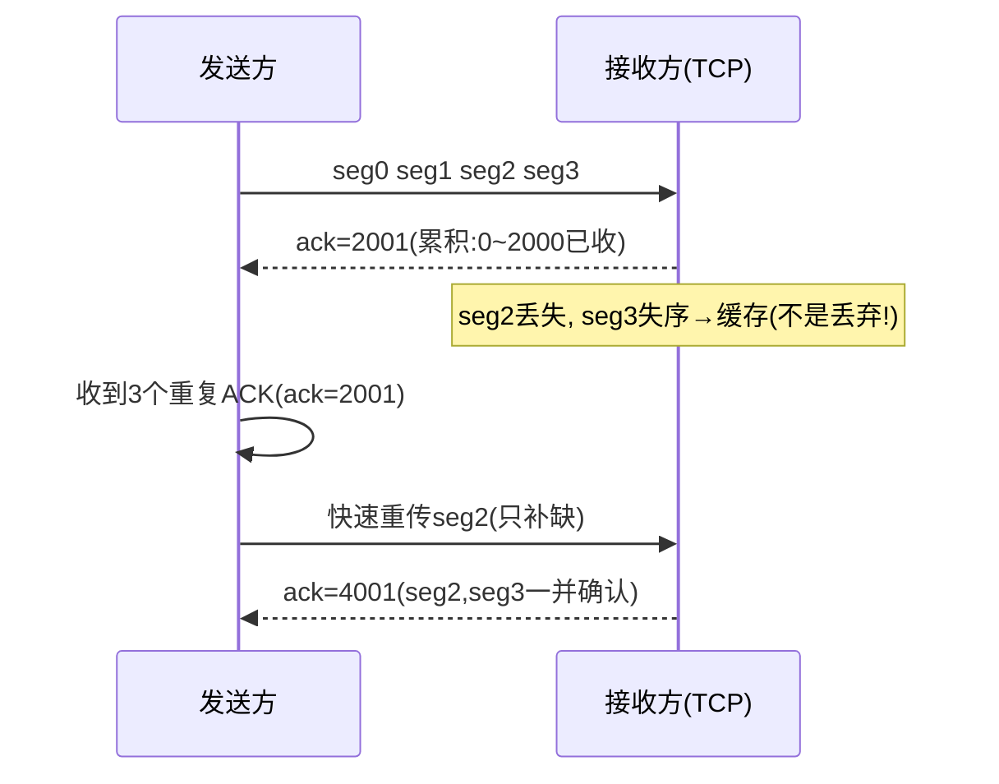
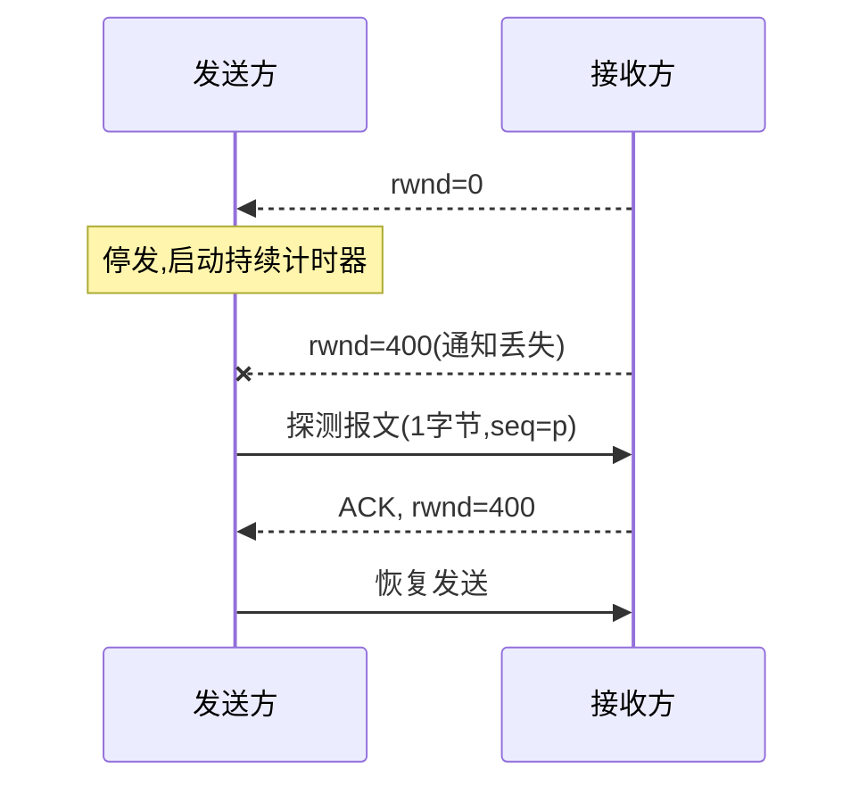
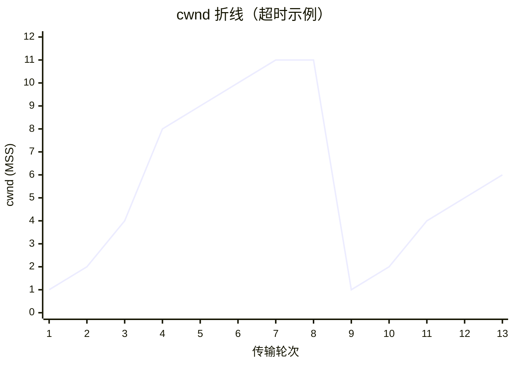

> **位置**：[总索引](/posts/872-index/)｜**上游**：[FTP/TELNET/SNMP](/posts/872-net-05-ftp-telnet-snmp/)｜**下游**：[路由算法 RIP/OSPF/BGP](/posts/872-net-07-routing/)

## 1. 考点与考法

| 考法问句 | 题型 | 频次 |
|---|---|---|
| 传输层的作用与端到端通信的含义？ | 简答 | 高频 |
| 端口号的作用？为什么通信要有端口？ | 简答/选择 | 高频 |
| 复用与分用分别发生在发送方还是接收方？ | 选择 | 高频 |
| UDP 的特点（对比 TCP）？ | 简答/选择 | 高频 |
| UDP 校验和如何计算？伪首部的作用？ | 计算/选择 | 中频 |
| 给定场景选 TCP 还是 UDP？ | 选择 | 高频 |
| 序号 n 位时，GBN/SR 的发送窗口最大是多少？ | 计算/选择 | 高频（原理见 11 篇，此处速查） |
| 收到确认号 N 代表什么含义？ | 选择/计算 | 高频 |
| GBN 与 SR 在确认方式、失序处理上的区别？ | 选择/简答 | 高频 |
| 停等协议信道利用率公式及计算？ | 计算 | 高频 |
| RTTs、RTTd、RTO 如何计算？ | 计算 | 中高频 |
| TCP 可靠传输靠哪些机制实现？ | 简答 | 高频 |
| 为什么握手是三次、挥手是四次？ | 简答 | 极高频 |
| TIME_WAIT 为什么要等 2MSL？ | 简答 | 高频 |
| FIN/ACK/SYN 各占几个序号？序号计算 | 计算 | 高频 |
| 给定场景判断 TCP 状态（SYN_SENT/FIN_WAIT 等） | 选择 | 高频 |
| 流量控制如何实现？零窗口怎么办？ | 简答/选择 | 高频 |
| TCP 可能遭受哪些攻击？SYN 洪泛、RST 注入、会话劫持如何防御？ | 简答 | 中频 |
| DDoS 是什么？有哪些类型和防御？ | 简答 | 中频 |
| 画出/分析整个传输过程中 cwnd 的变化折线 | 大题 | 极高频 |
| 慢开始与拥塞避免的门限 ssthresh 如何变化？ | 选择/大题 | 极高频 |
| 超时 vs 收到 3 个重复 ACK，处理有何不同？ | 简答/大题 | 高频 |
| 发送窗口 = ？（rwnd 与 cwnd 取小） | 计算 | 高频 |
| 拥塞控制与流量控制的区别？ | 简答 | 高频 |
| 四种算法各在什么条件下触发？ | 选择 | 高频 |
| 大 RTT 链路（如卫星）给 TCP 带来哪些问题？ | 简答 | 中频 |
| 给带宽与 RTT 求**窗口下限**、算利用率/所需窗口 | 计算 | 中频 |

## 2. 知识框架

```
传输层地位：只存在于主机（端系统），路由器不实现传输层功能
  └─ 向上面的应用层提供通信服务：进程到进程（端到端）的逻辑通信
     └─ 网络层提供主机到主机的通信，传输层把通信延伸到进程

两个协议：
  UDP —— 无连接、不可靠、面向报文、支持一对多，8B 首部
  TCP —— 面向连接、可靠、面向字节流、仅一对一，20B 起首部

端口（协议端口号）：16 位，0~65535；0 保留不用
  ├─ 1~1023    熟知端口（服务器端固定分配）
  ├─ 1024~49151 登记端口（IANA 登记，多用于服务器软件）
  └─ 49152~65535 短暂端口（客户端临时使用，通信结束即回收）

复用与分用：
  发送方不同应用进程的数据 → 传输层统一封装 → 网络：复用
  接收方传输层按 (目的IP, 目的端口) 交付到正确进程：分用

TCP 可靠传输（§5）：
  序号 = 数据第一个字节的字节编号（字节流编号，非报文段编号）
  确认号 = 期望收到的下一个字节的序号（累积确认，思想近 GBN）
  失序段缓存 + SACK；超时重传时间 RTO = RTTs + 4×RTTd

TCP 连接管理（§6）：三次握手建立、四次挥手释放、TIME_WAIT 等 2MSL
TCP 流量控制（§7）：rwnd 通告接收能力，零窗口探测防死锁
TCP 拥塞控制（§8）：
  发送窗口 = min(rwnd, cwnd)
  慢开始（指数翻倍）→ 拥塞避免（线性 +1）
  超时：ssthresh = cwnd/2，cwnd = 1，重新慢开始
  3 个重复 ACK：快重传 + 快恢复，cwnd = ssthresh，直接拥塞避免
```

## 3. 传输层概述：端口、复用与分用

### 3.1 传输层的地位与作用【必背】

传输层为运行在**不同主机上的应用进程**之间提供**逻辑通信**服务。"逻辑"指看起来是端到端直连，实际中间经历了复杂的物理路径；网络层提供主机到主机的通信，传输层在其上把通信对象细化到进程。传输层功能只在端系统实现，路由器最高只到网络层。

### 3.2 端口号【必背】

端口号是传输层用来**标识本计算机应用层中各应用进程**的 16 位标识符（0~65535），长度 2 字节。通信时用**目的端口**实现分用：接收方传输层根据报文携带的目的端口号把数据交付给对应进程。熟知端口举例：DNS 53、HTTP 80、FTP 21/20、TELNET 23、SMTP 25、SNMP 161。

- 端口号只是**传输层服务访问点 TSAP 的标识**，不是物理插口；**套接字 = (IP, 端口)** 二元组唯一标识一个通信端点；而一条 TCP 连接由**一对套接字（四元组）**唯一确定——服务器的同一个 (IP, 端口) 上可以同时挂多条连接。

| 端口类别 | 范围 | 用途 |
|---|---|---|
| 熟知端口 | 1~1023（0 保留） | 标准服务器（DNS 53、HTTP 80、FTP 21 等） |
| 登记端口 | 1024~49151 | IANA 登记的服务器软件 |
| 短暂端口 | 49152~65535 | 客户端临时源端口 |

> 记法：熟知端口数值"越小越老"。

### 3.3 复用与分用【必背】

发送方传输层把多个应用进程的数据统一封装后交给网络层发送，称为**复用**；接收方传输层根据报文中的目的端口等信息把数据正确交付给相应的应用进程，称为**分用**。一句话：复用在发送方，分用在接收方，端口是分用的依据。

### 3.4 辨析

- **传输层 vs 网络层**：网络层负责把分组从源主机送到目的主机（主机到主机），传输层负责把数据从源进程送到目的进程（进程到进程/端到端）；IP 首部没有端口字段，端口在传输层首部里。
- **熟知端口 vs 登记端口 vs 短暂端口**：1~1023 给标准服务器软件（0 保留不用）；1024~49151 给登记使用的软件；49152~65535 客户端随机取用作源端口。

## 4. UDP

### 4.1 UDP 的特点【必背】

UDP 是无连接的传输层协议，尽最大努力交付，不提供可靠性保证。UDP **面向报文**：对应用层交下来的报文既不合并也不拆分，保留报文边界，一次交付一个完整的 UDP 报文。UDP 支持**一对一、一对多、多对一、多对多**的交互通信，首部仅 8 字节，开销小、时延低。

### 4.2 UDP 首部与伪首部【必背】

UDP 首部共 8 字节，四个字段各 2 字节：**源端口、目的端口、长度（首部+数据的总长度）、校验和**。计算校验和时要临时加上 **12 字节伪首部**（源IP、目的IP、全零、协议字段17、UDP长度），伪首部既不向下传送也不算在 UDP 长度内，只用于校验，目的是让校验和同时覆盖 IP 层信息，防止交付错主机。


*图：UDP 用户数据报首部固定 8 字节——源端口、目的端口、长度、校验和各 16 位；校验和计算时临时加的 12 字节伪首部不在图中（伪首部不向下传送）*

**UDP 首部字段速查（固定 8 B）**：

| 字段 | 长度 | 作用 |
|---|---|---|
| 源端口 | 16 位 | 发送方进程，可全 0 表示不需要回复 |
| 目的端口 | 16 位 | 接收方进程，分用的依据 |
| 长度 | 16 位 | 首部 + 数据总长度，最小 8 |
| 校验和 | 16 位 | 覆盖首部 + 数据 + 12 B 伪首部，置 0 表示不校验 |

### 4.3 UDP 校验和计算

**触发条件**：题目给出 UDP 报文各字段或二进制内容，要求算校验和或判断校验是否通过。

**步骤**：
1. 构造 12 字节伪首部：源 IP（4B）+ 目的 IP（4B）+ 全零（1B）+ 协议 17（1B）+ UDP 总长度（2B）
2. 伪首部 + UDP 首部 + 数据按 **16 位一组**切分；若总长为奇数字节，末尾补一个全零字节（仅计算用）
3. 各组按二进制**反码求和**：逐组相加，超出 16 位的进位回卷到最低位，直到无进位
4. 结果按位**取反码**，即得校验和，填入 UDP 首部校验和字段
5. 接收方验证：将伪首部+首部+数据（校验和字段一并）再求和，结果应为**全 1**，否则丢弃

**注意**：UDP 长度字段是"首部 8B + 数据"的总长，不含伪首部；IPv6 的伪首部同样只参与校验不传输（流标签**不**计入，现行 RFC 8200 口径），且 IPv6 下 UDP 校验和为**强制**（算得全 0 记为 FFFF）；872 计算题只考 IPv4 伪首部。

**了解**：
- 接收方校验：同样加上伪首部重新求和取反，结果非全 0 则丢弃该数据报
- IPv4 伪首部协议字段为 17（UDP）、6（TCP）；**IPv6 下 TCP/UDP 校验和仍然加伪首部**（换成 128 位源/目的地址 + 上层包长 + 下一个首部号，共 40 B），真正被去掉的是 **IPv6 分组首部自己的"首部校验和"字段**——这两个"校验和"不是一回事，别混

### 4.4 TCP vs UDP 与场景选择

| 对比项 | UDP | TCP |
|---|---|---|
| 连接 | 无连接 | 面向连接（三次握手建立） |
| 可靠性 | 尽最大努力交付，不可靠 | 可靠：确认、重传、有序 |
| 数据形态 | 面向报文，保留边界 | 面向字节流，无边界 |
| 通信方式 | 一对一、一对多、多对一、多对多 | 仅一对一 |
| 首部开销 | 8 字节 | 最少 20 字节 |
| 拥塞/流量控制 | 无 | 有 |
| 典型应用 | DNS(53)、DHCP(67/68)、SNMP(161)、RIP(520)、实时音视频 | HTTP(80)、FTP(21/20)、SMTP(25)、TELNET(23) |

**场景选择题：判断顺序**：
1. 要不要可靠？要 → TCP（文件、邮件、网页、登录）
2. 要不要一对多/广播？要 → UDP（组播、RIP 周期广播）
3. 要不要低时延、容忍少量丢包？要 → UDP（实时音视频、DNS 查询、SNMP）
4. 都要（如 QUIC）超出考纲，按题干倾向作答

| 协议 | 优点 | 缺点 |
|---|---|---|
| **TCP** | 可靠、有序；有流量控制和拥塞控制；连接管理完整 | 首部大（最少 20B）；握手、确认、重传开销大；时延相对高；只支持一对一，不适合实时/广播 |
| **UDP** | 无连接、首部小（8B）、时延低；支持一对一/一对多/广播；应用层控制灵活 | 不可靠、不保证有序；无流量/拥塞控制；丢包、重复要应用自己处理 |

> 一句话：**TCP 用开销换可靠，UDP 用可靠换轻量**；选型看"要不要可靠、能不能容忍丢包和时延"。

**辨析：UDP 面向报文 vs TCP 面向字节流**：UDP 把应用层报文当作整体，加首部就交给 IP，报文太长 IP 层要分片；TCP 把应用层数据看作无结构的字节流，自己决定分段大小（MSS），接收方按序号重组。

### 4.5 一道自编例题

主机 A 的 DNS 客户端向服务器 8.8.8.8:53 发出查询。A 进程使用短暂端口 51200。
- 该 UDP 数据报**源端口 = 51200**，**目的端口 = 53**
- 服务器回送时源端口 = 53，目的端口 = 51200
- 分用依据：**目的 IP + 目的端口**定位进程；一台主机上同一端口可被多个远端共用，但 (IP, 端口) 组合在 TCP 里唯一确定一条连接

## 5. TCP 可靠传输

### 5.1 TCP 报文段首部


*图：TCP 报文段首部——固定 20 字节（源/目的端口、序号、确认号、数据偏移、6 个标志位、窗口、校验和、紧急指针），选项与填充最多再 40 B；下方为 TCP 报文段封装进 IP 数据报的关系*

| 字段 | 长度 | 作用 |
|---|---|---|
| 源端口 | 16 位 | 发送方进程 |
| 目的端口 | 16 位 | 接收方进程 |
| 序号 seq | 32 位 | 本报文段数据第一个字节的编号 |
| 确认号 ack | 32 位 | 期望收到的下一个字节序号 |
| 数据偏移 | 4 位 | 首部长度，以 4 B 为单位，最小 5（20 B） |
| 保留 | 3 位 | 暂未使用 |
| 标志位 | 6 位 | URG / ACK / PSH / RST / SYN / FIN 各 1 位 |
| 窗口 | 16 位 | 接收窗口 rwnd，用于流量控制 |
| 校验和 | 16 位 | 覆盖首部 + 数据 + 伪首部 |
| 紧急指针 | 16 位 | 配合 URG 指出紧急数据末尾 |
| 选项 + 填充 | 可变 | MSS、窗口扩大、SACK、时间戳，4 B 对齐 |

### 5.2 序号与确认号【必背】

TCP 以**字节**为单位编号，首部序号字段指本报文段所发送数据的**第一个字节**的序号；确认号指期望收到对方下一个报文段的第一个字节的序号。若确认号 = N，则表示"到 N−1 为止的所有字节已正确收到，请发送序号为 N 及以后的数据"。确认号是累积确认语义。

| TCP 首部字段 | 含义 | 常见误读 |
|---|---|---|
| 序号 seq | 本段数据第一个字节的编号 | 不是"第几个报文段" |
| 确认号 ack | 期望对方发送的下一个字节序号 | 不是"最后收到的字节序号" |
| ACK 位 | 置 1 时确认号有效 | ACK=1 不等于"已确认全部" |

### 5.3 可靠传输机制与滑动窗口协议

**可靠传输的四个机制**：①**校验**：检测传输差错（TCP 有校验和字段）；②**序号**：给数据编号，接收方据此检测丢失、失序、重复；③确认：接收方返回 ACK 告知已正确收到的部分；④重传：发送方超时未收到确认就重传。四者结合即 ARQ（自动重传请求）。

三种 ARQ 协议本质都是**滑动窗口**：窗口越大，信道利用率越高，但序号空间限制了窗口上限（**GBN 减一、SR 减半**，完整推导见 [11 篇数据链路层](/posts/872-net-11-link/) §5⑥）：

| 对比项 | 停等 | GBN | SR | TCP |
|---|---|---|---|---|
| 编号单位 | 帧（0/1 交替） | 帧 | 帧 | 字节 |
| 发送窗口 | 1 | 1 < W_T ≤ 2ⁿ−1 | W_T ≤ 2ⁿ⁻¹ | 动态（min(rwnd, cwnd)） |
| 确认方式 | 逐帧 | 累积确认 | 逐个确认 | 累积确认（+SACK 可选） |
| 失序段 | — | 丢弃 | 缓存 | 缓存 |
| 重传 | 上一帧 | 出错帧及之后全部 | 仅出错帧 | 超时重传 + 快速重传（只补缺） |

**TCP vs GBN vs SR**：TCP 确认是**累积确认**（GBN 味道），但对失序段**先缓存**（SR 味道），配合 SACK 可精确指明缺失段；重传策略灵活（快速重传只补缺，不必整窗后退）。链路层 GBN/SR 按帧编号，TCP 按字节编号；链路层窗口受序号空间硬约束，TCP 窗口还受接收缓存 rwnd 与拥塞 cwnd 约束。

- **累积确认 vs 逐个确认**：累积确认 ACK n = "n−1 之前全收到"，不必对每个帧单独确认，省带宽但信息模糊（无法告知失序帧已收到）；逐个确认信息精确、利于选择重传，但开销大。TCP 用累积确认。

### 5.4 RTT 估计与 RTO【必背】

加权平均往返时间 RTTs = (1−α)×旧RTTs + α×新RTT样本，α 推荐 1/8；往返时间偏差 RTTd = (1−β)×旧RTTd + β×|RTTs − 新样本|，β 推荐 1/2（首次取 RTTd = 样本/2）；超时重传时间 **RTO = RTTs + 4×RTTd**。

**了解**：
- Karn 算法：重传的报文段无法判定确认对应哪一次发送，其 RTT 样本不参与 RTTs 估计
- 信道利用率（停等）：U = T_D / (T_D + RTT + T_A)，T_D 为发送一帧的发送时延，T_A 为确认帧的发送时延；忽略 T_A、传播时延远大于发送时延时 U ≈ T_D/RTT
- 连续 ARQ 的利用率：U = W×T_D / (T_D + RTT + T_A)，窗口 W 越大越接近 1，直到受序号空间和拥塞控制限制

### 5.5 计算与方法

**① 窗口与序号范围计算（最高频大题，完整推导见 11 篇 §5⑥）**

序号 n 位、序号总数 2ⁿ——
- GBN：**W_T ≤ 2ⁿ − 1**（"GBN 减一"）
- SR：**W_T ≤ 2ⁿ⁻¹**（"SR 减半"，默认 W_T = W_R）
- 反向：GBN 解 2ⁿ ≥ W_T + 1；SR 解 2ⁿ ≥ 2W_T

自编例题：序号 4 位（0~15）。GBN 最大发送窗口 2⁴ − 1 = **15**；SR 最大发送窗口 2⁴⁻¹ = **8**。

**② 停等信道利用率**

1. T_D = 帧长 / 发送速率；T_A = 确认帧长 / 发送速率（ACK 很短常忽略）
2. U = T_D / (T_D + RTT + T_A)
3. 若问"至少多大窗口才能占满信道"：W ≥ ⌈(T_D + RTT + T_A) / T_D⌉，再与序号上限取小

自编例题：1000 km 链路，传播速率 2×10⁸ m/s（RTT = 10 ms），发送速率 1 Mb/s，帧长 1000 B。
T_D = 1000×8 / 10⁶ = 8 ms；U = 8 / (8 + 10) ≈ **44.4%**（忽略确认帧时延）。

**③ RTT 估计（RTO）**

1. 新 RTTs = (7/8)×旧RTTs + (1/8)×新样本
2. 新 RTTd = (1/2)×旧RTTd + (1/2)×|新RTTs − 新样本|
3. 新 RTO = 新RTTs + 4×新RTTd

自编例题：旧 RTTs = 100 ms，旧 RTTd = 10 ms，新样本 = 116 ms。
新 RTTs = 87.5 + 14.5 = 102 ms；新 RTTd = 5 + |102−116|/2 = 5 + 7 = 12 ms；RTO = 102 + 48 = **150 ms**。

**④ TCP 序号 / 确认号计算**

1. 下一报文段序号 = 本段序号 + 本段数据字节数
2. 对方应答确认号 = 本段序号 + 本段数据字节数（"下一个期望字节"）
3. 注意 SYN、FIN 各占一个序号（§6 连接管理详述）

自编例题：主机 A 发出报文段 seq = 1001，携带 200 B 数据。A 的下一个报文段 seq = 1201；B 应答 ack = **1201**。

### 5.6 TCP 累积确认 + 失序缓存流程



TCP 与 GBN 的关键差异就在这：失序段**缓存不丢弃**，且收到重复 ACK 可触发**快速重传**只补缺，不必像 GBN 整窗后退。

## 6. TCP 连接管理

### 6.1 三次握手【必背】

①客户端发 **SYN=1、seq=x** 的连接请求报文段，进入 SYN_SENT；②服务器回 **SYN=1、ACK=1、seq=y、ack=x+1**，进入 SYN_RCVD；③客户端再发 ACK=1、seq=x+1、ack=y+1，进入 ESTABLISHED，服务器收到后也进入 ESTABLISHED。第三次握手可以携带数据。若只两次握手，失效的旧连接请求到达服务器后服务器单方面建立连接并等待数据，造成资源浪费，故需要第三次确认。

### 6.2 四次挥手【必背】

①数据传完后客户端发 **FIN=1、seq=u**，进入 FIN_WAIT_1；②服务器回 **ACK=1、ack=u+1**，进入 CLOSE_WAIT，客户端收到后进入 FIN_WAIT_2——此时半关闭，A→B 方向已关闭但 B 仍可发数据；③服务器数据发完后再发 FIN=1、ACK=1、seq=w、ack=u+1，进入 LAST_ACK；④客户端回 ACK=1、ack=w+1，进入 TIME_WAIT，等 2MSL 后关闭，服务器收到 ACK 即关闭。挥手之所以四次，是因为服务器收到 FIN 时可能还有数据要发，ACK 和 FIN 分开发送。

### 6.3 TIME_WAIT = 2MSL【必背】

MSL（最长报文段寿命）是一个报文段在网络中可存活的最长时间，**RFC 793/教材惯用口径 MSL = 2 分钟**，故 TIME_WAIT 约等 4 分钟（题目另给数值以题面为准）。主动关闭方在发出最后一个 ACK 后须等 2MSL：①保证最后这个 ACK 若丢失，能在 MSL 内收到对方重传的 FIN 并再次应答（一去一回恰好 2MSL）；②让本连接产生的所有报文段在网络中消逝，避免旧连接的报文串扰到用相同端口号的新连接。

### 6.4 握手挥手每步目的与状态迁移

| 步骤 | 报文 | 这一步的目的（各确认/关闭了什么） | 能否携带数据 | 消耗序号？ |
|---|---|---|---|---|
| 握手 1 A→B | SYN=1, seq=x | 请求建连，让 B 确认 **A 的发送能力**、自身接收能力；同步 A 初始序号 x | 否 | 是（1 个） |
| 握手 2 B→A | SYN=1, ACK=1, seq=y, ack=x+1 | 让 A 确认 **B 的发送能力**、自身接收能力；同步 B 初始序号 y（ack=x+1 表示"x 及之前全收到"） | 否 | 是（1 个） |
| 握手 3 A→B | ACK=1, seq=x+1, ack=y+1 | 让 B 确认 **A 的接收能力**；并确认已收到 B 的 SYN | 可以 | 带数据才消耗 |
| 挥手 1 A→B | FIN=1, seq=u | 关闭 **A→B 方向**（半关闭起点），告知 A 已无数据可发 | 可以 | 是（1 个） |
| 挥手 2 B→A | ACK=1, ack=u+1 | **只确认**收到 FIN；此时 **B→A 方向仍开通**，B 继续发数据 | 无数据 | 否 |
| 挥手 3 B→A | FIN=1, seq=w | B 数据发完，**关闭 B→A 方向** | 可以 | 是（1 个） |
| 挥手 4 A→B | ACK=1, ack=w+1 | 确认 B 的 FIN，A 进入 **TIME_WAIT**，等满 2MSL 才 CLOSED | 无数据 | 否 |

> 两条"不可省"：握手缺第 3 次 → 失效的旧连接请求会让服务器单方面建连并空等数据，浪费资源；挥手第 2、3 步不可合并 → 服务器收到 FIN 时可能还有数据要发，ACK 必须先单独回。

| 主动关闭方状态迁移 | 含义 |
|---|---|
| ESTABLISHED → FIN_WAIT_1 | 发出 FIN，等对方 ACK |
| FIN_WAIT_1 → FIN_WAIT_2 | 收到 ACK，等待对方 FIN（半关闭） |
| FIN_WAIT_2 → TIME_WAIT | 收到对方 FIN，回最后一个 ACK |
| TIME_WAIT → CLOSED | 等满 2MSL |

**了解**：
- 保活计时器：服务器 2 小时无数据交互则每 75 s 发探测报文，连续 10 次无响应则关闭连接，处理"半打开"状态
- TCP 状态迁移要点：主动打开 SYN_SENT → ESTABLISHED；被动打开 LISTEN → SYN_RCVD → ESTABLISHED；主动关闭 FIN_WAIT_1 → FIN_WAIT_2 → TIME_WAIT → CLOSED；被动关闭 CLOSE_WAIT → LAST_ACK → CLOSED
- 同时打开/同时关闭：两端同时发 SYN（或 FIN）的极端情形，状态走特殊路径，考试偶见选择题

### 6.5 握手/挥手序号计算

**步骤**：
1. 客户端 SYN 段：seq = x，**不携带数据也占 1 个序号** → 客户端下一个可用序号 x+1
2. 服务器 SYN+ACK 段：seq = y，占 1 个序号 → ack = x+1；客户端回 ACK：seq = x+1, ack = y+1
3. 连接建立后第一个数据段：客户端 seq = x+1（若第三次握手不带数据）
4. FIN 段同理：FIN=1 占 1 个序号；对 FIN 的确认 ack = 对方最后序号 + 数据长 + 1
5. 数据段序号推进：下一 seq = 本段 seq + 本段字节数（字节流编号，见 §5.5④）

**自编例题**：A 初始序号 1000，B 初始序号 5000。
- 第一次握手：A→B：SYN=1, seq=1000
- 第二次握手：B→A：SYN=1, ACK=1, seq=5000, ack=1001
- 第三次握手：A→B：ACK=1, seq=1001, ack=5001
- 建立后 A 发送 100 B 数据段：seq=1001，数据 1001~1100；B 应答 ack=**1101**

**FIN 确认序号自编例题**：B 已发数据到序号 7999（即最后字节 7998），现发 FIN（seq=7999，不带数据）。
- FIN 占 7999 这一个序号
- A 应答：ACK=1, seq=A当前序号, ack=**8000**（"8000 之前全部收到，包括 FIN"）

### 6.6 状态判断题方法

按"谁主动"分两条主线：
1. 主动方：发 SYN→SYN_SENT；收 SYN+ACK 回 ACK→ESTABLISHED；发 FIN→FIN_WAIT_1；收 ACK→FIN_WAIT_2；收 FIN 回 ACK→TIME_WAIT（等 2MSL）
2. 被动方：收 SYN 回 SYN+ACK→SYN_RCVD；收 ACK→ESTABLISHED；收 FIN 回 ACK→CLOSE_WAIT；发 FIN→LAST_ACK；收 ACK→CLOSED
3. 出现"半关闭""还能发数据"字样 → 定位在 FIN_WAIT_2 / CLOSE_WAIT 一对状态

### 6.7 辨析

- **半关闭 vs 半打开**：半关闭指连接一端已发 FIN（一个方向关闭）但另一方向仍可传输数据——四次挥手中间的正常状态；半打开指一端崩溃/重启后另一端并不知情，连接处于异常状态，需靠保活或探测定期处理。
- **SYN 洪泛 vs SYN cookie**：SYN 洪泛攻击是攻击者伪造大量 SYN 请求但不回第三次 ACK，服务器半连接队列被占满，拒绝正常服务；SYN cookie 防御思路是服务器不为半连接分配资源，把连接信息**编码进初始序号 y** 返回，收到第三次 ACK 时用 cookie 验证合法性后再分配资源。
- **SYN 消耗序号 vs ACK 不消耗**：SYN=1 和 FIN=1 的报文段即使不携带数据也**各消耗一个序号**（因为要被确认）；纯 ACK 报文段不带数据时不消耗序号——这是握手/挥手序号计算题的核心。

### 6.8 TCP 的安全

答题骨架：TCP 的攻击面主要有两类——**状态资源**（半连接/全连接队列、连接表）和**报文可信性**（四元组、序列号都可伪造）。前者用 SYN 洪泛耗尽，后者用 RST 注入、会话劫持；端口扫描则是前置侦察。防御按协议侧与部署侧两栏写。

| 攻击 | 手段 | 防御（软件 / 协议侧） | 防御（硬件 / 部署侧） |
|---|---|---|---|
| **SYN 洪泛** | 伪造大量源 IP 发 SYN、不回第三次 ACK，占满半连接队列，正常连接被拒绝 | **SYN cookie**：不立即分配 TCB，把连接信息编码进 ISN，收到有效 ACK 再建连；SYN cache、半连接队列调优 | 防火墙/IPS 限速与异常检测、Anti-DDoS 清洗、源地址过滤（uRPF/BCP 38） |
| **RST 注入 / 连接重置** | 伪造四元组匹配的 RST，序列号落在接收窗口内即可拆连接；链路上嗅探时更易得手 | **随机 ISN** 增加序列号猜测难度；TLS/IPsec 保护数据机密性/完整性，但不防断连 | 状态防火墙、入口过滤、IDS/IPS 检测异常 RST |
| **会话劫持 / 序列号预测** | 嗅探或预测 ISN，伪造后续报文冒充一方；常与 ARP 欺骗、中间人结合 | **随机 ISN + 加密认证**（TLS/SSH/IPsec）；禁用 Telnet/FTP 等明文服务 | 交换机 DAI/静态 ARP、VLAN 隔离、IDS/IPS 检测异常流量 |
| **端口扫描 / SYN 扫描** | 向大量端口发 SYN，按 SYN-ACK/RST 判断开放情况，为入侵做侦察 | 关闭无用端口、最小化服务；日志与告警 | 防火墙默认拒绝、ACL、IPS/限速 |

根因一句话：TCP 只保证**可靠、有序**，不保证**对端身份真实**；四元组 + 序列号是唯一凭据。协议侧靠随机化、SYN cookie 提高伪造成本，部署侧靠过滤、限速、清洗，最后用 TLS/SSH/IPsec 等端到端加密兜底数据安全。

### 6.9 DDoS（分布式拒绝服务）

**定义**：攻击者控制大量僵尸主机（botnet），从不同位置同时向目标发送流量或服务请求，耗尽目标的**带宽、连接表、CPU/内存或应用处理能力**，使合法用户无法访问。DDoS 攻击的是**可用性 A**；与 DoS 的区别是"**分布式、多源、流量大、溯源难**"。

| 类型 | 典型手法 | 打什么资源 | 防御 |
|---|---|---|---|
| **流量型** | UDP/ICMP Flood、DNS/NTP 反射放大 | 出口带宽、链路 | 流量清洗中心、黑洞路由、Anycast/CDN 分摊、运营商限速 |
| **协议/状态型** | SYN Flood（见上表）、ACK Flood | 半连接队列、连接表、会话表 | SYN cookie、连接数/速率限制、防火墙/IPS、uRPF/BCP 38 源地址过滤 |
| **应用层型** | HTTP Flood/CC、慢连接 | Web 线程、数据库、应用处理能力 | WAF、验证码/人机校验、频率限制、缓存/CDN、业务降级 |

**防御总原则**：DDoS 不能靠单一设备，按四层写：
1. **近源**：运营商/清洗中心尽早丢弃，入口过滤防伪造源地址
2. **近目标**：防火墙/IPS/负载均衡限速、连接数限制、SYN cookie
3. **应用层**：WAF、验证码、缓存、业务限流/降级
4. **架构**：冗余带宽、Anycast/CDN、多可用区、监控与应急预案

> 一句话：DDoS 防的是**可用性**，思路是"**近源清洗 + 本地限速 + 应用识别 + 冗余扩容**"。

## 7. TCP 流量控制

### 7.1 滑动窗口流量控制【必背】

流量控制是**点对点**的，目的是让发送速率不超过**接收方**的处理能力。实现机制是滑动窗口：接收方通过报文段首部的窗口字段把自己的接收窗口 rwnd 通告给对方，发送方的发送窗口不得超过 rwnd，从而动态调节发送速率。

**窗口怎么滑动**（简答缺这一步就写不完整）：发送窗口**左沿**随累积 ACK 跳到"第一个未确认字节"，**右沿 = 左沿 + 对方最新通告的窗口值 − 1**，窗口随 ACK 与 rwnd 变化整体前移；接收方把已交付字节从缓存搬走、腾出空间后，rwnd 增大并随 ACK 一并通告——这就是"滑动"。

| 接收方窗口通告 | 发送方行为 |
|---|---|
| rwnd > 0 | 按窗口持续发送 |
| rwnd = 0 | 停止发送，启动持续计时器 |
| 收到新通知 rwnd > 0 | 恢复发送 |
| 通知丢失 | 计时器超时 → 发 1B 探测报文 → 收当前窗口值 |

### 7.2 零窗口与持续计时器【必背】

接收方通告 rwnd=0 时发送方停止发送。之后接收方缓存放空发出 rwnd>0 的通知，**若该通知丢失**，双方将互相死等。为此发送方设**持续计时器**：超时后发送一个只携带 1 字节数据的零窗口探测报文段，接收方回应当前窗口值；探测报文即使丢失，也有超时重传兜底，死锁得以打破。



### 7.3 流量控制 vs 拥塞控制

流量控制是**端到端**问题，抑制发送方保护**接收方**（依据 rwnd）；拥塞控制是全局问题，防止过多数据注入网络（依据 cwnd，见 §8）。发送窗口取 min(rwnd, cwnd)，两者同时起作用。

## 8. TCP 拥塞控制

### 8.1 四个算法【必背】

- **拥塞控制**：拥塞控制是防止过多的数据注入到网络中，使网络中的路由器或链路不致过载。它是一个全局性的过程，涉及所有主机、路由器；发送方通过维护拥塞窗口 cwnd 探测网络容量，发送窗口 = min(rwnd, cwnd)。TCP 的拥塞控制由慢开始、拥塞避免、快重传、快恢复四种算法配合完成。
- **慢开始**：连接建立或超时后，cwnd 从 1 个 MSS 起，每经过一个 RTT，cwnd 加倍（1→2→4→8…），指数增长；当 cwnd 达到慢开始门限 ssthresh 时，转入拥塞避免。"慢开始"的"慢"指起点低，不是增长速度慢。
- **拥塞避免**：cwnd ≥ ssthresh 后，每经过一个 RTT，cwnd 只加 1 个 MSS，线性缓慢增大。只要没有出现拥塞就持续增长；一旦超时判定网络拥塞，把 ssthresh 更新为当前 cwnd 的一半（乘法减），cwnd 重置为 1，重新开始慢开始。
- **快重传**：接收方收到失序报文段后立即发送重复确认（而不是等自己发送数据时捎带）。发送方一连收到 3 个重复 ACK，就立即重传对方尚未收到的那个报文段，而不必等重传计时器超时。快重传让发送方尽早发现个别报文段丢失，避免网络拥塞进一步加重。
- **快恢复**：与快重传配合使用。发送方收到 3 个重复 ACK 时（轻度拥塞，还能送达 ACK），执行 **ssthresh = 当前 cwnd / 2，cwnd = ssthresh（新值）**，直接进入拥塞避免阶段线性增长，不重置为 1、不走慢开始。这与超时的处理（cwnd=1 + 慢开始）形成鲜明对比。


_超时（严重拥塞）：cwnd 指数爬到 ssthresh(16) 后线性加 1；超时后 ssthresh 减半为 12、cwnd 打回 1 重新慢开始_


_3 个重复 ACK：ssthresh 与 cwnd 都减半，直接进拥塞避免。本图按现行默认的 Reno 画（Tahoe 差异见辨析）_

### 8.2 辨析

- **拥塞控制 vs 流量控制**：流量控制是端到端问题，依据接收方通告的 rwnd，保护接收方；拥塞控制是全局问题，依据发送方推断的 cwnd，保护网络。二者都压低发送窗口：发送窗口 = min(rwnd, cwnd)。
- **超时 vs 3 个重复 ACK 的处理**：超时说明网络严重拥塞（连 ACK 都回不来），最激进地降窗，**ssthresh = cwnd/2，cwnd = 1，慢开始**；3 个重复 ACK 说明个别报文段丢失但网络仍通（后续段被收到并触发重复确认），轻度处理，**ssthresh = cwnd/2，cwnd = ssthresh，直接拥塞避免**。后者常称"乘法减、加法增"不重置起点。
- **TCP Tahoe vs TCP Reno（版本差异，易错）**：旧版 TCP Tahoe（塔霍）只有慢开始、拥塞避免和快重传，**没有快恢复**，即使收到 3 个重复 ACK 触发快重传，也按超时处理：ssthresh 减半、cwnd 照样重置为 1、从头慢开始；新版 TCP Reno（里诺）才引入快恢复，快重传后 ssthresh 与 cwnd 减半、cwnd 直接停在新门限上进入拥塞避免，不再回 1。"三重复 ACK 不回 1"的处理均指 Reno（现行标准与考试默认版本），Tahoe 已废弃不用。
- **慢开始门限的两种来源**：初始 ssthresh 由具体实现设定（题目一般直接给定）；运行中每次发生拥塞（无论超时还是 3 重复 ACK），ssthresh 都被更新为拥塞时 cwnd 的一半。ssthresh 只在拥塞发生时下降，不会主动上升（考试范围内不考 RFC 5681 的 ssthresh 恢复细节）。
- **"乘法减、加法增"（AIMD）**：拥塞避免阶段每 RTT 线性加 1（加法增），出现拥塞窗口减半（乘法减）。**减半**能一步把全网发送总量压下去、快速排掉排队；**加 1** 则在清空后温和试探富余容量，多条连接各自只加 1、按比例回涨，窗口收敛到公平分享而不是互相争抢振荡，既保证效率又保证收敛，是 TCP 拥塞控制的核心思想。

### 8.3 对比与速查

四算法在不同事件下的动作：

| 触发事件 | ssthresh | cwnd | 下一阶段 |
|---|---|---|---|
| 连接建立/初始 | 题目给定 | 1 | 慢开始 |
| cwnd = ssthresh | 不变 | 每 RTT +1 | 拥塞避免 |
| 超时 | 减半（=当时cwnd/2） | 重置 1 | 慢开始 |
| 3 个重复 ACK | 减半（=当时cwnd/2） | = 新 ssthresh | 拥塞避免（跳过慢开始，Reno） |

> 本表按 Reno；Tahoe 遇 3 重复 ACK 也回 1（详见辨析 Tahoe/Reno 条）。

慢开始与拥塞避免的分野：

| 对比项 | 慢开始 | 拥塞避免 |
|---|---|---|
| 增长方式 | 每 RTT 翻倍（指数） | 每 RTT 加 1（线性） |
| 起始 cwnd | 1 | ssthresh |
| 结束条件 | cwnd ≥ ssthresh | 超时或 3 重复 ACK |

流量控制与拥塞控制的分野：

| 对比项 | 流量控制 | 拥塞控制 |
|---|---|---|
| 作用范围 | 端到端（一对收发方） | 全局（所有主机、路由器） |
| 保护对象 | 接收方 | 网络（链路/路由器缓存） |
| 依据 | rwnd（接收方通告） | cwnd（发送方推断） |
| 实现机制 | 滑动窗口 | 四算法 |

> 记法：折线题只认三个动作，**翻倍（慢开始）、加1（拥塞避免）、减半（遇到拥塞）**；减完之后，cwnd 是回 1 还是停在门限，看"超时还是三重复"。

### 8.4 cwnd 折线分析大题模板（本章压轴题型）

**触发条件**：给出初始 cwnd、初始 ssthresh、传输轮次中发生的事件（正常、超时、3 重复 ACK），要求写各轮 cwnd 或画折线。

**步骤**：
1. 列表逐轮推：cwnd < ssthresh → 翻倍，但**翻倍后若超过 ssthresh，则取 ssthresh**（不越过门限）；cwnd ≥ ssthresh → +1
2. 到达 ssthresh 后，下一轮转入拥塞避免 +1（872 常规处理：恰好等于门限的当轮按慢开始记账，下一轮开始 +1）
3. 发生超时的轮次：记下该轮 cwnd → ssthresh = cwnd/2，下一轮 cwnd = 1
4.发生 3 重复 ACK 的轮次：ssthresh = cwnd/2，下一轮 cwnd = ssthresh
5. 有 rwnd 时每轮发送窗口 = min(rwnd, cwnd)，单独列一列

**自编例题**：初始 cwnd = 1，ssthresh = 8，rwnd 足够大。

| 轮次 | 事件 | cwnd（发送窗口） |
|---|---|---|
| 1 | 慢开始 | 1 |
| 2 | 翻倍 | 2 |
| 3 | 翻倍 | 4 |
| 4 | 翻倍 | 8 |
| 5 | =ssthresh，转拥塞避免 | 9 |
| 6 | +1 | 10 |
| 7 | +1 | 11 |
| 8 | **超时** → ssthresh=11/2=5 | （5） |
| 9 | cwnd=1，慢开始 | 1 |
| 10 | 翻倍 | 2 |
| 11 | 翻倍 | 4 |
| 12 | ≥ssthresh(5)，拥塞避免 | 5 |
| 13 | +1 | 6 |

若第 8 轮事件改为 **3 个重复 ACK**：ssthresh = 5，第 9 轮 cwnd 直接 = 5，第 10 轮 6……不再回 1。



### 8.5 发送窗口取小计算

发送窗口 = min(rwnd, cwnd)；逐轮比较，rwnd 小的轮次折线被压平在 rwnd 上。

自编例题：某轮 cwnd = 16，接收方通告 rwnd = 10 → 该轮发送窗口 = 10；此后网络再拥塞、cwnd 降到 8，发送窗口 = min(10, 8) = 8。

### 8.6 窗口下限与大 RTT 链路

**时延带宽积（教材口径，定义见 01 篇 §3.5）= 带宽 × 单向传播时延** = 单向管道里此刻正在传送的比特数（管道体积）。带宽高而传播时延又长的链路（典型是 GEO 卫星链路，业内称"长肥管道"）这个值极大：100 Mb/s × 单向 250 ms ≈ 3 MB。

**⚠️ 别把它和"跑满带宽所需的窗口下限"混为一谈**：要让发送方不间断地推、把带宽跑满，发送窗口（= 发送缓冲区）至少要能装下 `链路速率 × RTT` 的数据，而 `RTT ≈ 2 × 单向传播时延`，所以**窗口下限 ≈ 2 × 时延带宽积**。英文资料（RFC 6349、维基百科）把这个窗口下限也叫 "BDP"，本博客不这么叫，统一叫"窗口下限"，考题问"时延带宽积"一律用**单向传播时延**（判别表见 01 篇 §3.5.1）。

**窗口下限与滑动窗口的定量关系**：能跑满带宽的条件是**发送窗口 ≥ 带宽 × RTT**；停等（窗口=1）能跑满的条件是 RTT ≈ 0，所以长 RTT 链路上停等协议利用率趋近 0（计算口径见 12 篇 §5⑤）。

**窗口下限与利用率计算步骤**：
1. 若给的是单向传播时延 → RTT = 2 × 单向传播时延（+ 题目给的收发时延）
2. **时延带宽积 = 带宽 × 单向传播时延**；**窗口下限 = 带宽 × RTT**（= 2 × 时延带宽积）
3. 跑满所需窗口 W_full = ⌈窗口下限 / 每个报文段大小⌉（或直接 ⌈窗口下限 / MSS⌉）
4. 利用率 = min(1, 实际窗口 / 窗口下限)
5. 折回窗口够不够时用 W ≥ 1 + RTT/T_D 与序号位数（12 篇 §5⑤、11 篇 §5⑥）

**自编例题**：卫星链路 128 kb/s，单向传播时延 250 ms，窗口 1.2 KB、MSS 1000 B。
RTT = 500 ms；**时延带宽积** = 128×10³ × 0.25 = 32000 bit = **4000 B**（单向管道在途量）；
**窗口下限** = 128×10³ × 0.5 = 64000 bit = **8000 B**（= 2 × 4000 B）；跑满需 W = 8000/1000 = **8 个 MSS**。
窗口只有 1.2 KB → 利用率 ≈ 1200/8000 = **15%**，带宽严重闲置，这正是大 RTT 链路"窗口跟不上窗口下限"的典型症状。

**自编例题 2**：100 Mb/s 卫星链路，RTT 500 ms。
- 若题目问**时延带宽积** → 100×10⁶ × 0.25（单向 250 ms）= 25×10⁶ bit = **3.125 MB**
- 若题目问**发送窗口要多大** → 100×10⁶ × 0.5 = 50×10⁶ bit = **6.25 MB**，即窗口至少要能装 6.25 MB 才跑得满，远超默认窗口，故必须扩窗口

两者关系：6.25 MB = 2 × 3.125 MB。**同一组条件，题干问谁就答谁，别互相套。**

**轮次/时间换算**：
1. 慢开始阶段：cwnd 按 2ᵏ 增长，k 为轮次；从 1 到 ssthresh 需 ⌈log₂ ssthresh⌉ 轮
2. 拥塞避免阶段：每轮 +1，从 ssthresh 到 X 需 X − ssthresh 轮
3. 总轮数相加；题目问时间再乘 RTT

自编例题：cwnd=1，ssthresh=16，RTT=10 ms。首次达到 cwnd=24：
慢开始 1→16 需 4 轮（1→2→4→8→16），拥塞避免 16→24 需 8 轮，共 **12 轮 = 120 ms**。

**大 RTT 链路（卫星链路）给 TCP 带来的四个问题**（题干问"大时延对 TCP 有何影响"时按这四条写）：①**窗口不够大就跑不满带宽**，利用率 = min(1, 发送窗口 / 窗口下限)，窗口小于窗口下限就白白浪费带宽；②**慢启动爬得太慢**，窗口下限越大 cwnd 要爬到的目标越高，而每爬一轮就是一个 RTT，卫星链路上每轮半秒起，指数增长阶段要耗掉几十秒；③**RTO 难以设定**，传播时延本身就把 RTT 抬高了，RTO 取小会把正常延迟误判为丢包、频繁超时导致 cwnd 反复被打回 1（吞吐雪崩），取大则真丢包后要等很久才重传；④**丢包发现严重滞后**，超时与 3 个重复 ACK 都以 RTT 为时钟，RTT 半秒就意味着丢包后近半秒才启动重传，损伤被放大。

相应缓解手段（题干问"如何改进"才写）：窗口扩大选项（把窗口字段扩宽）、前向确认（ACK 提前反映链路情况）、把 cwnd 按**窗口下限**起步而不是从 1 开始慢启动、卫星链路改用专门设计的传输协议。

地面短链路与大 RTT 链路的分野：

| 对比项 | 地面短链路 | 大 RTT 链路（卫星链路） |
|---|---|---|
| 窗口下限（= 带宽 × RTT） | 小（KB 级） | **大（MB 级）** |
| 瓶颈 | 路由器队列（排队时延） | **窗口不够大**（带宽被闲置） |
| 慢启动耗时 | 几个 RTT 即到门限 | 几十个 RTT，几秒到几十秒 |
| RTO 设定 | 接近真实 RTT | **偏大**，误超时风险高 |
| 丢包发现 | 1 个 RTT 内 | 1 个 RTT 已是数百毫秒 |
| 传输层对策 | 四算法照常 | 加大窗口、特殊协议 |

**了解（低频背景）**：
- AQM 主动队列管理/RED：路由器在队列将满时随机提前丢包，让发送方提前减速（教材了解级）
- 发送方的发送窗口实际还受 rwnd 限制：若题目同时给 rwnd，发送窗口各时刻取 min(rwnd, cwnd)，折线会被"削顶"
- 拥塞判断的两种依据：超时（严重）与 3 个重复 ACK（轻度），是四算法切换的开关

## 9. 全章易错点

**传输层概述**：
- "传输层在路由器上实现"：错，传输层功能只在主机（端系统）实现，路由器最高到网络层
- "端口号标识一台主机"：错，IP 标识主机，端口号标识主机内的应用进程；唯一确定一条 TCP 连接的是 (源IP, 源端口, 目的IP, 目的端口) 四元组
- "复用发生在接收方"：反了，发送方复用、接收方分用
- "客户端进程不能用熟知端口"：对，客户端通常用短暂端口，熟知端口留给服务器软件

**UDP**：
- "UDP 长度字段包含伪首部"：错，UDP 长度 = 首部 + 数据，伪首部只参与校验和计算，不计入长度也不被传输
- "UDP 是可靠协议因为 UDP 有校验和"：错，校验和只能检错不能纠错，检出错误直接丢弃，不重传，因此仍是不可靠交付
- "TCP 可以一对多"：错，TCP 只支持一对一；一对多用 UDP 或组播

**TCP 可靠传输**：
- "GBN 发送窗口最大 2ⁿ"：错，是 2ⁿ − 1；SR 才与接收窗口对半分序号空间（2ⁿ⁻¹）
- "SR 发送窗口和接收窗口可以不相等且都取 2ⁿ⁻¹"：错，约束是 W_T + W_R ≤ 2ⁿ；若 W_R < W_T，W_T 可大于 2ⁿ⁻¹，但考题默认 W_R = W_T
- "确认号 N 表示第 N 号字节已收到"：错，表示 N−1 及之前全部收到，N 是**期望的下一个**
- "TCP 序号是报文段的编号"：错，TCP 面向字节流，序号按**字节**编号
- "TCP 失序段像 GBN 一样丢弃"：错，TCP 缓存失序段（SR 味道），累积确认只是确认语义像 GBN
- "停等协议无需序号"：错，需要 0/1 交替序号，否则无法区分新帧和超时重传的旧帧
- "RTO 越小越好"：错，RTO 太小引起大量不必要重传，太大则丢帧恢复慢；RTO = RTTs + 4×RTTd 动态调整
- "重传报文段的 RTT 样本可用于估计"：错（Karn 算法），无法区分确认对应原发还是重传
- 计算窗口上限忘"减一/减半"口诀：**GBN 减一，SR 减半**

**连接管理**：
- "三次握手中的 SYN、ACK 都不能携带数据"：错，只有 SYN=1 的两个报文段不能携带数据；**第三次握手（纯 ACK）可以携带数据**
- "挥手四次可合并为三次"：通常不行，因为服务器收到 FIN 时可能还有数据要发，ACK 必须先回；仅当服务器恰好无数据可发时 ACK+FIN 才可能同段（考题一般按四次处理）
- "TIME_WAIT 出现在被动关闭方"：错，TIME_WAIT 在**主动关闭**一方；被动方最后经 LAST_ACK 直接 CLOSED
- "FIN 段不带数据所以不消耗序号"：错，FIN 占 1 个序号；SYN 同理
- "ack=x 表示收到了第 x 字节"：错，ack=x 表示 **x−1 及之前**全收到，期望下一个是 x
- "服务器在 CLOSE_WAIT 状态不能发数据"：错，半关闭期间 B→A 方向仍然畅通，这正是挥手要四次的原因

**流量控制**：
- "收到零窗口通知后发送方只能干等"：错，启动持续计时器发 1B 探测报文，防死锁
- "流量控制控制的是整个网络"：错，那是拥塞控制；流量控制只管接收方

**拥塞控制**：
- "慢开始是慢速增长"：错，是**起点慢（cwnd=1）但指数增长**，很快逼近门限
- "cwnd 达到 ssthresh 后继续翻倍到超时"：错，等于门限当轮就转拥塞避免 +1
- "3 个重复 ACK 也要把 cwnd 重置为 1"：错，重置 1 只发生在超时；三重复 ACK 走快恢复，cwnd = 新 ssthresh
- "Tahoe 版 3 个重复 ACK 也走快恢复、cwnd 不回 1"：错，**快恢复是 Reno 才引入的**；Tahoe 无快恢复，三重复 ACK 后照样 cwnd=1 慢开始（已废弃，考试默认 Reno）
- "ssthresh 一直不变"：错，每次拥塞（超时或三重复）都更新为拥塞时 cwnd 的一半
- "cwnd 单位是字节"：通常按 **MSS 个数**计（题目另有说明除外）
- "发送窗口永远等于 cwnd"：错，还要跟 rwnd 取小
- **超时发生的那一轮，cwnd 已经减半了吗？** 没有，减半动作下一轮才生效，当轮仍按事件前的值处理（按题目约定，注意题干表述）
- "拥塞控制与流量控制是一回事"：错，全局 vs 端到端，cwnd vs rwnd
- **"带宽大就不用开大窗口"**：错，跑满看的是**窗口下限 = 带宽 × RTT**（≈ 2 × 时延带宽积），不是带宽本身；RTT 一大（卫星）窗口下限就巨大，窗口跟不上照样浪费带宽
- **本篇的"BDP"不是教材的时延带宽积**：教材的**时延带宽积 = 带宽 × 单向传播时延**（01 篇 §3.5）；本篇所有 `带宽 × RTT` 都是**窗口下限**，等于它的 2 倍。**考题问"时延带宽积"要乘单向传播时延**，别用本篇的口径去答（01 篇 §3.5.1 有判别表）
- "卫星链路时延小，TCP 表现更好"：错，卫星是**大传播时延**链路，丢包发现与 RTO 都受影响，慢启动也慢
- 算窗口时把单向传播时延当 RTT：RTT = 2× 单向传播时延，窗口会算小一半（问时延带宽积则反过来：给 RTT 要 ÷2）
- "卫星链路减少的是传播时延"：错，它减少的是中间结点的排队与处理时延，传播时延反而剧增（12 篇 §3）

---
**出处汇总**：RFC 768（UDP）；RFC 9293（TCP 规范）；RFC 5681（TCP 拥塞控制）；谢希仁《计算机网络（第7版）》第5章（5.1 运输层概述、5.2 UDP、5.4 可靠传输、5.6 TCP 可靠传输与滑动窗口、5.7 流量控制、5.8 拥塞控制、5.9 运输连接管理）；王道计算机网络第5章传输层
