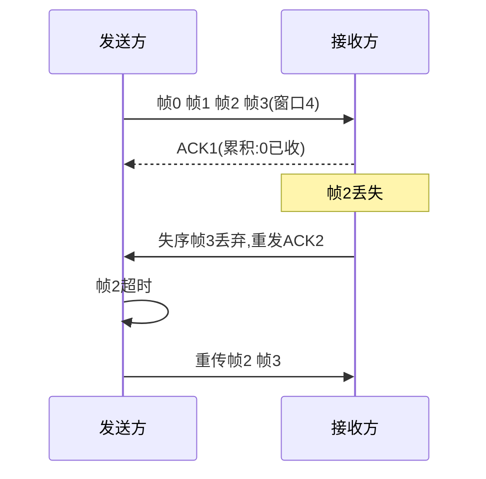

> **位置**：[总索引](/posts/872-index/)｜**上游**：[综合拓扑专题](/posts/872-net-10-topology/)｜**下游**：[物理层](/posts/872-net-12-phy/)（12）｜**原理关联**：[传输层（UDP 与 TCP）](/posts/872-net-06-transport/)（06，同一套滑动窗口在端到端的复用）

## 1. 这一篇会怎么考

| 考法问句 | 题型 | 频次 |
|---|---|---|
| 透明传输要解决什么问题？字节填充与零比特填充怎么区分 | 选择/简答 | 极高频 |
| PPP 的 LCP 与 NCP 各管什么？IP 地址由谁分配 | 选择 | 高频 |
| PPP 是否提供可靠传输（出错是否重传） | 判断/选择 | 高频 |
| GBN/SR 接收方是否缓存失序帧、窗口上限多少 | 选择/判断/计算 | 高频 |
| 给出生成多项式与数据，求 CRC 校验码/发送序列 | 大题/计算 | 极高频 |
| CSMA/CD 最小帧长公式与计算 | 计算/选择 | 极高频 |
| 给定随机退避数 r，求退避等待时间 | 大题小问/计算 | 高频 |
| 截断二进制指数退避算法怎么退？ | 选择/简答 | 高频 |
| CSMA/CD 发送方完整流程（监听→冲突计数→退避/放弃）、1-坚持含义 | 选择 | 高频 |
| 802.11 为什么用 CSMA/CA 不用 CD（不能边发边听、隐蔽站） | 选择/简答 | 高频 |
| SIFS/PIFS/DIFS 大小排序、各自适用帧 | 选择 | 中高频 |
| 802.11 发送一帧总耗时（DIFS+数据+SIFS+ACK） | 计算 | 中频 |
| CSMA/CD 与 CSMA/CA 的帧格式相同吗？ | 选择/判断 | 中频 |
| 以太网帧各字段（类型/长度、FCS）？MAC 帧有无帧尾 | 选择/判断 | 高频 |
| 以太网 II 帧与 IEEE 802.3 帧的类型/长度字段怎么区分 | 选择/判断 | 中高频 |
| 10Base-T / 100Base-T 用什么传输介质？各标准最大段长？ | 选择 | 中频 |
| 曼彻斯特编码属于哪一层 | 选择 | 高频 |
| 集线器/交换机/路由器层次与冲突域广播域 | 选择 | 高频 |

> **872 与 408 考法差异**（本层最容易按惯性失分的地方）：
> 1. **872 有独立的判断题大题**（如 15 题一板块，408 没有），概念必须精确到"对不对"，不能只记大概；
> 2. 872 把**停止等待 / GBN / SR 放在数据链路层考**，408 多放到传输层 TCP，本层就要会判"GBN 接收方不缓存失序帧、SR 缓存"；
> 3. 872 高频考 **PPP 的 LCP/NCP 分工**（尤其"IP 地址谁分配"这个坑）；
> 4. 872 会把 **CSMA/CD 退避等待时间**直接做成大题小问（等待时间 = r × 争用期）；
> 5. 872 常考**功能归属层次**（如曼彻斯特编码属物理层），不要只记"是什么"。

## 2. 数据链路层的骨架

```
数据链路层：在相邻节点间透明、可靠地传送帧
  ├─ 功能：成帧（封装定界）、差错控制（检错/纠错）、流量控制
  ├─ 信道模型
  │    点对点链路（一条链路两端）：成帧 → 透明传输 → PPP / HDLC
  │    广播信道（多站共享介质）：介质访问控制 MAC
  ├─ 点对点链路
  │    封装成帧：帧定界（SOH/EOT、标志字段）
  │    透明传输：数据中恰含定界符 → 字节填充（异步）/ 零比特填充（同步）
  │    PPP：CRC 检错不重传；LCP 管链路、NCP 管网络层（IPCP 分配 IP）
  │    HDLC：面向比特、面向连接、可靠传输（零比特填充）
  ├─ 差错检测：奇偶校验 → CRC 模 2 除法（只检错不纠错）
  ├─ 可靠传输（ARQ）：停等 → GBN（后退 N 帧）→ SR（选择重传）
  │    四机制：校验、序号、确认、重传
  └─ 广播信道 MAC
       静态划分：FDM/TDM/WDM/CDM
       受控访问：轮询、令牌
       随机访问：ALOHA → CSMA（三种坚持）→ CSMA/CD（有线以太网）
                 CSMA/CA（无线 802.11）
       局域网：以太网帧 / 802.11 帧 / VLAN
       设备：网桥、交换机（多端口网桥、自学习）
```

## 3. 数据链路层的功能与信道模型

### 3.1 数据链路层要解决什么问题

物理层只管把比特送上线路，但比特流没有边界、没有校验、没有收发协调。数据链路层在**相邻两个节点之间**补上三件事：

1. **成帧（封装）**：把网络层交下来的分组封装成帧，加上帧头帧尾，让接收方能从连续比特流中识别每一帧的起止；
2. **差错控制**：检测（少数情况下纠正）传输中产生的差错；
3. **流量控制**：控制发送速率，使接收方来得及接收。

### 3.2 两类信道

链路层的协议分两种部署环境，后面所有内容都沿这两条线展开：

- **点对点链路**：一条链路两端，没有第三方争用介质，问题是成帧、透明传输、链路配置（§4）；
- **广播信道**：多个站点共享同一传输介质，任何一站发送，信号都会传播到所有站点，额外需要**介质访问控制（MAC）**来决定"谁能发、怎么避免冲突"（§7）。

### 3.3 共享介质模型（广播信道的地基）

广播信道上，多个设备同时访问同一物理介质，数据一旦发出就会在整个介质上传播，所有站点都能收到；若两个设备同时发送，信号相互叠加就会**冲突（collision）**，导致帧损坏。

考研语境下，只要题目出现 CSMA/CD、冲突、传播时延、最小帧长，就要立刻切换到这个模型：

```
共享信道 + 广播传播 + 半双工
  - 所有设备接在同一根"线"上
  - 一个设备同一时刻只能发或收
  - 任意发送 = 信号扩散到全网
  - 所有设备都能"听到"
```

一句话：**一人发，全网听；但只认目的地址**。后面的 CSMA/CD、最小帧长、冲突域都是这个模型的直接推论。

## 4. 点对点链路：成帧、透明传输与 PPP / HDLC

### 4.1 封装成帧与帧定界

**成帧**：在一段数据的前后分别添加首部和尾部，构成一个帧。首部和尾部的一个重要作用是**帧定界**——接收方靠它们确定帧的起止。

- 字符式定界：用特殊控制字符作帧边界，如 `SOH`（Start Of Header）开始、`EOT`（End Of Transmission）结束；
- 标志式定界：用特殊比特标志（如 PPP 的 `0x7E`）作帧首尾。

### 4.2 透明传输：字节填充与零比特填充

**透明传输**：不论数据是怎样的比特组合，都能原样通过链路而不被误判。对网络层而言，链路层做的填充/转义仿佛不存在，故称"透明"。

要解决的问题：**数据中恰好出现与帧定界符相同的比特组合**，接收方会把它误当帧边界，导致帧定界错误。两种实现：

| 链路类型 | 方法 | 规则 |
|---|---|---|
| **异步（字符）链路** | **字节填充** | 发送方在数据中出现的定界字符前插入转义字符（PPP 用 `0x7D`，把 `0x7E`、`0x7D` 及控制字符转义），接收方删除转义字符还原 |
| **同步（比特）链路** | **零比特填充** | 发送方每遇到 **5 个连续 1** 就在其后插入一个 0；接收方每收到 5 个连续 1 就把紧随的 0 删除 |

> **注意**：异步用字节填充、同步用零比特填充，判断题常把两者反过来写。

### 4.3 PPP（点对点协议）

**PPP** 是面向点对点链路的数据链路层协议，用于主机到 ISP、路由器直连等场景。

**帧格式**：帧以 **0x7E** 标志字段定界，地址字段 `0xFF`、控制字段 `0x03`（固定、无实际意义），协议字段用于区分载荷是 IP 分组、LCP 还是 NCP，信息字段 ≤ 1500 B，FCS 做 CRC 检错。


_PPP 帧：F(0x7E) 定界｜A/C 固定无意义｜协议字段区分 IP/LCP/NCP｜信息 ≤1500B｜FCS 做 CRC 检错_

**只检错、不重传**：PPP 用 CRC 检测差错，发现错误直接丢弃、不重传，因此 **PPP 不提供可靠传输**，可靠性交由上层（TCP）负责。PPP 帧中没有序号与确认字段。

**LCP 与 NCP 的分工（高频）**：

- **LCP（链路控制协议）**：建立、配置、测试、拆除数据链路，包括协商 MRU（最大接收单元）、认证方式（PAP/CHAP）、链路质量检测；**不负责 IP 地址分配**；
- **NCP（网络控制协议）**：配置网络层参数，IP 对应 IPCP，**IP 地址分配由 IPCP 完成**。

陷阱选项常把"分配 IP"塞进 LCP。


_拨号建链顺序：物理链路 → LCP 配置协商 → LCP 鉴别 → NCP 协商（分配 IP）→ 携 IP 分组上网_

PPP 的透明传输：异步链路用字节填充（转义字符 `0x7D`），同步链路用零比特填充（5 个连续 1 后插 0）。

### 4.4 HDLC（高级数据链路控制）

**HDLC** 是面向比特（bit-oriented）的数据链路层协议，用于点对点或点对多点链路，三个特点：

- **面向比特**：以比特流为单位组帧，用标志字段（`0x7E`）定界，采用**零比特填充**保证透明传输；
- **面向连接**：通信前建立链路、通信后释放；
- **提供可靠传输**：帧中带序号与确认字段，出错通过 ARQ 重传。

**PPP vs HDLC**：PPP 是在 HDLC 的基础上发展而来，但做了简化——PPP 无序号、无确认、只检错不重传，是**不可靠**的数据链路协议；HDLC 靠序号确认和重传提供可靠传输。

> **注意**：透明传输解决的是帧定界不被误判（填充问题），与是否出错无关；可靠传输解决的是丢帧/错帧的恢复（确认与重传）。"透明"不等于"可靠"，PPP 既透明又不可靠。

## 5. 差错检测：CRC

### 5.1 三种校验方式

| 校验方式 | 检错能力 | 能否纠错 |
|---|---|---|
| **奇偶校验** | 只能检奇数位错 | 无 |
| **CRC** | 突发错误，能力强 | 无（考纲内只检错，丢弃交上层） |
| **海明码** | 可检测 1 位错 | 可定位并纠正 1 位错（考纲以了解为主） |

**为什么链路层用 CRC 不用检验和**：CRC 基于模 2 除法，硬件上用移位寄存器加异或门即可逐位实现，检错能力强（覆盖突发错误、多位错），适合对每一帧做硬件检错；检验和是普通加法求和取反码，实现简单但检错能力弱（字节交换、进位叠加等差错会漏检）。所以链路层（以太网 FCS、PPP 的 FCS）选 CRC，而 TCP/UDP/IP 等上层协议用检验和。

### 5.2 CRC 计算：模 2 除法

约定生成多项式 P(X)：**r 次多项式对应 r+1 位除数**。

**步骤**：

1. 多项式次数 r → 除数为 r+1 位，数据后**补 r 个 0**（相当于数据左移 r 位，低 r 位空出来放余数）；
2. **模 2 除法**：把除数与当前最高位的 1 对齐，对齐后的 r+1 位做一次异或（不借位、商只取 0/1）；
3. 异或后最高位变 0，再往低位找下一个 1 继续对齐异或；剩余位数短于除数时停止，余数不足 r 位要**高位补零**，得 FCS；
4. 发送序列 = 原数据 + FCS；验算：整体再模 2 除同一除数，余数为 0。

接收方把收到的整串再除同一除数，数据部分本来就能除尽，能影响余数的只剩校验码，所以余数为 0 就判无错。

**例题**：数据 `1010`，生成多项式 X³+X+1（除数 `1011`，r = 3）：

- 补零：`1010 000`；
- 模 2 除：
  - 最高位对齐 1011：1010 ⊕ 1011 = 0001，落下后面的 000 → `0001000`；
  - 再对最高位的 1 对齐 1011：1000 ⊕ 1011 = 0011 → `0000011`；
  - 剩余位数不足 4 位，停止，余数 = **011**；
- 发送序列 = `1010`**011**；接收方用 `1010011` 除以 1011，余 0 ✔。

> **注意**：① 忘补 r 个 0、或余数不足 r 位没高位补零，都会导致发送序列错；② "CRC 能纠正错误"是错的——考纲内 CRC 只检错，发现错就丢弃，可靠由上层保证。

## 6. 可靠传输：停等 / GBN / SR

可靠传输协议都是滑动窗口式 **ARQ（自动重传请求）**，四个基本机制：

- **校验**：检错（如 CRC）；
- **序号**：区分新帧与重传的旧帧，检测丢失、失序、重复；
- **确认（ACK）**：告知发送方已正确收到；
- **重传**：超时未确认就重发。

同一套机制在两个位置使用：链路层 ARQ 管**相邻节点间一跳**，TCP 管**端到端进程间**（TCP 视角见 [06 篇](/posts/872-net-06-transport/)）。872 把这三个协议放在数据链路层考。

### 6.1 停止等待

发送窗口 = 1：发一帧 → 等确认 → 再发；超时未确认就重传。

- 需要 **0/1 交替序号**：没有序号，接收方分不清一个帧是新帧还是超时重传的旧帧；
- 优点：简单；缺点：信道利用率最低。

### 6.2 GBN（后退 N 帧）

- 发送窗口 > 1、**接收窗口 = 1**；
- 接收方只按序接收，**失序帧一律丢弃、不缓存**，并重发对最后一个按序帧的确认；
- **累积确认**：确认号 n 表示 n 及之前的帧全部收到；
- 某帧超时，从该帧起**重传其后所有已发帧**（"后退 N 帧"）。

### 6.3 SR（选择重传）

- 发送窗口与接收窗口均 > 1（通常相等）；
- 接收方**缓存落在接收窗口内的失序帧**，等缺失帧补齐后一并上交；
- **逐个确认**；
- 发送方只重传真正出错/超时的帧，代价是缓存与逻辑更复杂。

**三协议全维度对照**：

| 对比项 | 停等 | GBN | SR |
|---|---|---|---|
| 发送窗口 W_T | 1 | 1 < W_T ≤ 2ⁿ − 1 | W_T ≤ 2ⁿ⁻¹（与 W_R 对半分序号空间） |
| 接收窗口 W_R | 1 | 恒为 1 | > 1，通常 W_R = W_T |
| 失序帧处理 | —（只按序收） | **丢弃、不缓存** | **缓存，待缺失帧补齐** |
| 确认方式 | 逐帧 | 累积确认 | 逐个确认 |
| 重传范围 | 上一帧 | 出错帧及其后全部 | 仅出错帧 |
| 序号需求 | 2 个（1 位） | ≥ W_T + 1 | ≥ W_T + W_R |
| 信道利用率 | 最低 | 较高（重传代价大） | 较高（重传精确） |
| 接收方负担 | — | 轻 | 重（需缓存与重排） |

> 秒判口诀：先问"**接收方缓存不缓存失序帧**"——不缓存是 GBN，缓存是 SR；记法：GBN 是"接收方偷懒"，SR 是"接收方干活"。

### 6.4 窗口上限计算

序号必须能区分同一时刻在传的所有帧，否则接收方拿到一个序号时，分不清它是新帧还是重传的旧帧。

- **SR**：发送窗口和接收窗口里的帧同时存在、互不重复，最多 W_T + W_R 个，而 n 位序号一共只有 2ⁿ 个取值，故 W_T + W_R ≤ 2ⁿ；两边平分取 W_T = W_R，得 **W_T ≤ 2ⁿ⁻¹（SR 减半）**；
- **GBN**：接收窗口恒为 1，约束退化为 **W_T ≤ 2ⁿ − 1（GBN 减一）**；
- 停等是两者特例：发送窗口 1，只需 1 位序号。

**例题**：序号 4 位（0~15）：

- SR 最大发送窗口 = 2⁴⁻¹ = **8**；
- GBN 最大发送窗口 = 2⁴ − 1 = **15**。

**例题 2（反求序号位数）**：SR 发送窗口为 16，2ⁿ ≥ 2×16 = 32 → n = **5**。

> **注意**："GBN 发送窗口最大 2ⁿ"是错的，应为 2ⁿ − 1，要留 1 个序号区分新旧帧；"停等无需序号"也是错的，需要 0/1 交替。

### 6.5 停等信道利用率

- T_D = 帧长 / 发送速率（数据帧发送时延）；T_A = 确认帧长 / 发送速率（ACK 很短常忽略）；
- 停等利用率：**U = T_D / (T_D + RTT + T_A)**；
- 若问"至少多大窗口才能占满信道"：W ≥ ⌈(T_D + RTT + T_A) / T_D⌉，再与序号上限取小。

**例题**：1000 km 链路，传播速率 2×10⁸ m/s（RTT = 10 ms），发送速率 1 Mb/s，帧长 1000 B：

T_D = 1000×8 / 10⁶ = 8 ms；U = 8 / (8 + 10) ≈ **44.4%**（忽略确认帧时延）。

### 6.6 GBN 超时流程



## 7. 广播信道的介质访问控制

介质访问控制（MAC）决定共享信道上"谁能发"，分三大方向：

```
MAC
├─ 信道划分（静态）：FDM/TDM/WDM/CDM
├─ 受控访问：轮询、令牌
└─ 随机访问：ALOHA → CSMA → CSMA/CD（有线）/ CSMA/CA（无线）
```

### 7.1 信道划分（静态）

即多路复用：FDM 分频、TDM 分时隙、WDM 分光波长、CDM 分正交码片。静态划分的问题是用户不发时份额白白浪费，不适合突发流量（详见 [物理层篇 §6](/posts/872-net-12-phy/)）。

### 7.2 受控访问

- **轮询**：主站依次询问各站是否有数据要发；
- **令牌传递**：令牌（特殊控制帧）沿环依次传递，只有持有令牌的站才能发送。

受控访问不会冲突，但等待令牌的时延不确定，且令牌一旦丢失全网瘫痪。

### 7.3 随机访问：从 ALOHA 到 CSMA/CD

随机访问的思路：站点**随机尝试发送**，不需要事先协调，冲突后再处理。协议是一步步演进的，每一步都在解决上一步的问题：

**① ALOHA**：不监听、直接发，靠接收方是否回 ACK 判断成败。

- 纯 ALOHA：任意时刻都可发，冲突概率高；
- 时隙 ALOHA：时间划成离散时隙，只能在时隙开始时发，冲突概率减半。

**② CSMA（载波监听多路访问）**：发送前先监听信道，空闲才发，减少冲突。但**传播时延**使监听可能是"虚假空闲"——别的站的信号正在路上还没到达本站，所以仍会冲突。

CSMA 按"信道忙时怎么办"分三种，以太网采用 **1-坚持 CSMA**：

| 策略 | 信道忙时 | 信道空闲时 |
|---|---|---|
| **1-坚持** | 坚持监听，一空闲立即（概率 1）发 | 立即发 |
| **非坚持** | 随机等一段时间再监听 | 立即发 |
| **p-坚持** | 持续监听 | 以概率 p 发、1−p 推迟到下个时隙 |

**③ CSMA/CD（载波监听/碰撞检测）**：CSMA 只在发送前监听，CSMA/CD 增加**发送期间持续监听（边发边听）**，一旦发现冲突立即处理。用于总线式有线以太网，十六字：**先听后发、边听边发、碰撞停发、随机重发**。


_发送前监听到信道忙就坚持等待（1-坚持），空闲立即发送；边发边听，冲突即停发并记次数，k≤15 随机等待后重发，k=16 放弃并报告网络层_

**完整流程串起来**：

1. 帧准备好，先做发送前载波监听：忙就坚持等，空闲立即发；
2. 发送期间持续边发边听：若一个**争用期**内没听到冲突，就可以断定本次发送不会再冲突，把整帧发完；
3. 一旦听到冲突：立即停发（已发出的是不完整碎片），并发出 **32 bit（4 字节）Jam 信号（人为干扰/强化碰撞）**，让全网都感知到冲突；
4. 进入退避：本帧第 k 次冲突，k ≤ 15 时按截断二进制指数退避随机等待后重新从"监听"走一遍；k = 16 时放弃本帧并报告网络层。

**碰撞检测与 Jam 的因果**：碰撞检测是本地网卡物理层瞬间完成的（检测到电压异常即判定），不需要等待特殊信号；Jam 信号是检测到碰撞**之后**才主动发的干扰序列（IEEE 规定 32 bit，谢书称"若干比特"，部分题面取 48 bit，以题干为准），目的是让全网（尤其远端衰减感知弱的站）都感知冲突、使接收方 CRC 校验失败丢弃残帧。**检测是因，Jam 是果**。

**最小帧长（争用期）**：

设总线端到端单程传播时延为 τ，**争用期（碰撞窗口）= 2τ**。

最坏情形：t=0 时 A 开始发送，B 在 t=τ−δ（信号即将到达前）仍以为空闲，也开始发送，双方在 t=τ−δ/2 相撞；碰撞信号传回 A 已接近 t=2τ。δ 可任意小，因此**最迟要经过接近 2τ（一个往返）才能发现冲突**。

为在发送期间就能发现碰撞，帧的发送时延必须 ≥ 2τ，故：

$$\text{最小帧长} = 2\tau \times \text{数据传输速率}$$

以太网取 64 B：64 B × 10 Mb/s 恰对应 51.2 μs 争用期。小于最小帧长的帧视为碰撞碎片（无效帧）。


_A 在 t=0 发送，B 在 t=τ−δ 误判空闲后发送，t=τ−δ/2 相撞；B 在 t=τ、A 在 t=2τ−δ 才各自检测到冲突并停发_

**例题**：10 Mb/s 以太网，端到端传播时延 τ = 25.6 μs：

争用期 2τ = 51.2 μs；最小帧长 = 10×10⁶ × 51.2×10⁻⁶ = **512 bit = 64 B**（标准值）。

**例题 2（反求网段长度）**：帧长 512 B、速率 100 Mb/s、传播速率 2×10⁸ m/s：

τ ≤ (512×8 / 100×10⁶) / 2 = 20.48 μs；距离 ≤ 2×10⁸ × 20.48×10⁻⁶ ≈ **4096 m**（理论值，实际受标准约束更短）。

**截断二进制指数退避**：

第 i 次碰撞后，取 k = min(i, 10)，从 {0, 1, …, 2ᵏ−1} 中随机取 r，**等待时间 = r × 争用期（2τ）**，再重发；重传 16 次仍失败则放弃。"截断"指指数上限 10 和重传次数上限 16。

**例题**：以太网最小帧长 512 bit、速率 10 Mb/s，退避抽到 r = 100：

争用期 = 512 / 10×10⁶ = 51.2 μs；等待 = 100 × 51.2 μs = **5.12 ms**。

> **注意**：① 最小帧长用 **2τ** 不是 τ，64 B 含 MAC 头与 FCS、不含 8 B 前导码，数据段下限 46 B 是另一回事；② 退避等待是 r × **争用期 2τ**，不是 r × τ；③ "发送前监听到空闲就不会冲突"是错的——信号有传播时延，要等一个争用期内无冲突才锁定安全。

### 7.4 CSMA/CA（无线 802.11）

**为什么无线不能用碰撞检测**：

1. 无线网卡接收信号的强度远小于自身发射强度（自己发的信号淹没接收端），硬件上**无法边发边听**；
2. **隐蔽站问题**：A、C 都能与 B 通信，但彼此听不到，同时给 B 发必撞，监听再久也避免不了。

所以 802.11 把"事后检测"改为"**事先避免**"（Collision Avoidance；并非完全消除冲突，只是尽量降低概率）。

**几个基本概念**：

- **STA（站点）**：无线终端（手机、笔记本）；
- **AP（接入点）**：无线接入设备，连接无线局域网与分布式系统（DS，通常是 AP 背后的有线网络）；
- **BSS（基本服务集）**：一个 AP 覆盖范围内的所有 STA；多个 BSS 经 DS 互联组成 ESS（扩展服务集）。

**CA 四步**：

1. **载波监听 + DIFS**：发送前先监听，信道空闲还要再等一个**帧间间隔 IFS** 才发；忙则退避；
2. **IFS 分优先级**：**SIFS 最短**（ACK、CTS 用）＜ PIFS（PCF 轮询用）＜ DIFS（数据帧/管理帧用），等得越短优先级越高；
3. **随机退避**：信道由忙转闲后，从 {0, …, 2ᵏ−1} 抽时隙数，退避计时器在信道忙时冻结、空闲满 DIFS 后继续，计满才发；
4. **确认 + 重传**：接收方正确收到后隔 SIFS 回 ACK，发送方超时没收到 ACK 就重传。

这是**链路层确认重传**——有线以太网不确认、差错丢给上层，这是两者最常考的行为差异。

**为什么 ACK 隔 SIFS 而不是 DIFS**：SIFS 最短，若 ACK 等 DIFS，别的站可能先抢到信道把 ACK 挤掉；ACK、CTS 用 SIFS、普通数据帧用 DIFS，保证 ACK 恒优先。**间隔越短优先级越高**是排序题与流程题的统一逻辑。

**RTS/CTS（可选，缓解隐蔽站）**：发送前先广播 RTS 申请信道，AP 回 CTS 全网通报，邻站听到 CTS 保持静默；完整序列 RTS → CTS → 数据 → ACK。RTS/CTS 是短帧，即使冲突也只损失短帧，减少长数据帧碰撞的浪费。

**发送耗时计算**：

- 普通成功流程：**总时间 = DIFS + T_数据 + SIFS + T_ACK**；
- 含 RTS/CTS：DIFS + T_RTS + SIFS + T_CTS + SIFS + T_数据 + SIFS + T_ACK；
- 正常成功流程不含退避时间。

**例题**：DIFS = 128 μs，SIFS = 28 μs，数据帧发送 200 μs，ACK 发送 10 μs，忽略传播时延与退避：

总时间 = 128 + 200 + 28 + 10 = **366 μs**。

> **注意**：① 三种 IFS 排序是 **SIFS < PIFS < DIFS**，判断题常把 DIFS 说成最短；② 数据帧用 DIFS，SIFS 留给 ACK/CTS；③ 耗时题别漏 ACK 前的 SIFS。

## 8. 局域网：以太网 / 802.11 / VLAN

### 8.1 以太网帧结构

**以太网帧（IEEE 802.3 / Ethernet II）**：

```text
+--------+--------+----------+----------+----------+----------------+--------+
| 前导码 | 定界符 | 目的MAC  | 源MAC    | 类型/长度|  数据/载荷     |  FCS   |
| (7B)   | (1B)   | (6B)     | (6B)     | (2B)     | (46~1500B)     | (4B)   |
+--------+--------+----------+----------+----------+----------------+--------+
```

- 前导码 7B + 定界符 1B 属**物理层**，不计入帧长；目的 MAC 到 FCS 最小 64 B、最大 1518 B；
- 帧头 6+6+2 = 14 B，数据 46~1500 B（不足 46 B 要填充），FCS 为 4 B CRC；
- **MAC 帧没有帧结束定界符**，靠帧间间隙与物理层编码定界。

**Ethernet II vs IEEE 802.3（2 字节字段的两种含义）**：

| 2 字节字段 | 值域 | 含义 |
|---|---|---|
| Ethernet II **类型** | ≥ 0x0600（1536） | 上层协议类型（0x0800 = IPv4、0x0806 = ARP） |
| IEEE 802.3 **长度** | < 0x0600 | 数据字段字节数（最多 1500） |

> **注意**：以太网帧 2 字节字段不能一律当类型——**< 0x0600 是长度、≥ 0x0600 才是类型**。

### 8.2 以太网标准与传输介质

**10 Mb/s 以太网**：

| 标准 | 传输媒体 | 编码 | 拓扑 | 最大段长 | 每段最多节点 |
|---|---|---|---|---|---|
| 10Base5 | 同轴（粗缆） | 曼彻斯特 | 总线 | 500 m | 100 |
| 10Base2 | 同轴（细缆） | 曼彻斯特 | 总线 | 185 m | 30 |
| 10Base-T | 非屏蔽双绞线 | 曼彻斯特 | 星型 | 100 m | 2 |
| 10Base-F | 光纤（850 nm） | 曼彻斯特 | 点对点 | 2000 m | 2 |

**高速以太网（≥100 Mb/s）**：

| 标准 | 速率 | 介质 | 双工 | 介质访问 |
|---|---|---|---|---|
| 100Base-T | 100 Mb/s | **双绞线** | 半/全双工 | CSMA/CD 或 无 |
| 吉比特以太网 | 1 Gb/s | 双绞线或光纤 | 半/全双工 | CSMA/CD 或 无 |
| 10 吉比特 | 10 Gb/s | 双绞线或光纤 | 全双工 | 无 |

> 命名读法：`10/100/1000` 是速率，`Base` 是基带，`T` = Twisted pair（双绞线），`F` = Fiber（光纤），`5/2` 是粗/细同轴。**100Base-T 的介质是双绞线**（2025 川大网安已考）。

**以太网的交付方式**：以太网是**无连接、不可靠交付**——不事先建连，CRC 检错只丢弃不重传，差错恢复交给 TCP 等上层。这与"链路层是否可靠"的辨析题挂钩。

> **层归属提醒**：曼彻斯特编码是**物理层**编码（把比特变成带时钟的波形），不是链路层功能；802.3 只是规定物理层采用它。考"该功能属于哪一层"时是高频设错点。

### 8.3 802.11 帧结构

802.11 帧分数据帧、控制帧（RTS/CTS/ACK）、管理帧三类。数据帧格式：

```text
+----------+----------+--------+--------+--------+----------+----------+--------+--------+
| 帧控制   | 持续时间 | 地址1  | 地址2  | 地址3  | 序列控制 | 地址4    | 帧体   |  FCS   |
| (2B)     | (2B)     | (6B)   | (6B)   | (6B)   | (2B)     | (6B,可选)|(0~2312B)| (4B)   |
+----------+----------+--------+--------+--------+----------+----------+--------+--------+
```

- MAC 首部共 30 B，帧体最大约 2312 B，FCS 为 4 B CRC；
- 地址 1~3 的内容随帧控制字段"去往 AP/来自 AP"变化：**地址 1 = 接收者，地址 2 = 发送者，地址 3 = 最终目的或源**；地址 4 用于自组网/WDS 等场景。

### 8.4 VLAN（虚拟局域网）

**VLAN** 通过逻辑划分，把一个物理局域网拆成多个相互隔离的广播域，如同在一个交换机上用"看不见的墙"隔开不同部门。

- 802.1Q 标准在以太网帧的源地址与类型字段之间插入 **4 B VLAN 标签**（标签类型 2 B + 标签控制 2 B，其中 **VID 12 位**，最多支持 4096 个 VLAN）；
- 同一 VLAN 内才能直接通信，跨 VLAN 需经路由器或三层交换机。

### 8.5 CSMA/CD 与 CSMA/CA 不是帧格式

CD/CA 是介质访问控制方法，不是帧格式：CD 用 802.3 以太网帧，CA 用 802.11 MAC 帧，两者不是同一种帧。

- 相同点：都有 MAC 地址、FCS/CRC、承载上层数据；
- 不同点：802.3 帧头简单、2 个地址、数据 46~1500 B；802.11 有帧控制/持续/序列控制、3~4 个地址、帧体可达约 2312 B，并有链路层 ACK/重传。

## 9. 数据链路层设备：网桥与交换机

### 9.1 网桥与交换机

**交换机本质上就是多端口网桥**：网桥与交换机做的是同一件事——**按 MAC 地址表转发帧**，区别只在端口数量与转发并行度：

- 网桥通常 2~4 端口、逐帧串行处理；交换机多端口、可多路并行转发；
- 两者都通过**源 MAC 自学习**建立转发表：收到帧时把"源 MAC + 进入端口"登记进 MAC 表，查表转发——表中有则从对应端口转发（同端口则过滤），表中无则向除入口外所有端口**泛洪**；表项有老化时间。

所以判断题"交换机本质是一种多端口网桥"是**对的**；交换机的改进是多端口、硬件并行和高端口密度，不是"比网桥多做了自学习"。正因二者都自学习，才能即插即用。

### 9.2 冲突域与广播域

| 对比项 | 集线器 | 网桥/交换机 | 路由器 |
|---|---|---|---|
| 工作层次 | 物理层 | 链路层 | 网络层 |
| 转发方式 | 比特广播 | 按 MAC 表转发 | 按 IP 转发 |
| 冲突域 | 所有端口同属一个 | 每端口一个 | 每接口一个 |
| 广播域 | 不隔离 | 不隔离（VLAN 除外） | 每接口隔离 |
| 带宽 | 共享 | 每端口独享 | — |
| 双工 | 半双工 | 可全双工 | 全双工 |

> **注意**：① "集线器能隔离冲突域"是错的，Hub 全端口一个冲突域；② "交换机/网桥能隔离广播域"也是错的，隔离广播域靠路由器或 VLAN；③ 冲突域数按**端口**数，不能把交换机整体算一个。

## 10. 判断题汇总（872 特供）

> 872 有独立的判断题大题（408 没有）。先自己判 T/F，再看答案。

| # | 陈述 | 答案 | 理由 |
|---|---|---|---|
| 1 | GBN 接收方需要缓存无序到达的帧 | ✗ | GBN 接收窗口 = 1，失序帧一律丢弃、不缓存 |
| 2 | SR 接收方不缓存失序帧 | ✗ | SR 缓存落在接收窗口内的失序帧，待缺失帧补齐 |
| 3 | 停止等待无需序号也能区分新帧与重传帧 | ✗ | 需 0/1 交替序号，否则分不清新旧帧 |
| 4 | GBN 发送窗口最大可达 2ⁿ | ✗ | 是 2ⁿ − 1；留 1 个序号区分新旧帧 |
| 5 | 交换机通过自学习建立 MAC 表，即插即用 | ✓ | 按源 MAC 学习、查表转发 |
| 6 | CRC 既能检错也能纠错 | ✗ | 考纲内 CRC 只检错，出错丢弃交上层 |
| 7 | 全双工交换式以太网仍使用 CSMA/CD | ✗ | 全双工无碰撞；只有半双工共享式才用 |
| 8 | PPP 提供可靠传输，出错会重传 | ✗ | PPP 只 CRC 检错、不重传 |
| 9 | PPP 的 LCP 负责为终端分配 IP 地址 | ✗ | IP 由 NCP（IPCP）分配，LCP 管链路建立与协商 |
| 10 | 透明传输意味着链路上不会发生差错 | ✗ | 透明解决帧定界不误判，与是否出错无关 |
| 11 | 异步链路 PPP 用零比特填充，同步用字节填充 | ✗ | 反了：异步用字节填充、同步用零比特填充 |
| 12 | 以太网帧 FCS 由 CRC 计算，用于检测差错 | ✓ | FCS 即 CRC 余数，接收方再除同一除数验证 |
| 13 | 以太网 2 字节字段 ≥ 0x0600 表类型、< 0x0600 表长度 | ✓ | Ethernet II 用类型、802.3 用长度 |
| 14 | 曼彻斯特编码属于数据链路层功能 | ✗ | 属物理层编码 |
| 15 | 集线器可以隔离冲突域 | ✗ | Hub 全端口一个冲突域；隔离靠交换机 |
| 16 | 交换机默认可以隔离广播域 | ✗ | 不隔离，需 VLAN 或路由器 |
| 17 | 以太网 MAC 帧有专门的帧结束定界符 | ✗ | 无；靠帧间间隙与物理层编码定界 |
| 18 | 截断二进制指数退避中，退避时间 = r × 争用期 | ✓ | r 取自 {0,…,2ᵏ−1}，k = min(i,10) |
| 19 | 最小帧长 = 速率 × 单程传播时延 τ | ✗ | 应为速率 × 2τ（往返争用期） |
| 20 | 链路层 ARQ 与 TCP 可靠传输使用同一套滑动窗口机制 | ✓ | 思想相同：校验/序号/确认/重传；TCP 编号按字节、端到端 |
| 21 | 802.11 也使用 CSMA/CD 检测碰撞 | ✗ | 无线无法边发边检（衰减+隐蔽站），用 CSMA/CA |
| 22 | 三种帧间间隔中 DIFS 最短 | ✗ | 反了：SIFS 最短，DIFS 最长 |
| 23 | 802.11 接收方收到数据帧后回 ACK 属于链路层功能 | ✓ | 802.11 链路层确认重传；以太网才"不确认、差错交上层" |
| 24 | CSMA/CA 中数据帧应使用 SIFS 间隔发送 | ✗ | 数据帧用 DIFS；SIFS 留给 ACK/CTS |
| 25 | HDLC 面向比特、用零比特填充并提供可靠传输 | ✓ | 带序号确认、出错重传；PPP 是其简化版、不可靠 |

## 11. 最容易写错的二十一处（速查清单）

1. CRC 忘补 r 个 0、或余数不足 r 位没高位补零，发送序列必错。
2. "CRC 能纠正错误"：考纲内只检错，发现错丢弃、可靠由上层保证。
3. "GBN 窗口最大 2ⁿ"：错，是 2ⁿ − 1；SR 才是 2ⁿ⁻¹——**GBN 减一、SR 减半**。
4. "停等无需序号"：错，需 0/1 交替序号区分新旧帧。
5. "SR 不缓存失序帧"：错，只有 GBN 不缓存；SR 靠缓存 + 逐个确认换取只重传一帧。
6. 最小帧长用 τ 而非 2τ：错，检测碰撞需往返，公式 = 速率 × **2τ**。
7. 64 B 含 MAC 头与 FCS、不含 8 B 前导码；数据段下限 46 B 是另一回事。
8. 全双工交换式以太网仍需 CSMA/CD：错，全双工无碰撞。
9. "发送前监听到空闲就不会冲突"：错，传播时延造成虚假空闲，要等一个争用期无冲突才安全。
10. "集线器能隔离冲突域"：错，Hub 全端口一个冲突域。
11. "交换机是多端口网桥所以能隔离广播域"：前半句对、后半句错，网桥/交换机都不隔离广播域。
12. 冲突域数把交换机整体算一个：错，按端口数。
13. "LCP 负责分配 IP"：错，是 NCP（IPCP），LCP 管链路建立与 MRU/认证。
14. "PPP 是可靠传输协议"：错，只检错不重传，可靠交上层。
15. "退避等待 = r × τ"：错，是 r × **争用期 2τ**。
16. "曼彻斯特编码是链路层功能"：错，属物理层。
17. 以太网帧 2 字节字段一律当类型：错，**< 0x0600 是长度、≥ 0x0600 才是类型**。
18. "802.11 用 CSMA/CD"：错，无线用 **CSMA/CA**，听不了且隐蔽站监听无效。
19. 三种 IFS 排序记反：**SIFS < PIFS < DIFS**，ACK/CTS 用 SIFS、数据帧用 DIFS。
20. 把 802.11 当"不可靠交付"：错，链路层有确认重传；有线以太网才是"检错丢弃、可靠交上层"。
21. 802.11 耗时漏 ACK 前的 SIFS：结构是 **DIFS + 数据 + SIFS + ACK**。

---

**出处汇总**：IEEE 802.3；IEEE 802.11；IEEE 802.1Q；RFC 1661（PPP）；ISO/IEC 3309（HDLC）；谢希仁《计算机网络（第7版）》第3章（PPP、CSMA/CD 与以太网、扩展以太网、可靠传输：停等/GBN/SR）；《计算机网络：自顶向下方法》链路层章（CSMA/CA 与 802.11 帧间间隔）

---

**链路层完**。计网收尾篇：[物理层](/posts/872-net-12-phy/) → 之后进入操作系统 6 篇（D16 起），从 os-01 进程与线程开始。
