> **位置**：[总索引](/posts/872-index/)｜**上游**：[I/O 管理与系统调用](/posts/872-os-07-io/)（OS 07）｜**下游**：[网络安全（下）](/posts/872-sec-02-defense-device-vpn/)（安全 02）
>
> 本篇覆盖原笔记第 1–6 章；下篇覆盖第 7–12 章。
>
> 全文颜色约定：<span class="hl-red">红色 = 易错 / 错说法</span>，<span class="hl-orange">橙色 = 条件 / 对比口径</span>，<span class="hl-green">绿色 = 结论 / 必背</span>，<span class="hl-blue">蓝色 = 定义 / 基本关系</span>。

## 1. 信息安全基本目标与网络空间

### 1.1 信息安全基本目标：CIA

信息安全的三个基本目标是<span class="hl-blue">机密性 (Confidentiality)、完整性 (Integrity) 和可用性 (Availability)，即 CIA</span>。

**什么是信息安全**：信息本身的机密性、完整性和可用性的保持（一分），即防止未经授权使用信息（一分）、防止对信息的非法修改和破坏（一分）、确保及时可靠地使用信息（一分）。

| 属性 | 含义 |
|---|---|
| 机密性 | 确保信息没有非授权的泄漏，不被未授权的个人、组织和计算机程序使用 |
| 完整性 | 确保信息没有遭到篡改和破坏 |
| 可用性 | 确保拥有授权的用户或程序可以及时、正常使用信息 |

### 1.2 网络空间的定义

网络空间是由四个核心要素构成的人造活动空间：<span class="hl-blue">设施（信息通信技术系统）、数据（广义信号）、用户（网络角色）和操作（信息通信技术活动）</span>。

| 要素 | 角色 |
|---|---|
| 网络空间载体 | 设施，信息通信技术系统的集合 |
| 网络操作对象 | 数据，表达人类所能理解的意图的信号状态 |
| 网络活动主体 | 用户，网络活动的主体要素，属于人的代理 |
| 网络活动形式 | 操作，对数据的加工、存储、传输、展示等服务形式 |

### 1.3 网络空间的一般性定义

一般性定义是根据《国家网络空间安全战略》给出的定义：

> 网络空间是一种人造的电磁空间，其以互联网、各种通信系统与电信网、各种传播系统与广电网、各种计算机系统、各类关键工业设施中的嵌入式处理器和控制器等信息通信技术基础设施为载体，用户通过在其上对数据进行创造、存储、改变、传输、使用、展示等操作，以实现特定的信息通信技术活动。

### 1.4 网络空间安全

网络空间安全涉及保护网络空间中的信息通信技术系统及其所承载的数据免受攻击，同时也要防止对这些系统的运用或滥用波及政治安全、经济安全、文化安全、社会安全、国防安全等情况的发生。

### 1.5 网络空间安全的四层次模型

任何信息系统都会涉及四个层面：<span class="hl-blue">电磁设备、电子信息系统、运行数据、系统应用</span>。自顶向下：

| 层次 | 应对的安全问题 | 包括 |
|---|---|---|
| 应用层的安全 | 应对在信息应用的过程中所形成的安全问题 | 内容安全、应用安全等 |
| 数据层的安全 | 应对在网络空间中处理数据的同时所带来的安全问题 | 数据安全、身份安全、隐私保护等 |
| 系统层的安全 | 应对在网络空间中信息系统自身所面对的安全问题 | 网络安全、软件安全等 |
| 设备层的安全 | 应对在网络空间中信息系统设备所面对的安全问题 | 物理安全、环境安全、设备安全等 |

### 1.6 信息安全问题的根源与安全观念

**<span class="hl-green">根源 = 内因 + 外因</span>**

- **内因**：系统越来越复杂——移动介质、内网其它系统、拨号上网、无线网络接入等场景叠加，暴露面不断扩大。
- **外因**：来自对手的威胁（分三层）和来自自然的破坏。**国家安全威胁**：信息战士（压缩决策空间、制造混乱、目标破坏）、情报机构（搜集政治/军事/经济情报）；**共同威胁**：恐怖分子、商业间谍、犯罪团伙；**局部威胁**：社会型黑客（牟利、恐吓、挑战、声望）、娱乐型黑客（以吓人为乐）。

**方滨兴“六论”**

| 论点 | 一句话 |
|---|---|
| 实践论 | 安全是开放的 |
| <span class="hl-green">相对论</span> | 安全是相对的，等级保护、适度防护 |
| <span class="hl-green">进化论</span> | 安全是动态的 |
| <span class="hl-green">认识论</span> | 安全是整体的 |
| 方法论 | 安全是共同的 |
| 矛盾论 | 安全是妥协的：发展与安全、应用与可信、隐私与共享、自由与秩序、开放与防护 |

**安全是一种平衡**：绝对的安全不存在；安全投入与业务便利、成本与风险之间要取平衡。

**安全寓言 / 法则**

- **木桶原理**：整体安全水平由最短板决定。
- **海因里希 / 海恩法则**：1 起严重事故背后通常有 29 起轻微事故、300 起未遂、1000 起隐患（不同教材数字略有差异）。
- **墨菲定律**：可能出错的事终将出错，要做冗余与预案。
- **扁鹊“治未病”**：预防优于事后处置。
- **事故处理“四不放过”**：原因未查清、责任未处理、整改未落实、人员未受教育不放过。

### 1.7 形势与任务

**近年典型案例（记 5–6 条即可，考案例题可引）**

| 时间 | 事件 | 原因和要点 |
|---|---|---|
| 2022 | 美国 NSA 对西北工业大学网络攻击 | 长期渗透、窃取科研数据，说明国家级 APT 已直接针对高校与科研机构 |
| 2024 | Change Healthcare 勒索攻击 | 损失约 25 亿美元，医疗行业供应链中断 |
| 2024 | CrowdStrike 更新失误 | 全球约 850 万台 Windows 蓝屏，说明“安全软件自身也会成为单点” |
| 2024 | 黎巴嫩寻呼机爆炸 | 37 死、数千伤；爆炸物可能藏在锂电池内，激活前难检测；可归为物理攻击兼硬件供应链篡改（分析性归纳，课件未明确归因）|
| 2025 | 墨西哥ERP软件商ClickBalance 泄露 7.69 亿条记录 | ClickBalance的云数据库未设置任何密码或安全认证；数据规模化泄露，凸显数据安全治理缺口|
| 2025 | 哈尔滨第九届亚冬会遭境外网络攻击 27 万次 |第九届亚冬会期间，美国国家安全局针对赛事信息系统及黑龙江省能源、交通、国防科研等关键领域发动 27万次攻击，企图窃取运动员生物特征数据并制造社会混乱；后续通报涉及美国NSA相关特工，重大活动安保压力大|

**两大趋势**

- **隐蔽性**：看不见、摸不着，可能在不知不觉中已经中招。
- **趋利性**：单纯炫耀的黑客减少，为非法获利的攻击增多（勒索、挖矿、数据贩卖）。

**新风险**

- **量子计算**：Shor 算法理论上可在多项式时间破解 RSA / ECC；工程上仍需大规模容错量子计算机，不能简单说“几分钟就能破”。
- **供应链攻击常态化**：开源库、固件、更新通道都可能被投毒（NPM、PyPI 等）。
- **物联网安全**：课件常用“全球超 750 亿台设备、约 70% 存在默认密码或未修复漏洞”的数据，引用时最好标年份与来源。
- **AI / 大模型安全**：深度伪造、算法滥用、模型窃取、提示词注入、越狱、训练数据泄露；可对照 OWASP LLM Top 10 2025。

**主要任务**：落实网络安全等级保护与关基保护、数据分类分级、供应链安全、人才培养和自主可控替代。

## 2. 网络空间安全风险管理及国产化替代

### 2.1 第一部分：网络空间安全风险管理

#### 2.1.1 什么是网络空间安全风险管理？

**定义 1（GB/Z 24364《信息安全风险管理指南》）**：信息安全风险管理是识别、控制、消除或最小化可能影响系统资源的不确定因素的过程。

**定义 2（通用）**：在组织机构内部识别、优化、管理风险，使风险降低到可接受水平的过程。

**核心目标**：<span class="hl-green">了解风险 → 控制风险 → 将风险降至可接受水平</span>。

#### 2.1.2 网络空间安全风险术语（名词解释必背）

| 术语 | 定义 | 要点 |
|---|---|---|
| **资产**（Asset） | 任何对组织有价值的东西，是要保护的对象 | 分类：物理的/逻辑的；硬件的/软件的；有形的/无形的；静态的/动态的；技术的/管理的 |
| **威胁源**（Threat Agent） | 可能对资产或组织造成损害的事件的潜在原因 | 课件分三类：人为故意、人为非故意、自然威胁 |
| **威胁**（Threat） | 指可能对信息系统资产造成损害的潜在事件、行为或现象 | 来源为威胁源，需与系统脆弱性结合才可能引发实际安全风险 |
| **脆弱性**（Vulnerability） | 与信息资产有关的弱点或安全隐患，是造成风险的内因 | 例如：代码缺陷、配置错误、流程缺陷、安全意识不足 |
| **控制措施**（Countermeasure / Safeguard / Control） | 根据安全需求部署，用来防范威胁、降低风险的措施 | 例如：防火墙、入侵检测、审批环节、应急体系 |
| **可能性**（Likelihood / Probability） | 威胁源利用脆弱性造成不良后果的可能性 | 漏洞利用难度小 → 可能性高；系统隔离运行 → 可能性低 |
| **影响**（Impact / Loss） | 威胁源利用脆弱性造成不良后果的程度大小 | 国家级网站被黑比省市网站影响更大 |
| **安全事件**（Security Incident） | 威胁利用脆弱性导致的不良后果事件 | 标准口径五要素之一；课件“风险五方面”不单列，用“影响”收尾 |
| **风险**（Risk） | 威胁源采用恰当的威胁方式利用脆弱性造成不良后果 | 核心公式：**<span class="hl-green">风险 = 威胁 × 脆弱性 × 资产价值</span>**（简化记忆式；精确式见 §2.1.7） |
| **残余风险**（Residual Risk） | 采取了安全措施后，信息系统仍然可能存在的风险 | 需持续监控；超过可接受水平则进一步处理 |

风险（国标定义 GB/T 20984）：人为或自然的威胁利用信息系统及其管理体系中存在的脆弱性导致安全事件的发生及其对组织造成的影响。

**风险的五方面（因果链）**

```text
威胁源 → 威胁行为 → 脆弱性 → 资产 → 影响
```

| 要素 | 含义 | 在链中的位置 |
|---|---|---|
| **威胁源** | 威胁的来源；分人为故意、人为非故意、自然三类 | 起点 |
| **威胁行为** | 威胁源采取的行动或潜在原因，需与脆弱性结合才可能造成事件 | 利用脆弱性 |
| **脆弱性** | 与资产有关的弱点或安全隐患，是内因；本身不直接危害资产 | 被利用 |
| **资产** | 对组织有价值、要保护的对象 | 被作用 |
| **影响** | 威胁利用脆弱性造成不良后果的程度 | 终点 |

> 这套“五方面”是课件讲解页的口径，用来指导“从哪几方面降低风险”；GB/T 20984 的标准定义另有一套术语，见 §2.1.10 的两套口径对照，别混用。

#### 2.1.3 风险评估、检查评估和等级保护测评之间的关系

| 类型 | 含义 |
|---|---|
| 风险评估 | 系统性分析威胁、脆弱性，评估风险等级，提出防护对策 |
| 检查评估 | 针对特定安全要求或标准进行检查 |
| 等级保护测评 | 依据国家等级保护标准，对信息系统进行合规性测评 |

等级保护制度起源于 1994 年国务院颁布的《中华人民共和国计算机信息系统安全保护条例》，该条例规定：计算机信息系统实行安全等级保护，安全等级的划分标准和安全等级保护的具体办法，由公安部会同有关部门制定。

等保总要求/重点保护对象/重点保障内容：**重点保障基础信息网络和关系国家安全、经济命脉、社会稳定等方面的重要信息系统的安全**

**三者关系**：风险评估是基础，检查评估和等级保护测评是特定形式的评估，侧重于合规与检查。

#### 2.1.4 风险评估实施流程（四阶段）

| 阶段 | 内容 |
|---|---|
| <span class="hl-green">评估准备</span> | 确定评估目标、范围、组建团队，制定评估方案并选择方法 |
| <span class="hl-green">风险识别</span> | 识别资产、威胁、脆弱性及已有控制措施 |
| <span class="hl-green">风险分析</span> | 定性分析：依据知识、经验、历史教训、政策走向等非量化资料判断，以等级或叙述性范围描述可能性与影响（主观、快速）<br>定量分析：用金额、频率等数值度量风险，如 $ALE=SLE\times ARO$（客观，但依赖数据）<br>半定量/综合：对要素赋值后做数值化计算，兼顾两者，典型如相乘法、风险矩阵 |
| <span class="hl-green">风险处理</span> | 根据风险等级与可接受准则选择处置措施 |

实施时也常按七步展开：风险评估准备 → 资产识别 → 威胁评估 → 脆弱性评估 → 已有安全措施确认 → 风险分析 → 风险评估文档记录。简化表述可归纳为准备、识别、计算、报告；管理视角下则对应风险分析准备、风险要素识别、风险分析与风险结果判定。

#### 2.1.5 风险处理（四类方法）

| 方法 | 做法 | 适用条件 / 注意 |
|---|---|---|
| **<span class="hl-green">减低风险</span>** | 采取控制措施降低风险（如安装防火墙、打补丁）；具体从五个方面入手，见下表 | 首先考虑；通常**安全投入 < 负面影响价值**时采用 |
| **<span class="hl-green">转移风险</span>** | 将风险转移给第三方（如购买保险、技术外包） | 适合**低概率、影响重大**的风险，且**第三方愿意接受** |
| **<span class="hl-green">规避风险</span>** | 放弃可能产生风险的活动（如关闭高风险服务、不使用互联网） | 适合**损失无法接受**、又**难以用控制措施减低**的情况 |
| **<span class="hl-green">接受风险</span>** | 在成本效益分析后，主动承担风险 | 采取降低/规避措施后仍**必然存在**的风险；**接受不等于不闻不问**，需持续监控 |

**减低风险的五个抓手（对应“风险五方面”）**

| 风险五方面 | 具体办法 |
|---|---|
| **威胁源** | 减少威胁源：用法律制裁计算机犯罪，发挥法律威慑作用，遏制威胁源动机 |
| **威胁行为** | 减低威胁能力：采用身份鉴别，抵制身份假冒等威胁行为 |
| **脆弱性** | 减少脆弱性：及时打补丁、关闭无用端口，降低被利用可能性 |
| **资产** | 防护资产：建立资产安全域，采取防护措施，保证资产不受侵犯、价值得到保持 |
| **影响** | 降低负面影响：容灾备份、应急响应和业务连续计划，减少事件影响程度 |

#### 2.1.6 脆弱性识别与渗透测试

**脆弱性识别**：识别系统中存在的弱点或安全隐患（如代码漏洞、配置错误、管理缺陷）。

**渗透测试**：模拟黑客攻击，验证系统脆弱性是否可被利用。

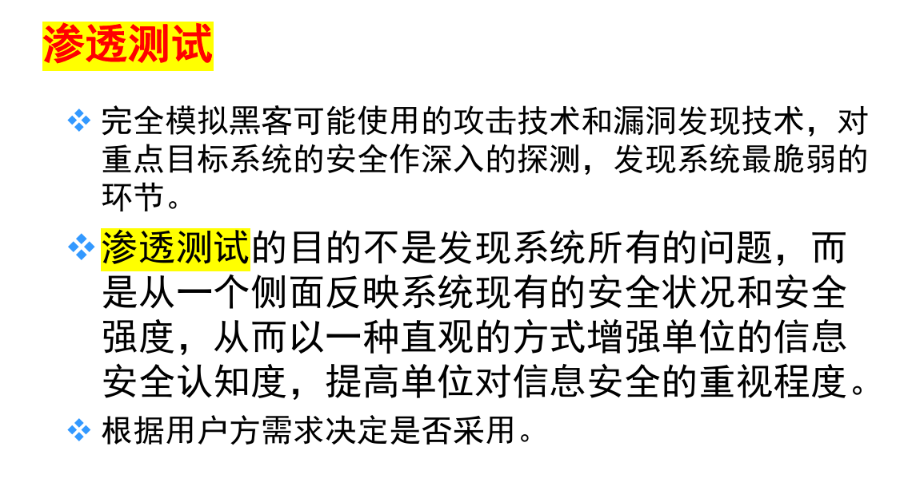

#### 2.1.7 风险分析

分析威胁利用脆弱性的可能性和影响程度，确定风险等级。

**定性分析**

依据研究者的知识、经验、历史教训、政策走向及特殊事例等非量化资料作出判断，以文字或叙述性等级描述影响程度与可能性大小。评价更多依赖经验、直觉或业界惯例，对风险要素分级，主观性较强；优点是能挖掘较深层的判断、结论相对全面，缺点是对评估者要求高。

- 典型方法：因素分析法、逻辑分析法、历史比较法、德尔斐法。
- 定性量度示例：

| 维度 | 等级 |
|---|---|
| 可能性 | A 几乎肯定 / B 很可能 / C 可能 / D 不太可能 / E 罕见 |
| 影响 | 1 可忽略 / 2 较小 / 3 中等 / 4 较大 / 5 灾难性 |

- 风险矩阵：按可能性与影响的预设等级划分规则（如 5×5 矩阵）查表得到风险结果（如 E/H/M/L），再汇总各资产的风险等级。

**定量分析**

常见方法包括因子分析法、聚类分析法、时序模型、回归模型、风险图法、决策树法等，也可用期望损失形式描述：$ValueR=\sum_{i=1}^{n} F_i\times L_i$（基于效用时可写作 $LossEU_i=\mu^{-1}(F_i)\times L_i$）。

**风险分析公式（GB/T 20984）**

<div class="hl-green" markdown="1">

$$R(A,T,V)=R\bigl(L(T,V),F(I_a,V_a)\bigr)$$

</div>

- $A$：资产；$T$：威胁；$V$：脆弱性。
- $L(T,V)$：威胁利用脆弱性导致安全事件发生的可能性。
- $F(I_a,V_a)$：安全事件发生后的损失；$I_a$ 为安全事件所作用的资产价值，$V_a$ 为脆弱性严重程度。

**年度损失期望（ALE）**

<div class="hl-green" markdown="1">

$$ALE=SLE\times ARO,\qquad SLE=AV\times EF$$

</div>

- $ALE$：年度损失期望；$SLE$：单次预期损失；$ARO$：年度发生率（一年中风险发生次数）。
- $AV$：资产价值；$EF$：暴露系数。
- **ROSI 有两种口径，别把“收益额”和“收益率”当成同一个公式**：

| 口径 | 公式 | 量纲 / 性质 |
|---|---|---|
| **<span class="hl-orange">课件口径：绝对净收益</span>** | `ROSI = ALE前 − ALE后 − 年控制成本` | 金额（元）；本质是安全投资净收益（ENB / Net Benefit），课件没有除以成本 |
| **<span class="hl-orange">标准口径：收益率</span>** | `ROSI = (风险降低额 − 安全投入) / 安全投入` | 无量纲 / 百分比；标准 ROSI（Return on Security Investment） |

> 两者分子同源：`风险降低额 = ALE前 − ALE后`，`安全投入 = 年控制成本`，都把成本当成要扣掉的一项。真正差别只在**标准口径多除以安全投入**做归一化。考试按课件公式写，但要知道课件算的是**净收益额**，标准 ROSI 算的是**收益率**。

**资产价值：加权与最大原则**

$$VA=VA_c W_c+VA_i W_i+VA_a W_a+VA_{ac} W_{ac}+VA_n W_n$$

- 五个维度：机密性、完整性、可用性、可审计性、不可抵赖性；权重和为 1。
- 最大原则：$VA=\max(VA_c,VA_i,VA_a,VA_{ac},VA_n)$。
- 定性 5 级：非常重要 → 重要 → 比较重要 → 不太重要 → 不重要。

**半定量（相乘法）示例**

已知威胁频率 $T_1=1$、脆弱性严重程度 $V_1=3$、资产价值 $A_1=4$：

- 安全事件发生可能性 $L=\sqrt{T_1\times V_1}=\sqrt{3}$；
- 安全事件损失 $F=\sqrt{A_1\times V_1}=\sqrt{12}$；
- 风险值 $R=L\times F=\sqrt{3}\times\sqrt{12}=6$。若按整数等级赋值，可取 $L\approx 2$、$F\approx 3$ 后再判级。
- 按示例区间 1–4 / 5–9 / 10–16 / 17–25 对应 1 / 2 / 3 / 4 级，则风险等级为 2。实际判定以预设等级划分表为准，不同资料的区间阈值可能不同。

**威胁与脆弱性赋值**

- 威胁赋值：5 = 很高（≥1 次/周）；4 = 高（≥1 次/月）；3 = 中（≥1 次/半年）；2 = 低；1 = 很低。
- 仅采用 TOP5 或 TOP10 威胁参与计算。
- 脆弱性识别难点“三性”：隐蔽性、欺骗性、复杂性。
- 五类脆弱性：管理、结构、操作、技术、物理。

**已有控制与综合评估**

- 已有控制四类：预防性、检测性、纠正性、威慑性。
- 综合评估方法：AHP（层次分析法，萨蒂提出）；改进方法包括模糊综合评价、灰色理论、D-S 证据理论、机器学习等。

#### 2.1.8 风险管理的工作内容（四个阶段 + 两个贯穿）

依据 GB/Z 24364《信息安全风险管理指南》：

| 环节 | 内容 |
|---|---|
| <span class="hl-green">建立背景</span> | 确定风险管理对象、范围、组建团队、制定计划 |
| <span class="hl-green">风险评估</span> | 风险分析准备 → 风险要素识别 → 风险分析 → 风险结果判定 |
| <span class="hl-green">风险处置</span> | 判断现存风险 → 确认处理目标 → 选择处理措施 → 实施控制措施 |
| <span class="hl-green">批准监督</span> | 管理层审批残余风险，监督措施执行 |
| <span class="hl-green">监控审查（贯穿全程）</span> | 持续监控风险变化，定期审查 |
| <span class="hl-green">沟通咨询（贯穿全程）</span> | 与各方保持沟通，获取支持与反馈 |

> 风险管理 > 风险评估 > 风险分析

#### 2.1.9 其他考点：风险评估工具

由风险评估工具得到风险评估的结果。

**风险评估与管理工具（标准、知识、模型）**

- 基于标准的工具，如基于 NIST SP 800-30 或 ISO 27005 开发的工具
- 基于知识的工具，综合各种风险分析方法，形成知识库，以此为基础完成综合评估
- 基于模型的工具，对典型系统的资产、威胁、脆弱性建立量化或半量化的模型

**系统基础平台风险评估工具**

- 脆弱性扫描工具（漏扫）：基于网络的扫描器、基于主机的扫描器、分布式网络扫描器、数据库脆弱性扫描器
- 渗透性测试工具：黑客工具、脚本文件

**风险评估辅助工具**：检查列表、入侵检测系统（IDS）、安全审计工具、拓扑发现工具和资产信息收集系统，用于评估过程参考的评估指标库、知识库、漏洞库、算法库和模型库。

#### 2.1.10 PDCA 八步骤与风险管理观念

**PDCA 八步骤**

| 步骤 | 内容 |
|---|---|
| 1. 分析现状 | 找出问题，收集组织数据 |
| 2. 设定目标 | 设定目标与测量方法 |
| 3. 分析原因 | 分析问题产生的原因 |
| 4. 找主因 | 找出主要原因 |
| 5. 制定措施 | 用 5W1H 提出行动计划与资源 |
| 6. DO | 执行措施 |
| 7. CHECK | 检查效果、分析数据 |
| 8. ACT | 标准化推广，遗留问题转入下一循环 |

> 有的课件把 PLAN 拆成多步，用 2A / 4C / APDC 等变体记；核心仍是 PDCA 循环。

**前瞻性与反应性风险管理**

- **前瞻性**：评估风险 → 实施风险决策 → 风险控制 → 评定有效性。
- **反应性**：保护人身安全 → 遏制损害 → 评估损害 → 确定损害部位 → 修复 → 审查响应过程并更新。
- **最佳实践** = 前瞻性 + 反应性。

**安全目标五句话（常借 STOP 记忆）**：看不懂、进不来、拿不走、改不了、跑不了。

**风险的两套口径（别混）**

| 来源 | 五要素 / 术语 | 用途 |
|---|---|---|
| **GB/T 20984 标准口径** | 资产、威胁、脆弱性、安全事件、风险 | 标准定义；配 $R(A,T,V)=R(L(T,V),F(I_a,V_a))$ |
| **课件“风险的五方面”** | 威胁源、威胁行为、脆弱性、资产、影响 | 指导降风险措施；对应五个抓手 |

> 关键差异：<span class="hl-orange">标准口径有“**安全事件**”，课件五方面**不单列安全事件**；课件把“威胁”拆成“**威胁源 + 威胁行为**”，最后用“影响”收尾</span>。  
> 注：课件“GB/T 20984 定义”页原文是并列定义，不是整齐的五项枚举；上表是按标准口径整理的答题版。

**怎么答**

- 题干明确写 **GB/T 20984** → 用标准口径：资产、威胁、脆弱性、安全事件、风险，并配 $R(A,T,V)$ 公式。
- 问“**构成风险的五个方面**”或“**降低风险从哪几方面入手**” → 用课件五方面：威胁源、威胁行为、脆弱性、资产、影响，再配五个抓手。
- 保险答法：先写标准口径，再补一句“课件另按威胁源、威胁行为、脆弱性、资产、影响五方面展开，用于指导降风险措施”。

### 2.2 第二部分：国产化替代（信创）

#### 2.2.1 国产化替代的核心定义与必要性

**定义**：用国产自主可控产品替代被垄断的国外产品。

**必要性（为什么要国产化替代）**：应对供应链安全危机（如华为、中兴事件），打破国外在芯片、基础软件等领域的垄断；或者实现核心技术自主可控，规避依赖导致的风险。

**政策表述（论述题可直接引）**

> 2016 年 10 月 9 日，中共中央政治局就实施网络强国战略进行第三十六次集体学习。习近平总书记强调：要紧紧牵住核心技术自主创新这个“牛鼻子”……加快推进国产自主可控替代计划，构建安全可控的信息技术体系。

倪光南：“我们必须坚持这么做，因为中兴、华为事件说明，如果不是自主可控的产品，我们的产业可能在一天之内瘫痪。”

**垄断事实（为什么必须替）**

- 芯片起步晚、差距大；PC 端被 Windows 垄断，移动端被 Android / iOS 垄断；数据库被 Oracle、MySQL、SQL Server、DB2 垄断。
- 课件常用数据：Windows 全球桌面份额约 88.18%、中国 95% 以上（引用时最好标年份）——比喻为“身体上长着别人的大脑”。
- WannaCry 后出现工厂停产、医院挂号缴费终端瘫痪；“大面积停电”更多是 NotPetya / 乌克兰电网事件，别混到 WannaCry 头上。

**国产替代清单**

- 国产 CPU：申威、飞腾、龙芯（以及鲲鹏、海光、兆芯等）。
- 国产 OS：银河麒麟、统信 UOS、普华、深度、中科方德、中标麒麟等。
- 国产数据库：达梦、金仓、南大通用、神通等。

> 国产 Linux 的优势：源代码公开可获得，可从源码层修补漏洞、节省研发费用。

**信创生态“去美化”**：原生态建立在 Intel / AMD、微软 / 苹果、Oracle / 微软、IBM / Oracle、Office 365 / Adobe 等之上；安全软件层不要用“卡巴斯基”举例——它是俄罗斯企业，不属于“去美化”对象。

#### 2.2.2 主要替代内容（"替什么"）

国产桌面计算机技术体系对 **Wintel 体系**的替代；高端服务器和数据库对 **"IOE"** 的替代。

- 这里的 **"Wintel 体系"** 指的是微软的 Windows 操作系统和英特尔的处理器技术体系，
- 而 **"IOE"** 通常指的是 IBM 的硬件（大型计算机）、甲骨文（Oracle）的数据库软件以及 EMC 的存储设备。

| 层面 | 替代内容 |
|---|---|
| 底层硬件 | 替代 Intel/AMD CPU，采用国产 CPU（龙芯、飞腾、申威等） |
| 操作系统 | 替代 Windows，发展国产 Linux 发行版（麒麟、统信 UOS） |
| 企业级系统 | 替代国外"IOE"体系（IBM 服务器、Oracle 数据库、EMC 存储设备） |

#### 2.2.3 信创产业（"怎么替"）

信创：信息技术应用创新产业，目标是建立中国自主的 IT 底层架构和生态。核心产业链（自下而上）：

1. **底层硬件**（芯片、存储）
2. **基础软件**（操作系统、驱动、数据库、中间件）
3. **应用软件**（办公 OA、ERP、行业软件）
4. **信息安全产品**（边界安全、终端安全）

#### 2.2.4 总结

- 风险管理是 **<span class="hl-green">PDCA 循环</span>**（建立背景、风险评估、风险处置、批准监督 + 监控审查、沟通咨询）。
- 风险术语需背全，特别是 **资产、威胁、脆弱性、风险、残余风险**。
- 风险评估流程四阶段：准备 → 识别 → 分析 → 处理。
- 风险处置四策略：减低、转移、规避、接受。
- 国产化替代是 **硬件 → 操作系统 → 企业系统** 的全面替代；信创产业链涵盖 **硬件 → 基础软件 → 应用软件 → 安全产品**。

#### 2.2.5 【应试背诵要点与预测考点】

- **名词解释**：风险、脆弱性、ALE、信创、国产化替代。
- **简答题**：
  - 简述风险管理 PDCA 过程的六个步骤。
  - 风险评估的四个基本步骤是什么？
  - 风险处置的四种策略，并各举一例。
  - 定性风险分析与定量风险分析的区别与特点。
  - 为什么说国产化替代是网络安全的基础？（结合必要性答）
- **计算/分析题**：可能给场景数据，要求计算 ALE。
- **论述题要点**：结合"IOE"替代和信创产业链，论述我国实现信息技术自主可控的路径。

## 3. 信息与网络空间安全保障

### 3.1 第一部分：网络空间安全保障背景

#### 3.1.1 信息的性质（8 性，理解即可）

依附性、动态性、可处理性、共享性、可传递性、异步性、可交换性、可伪性。网络空间安全的任务是确保信息功能的正确实现。

#### 3.1.2 网络空间安全的核心属性（CIA，必背）

| 属性 | 说明 |
|---|---|
| 保密性 (Confidentiality) | 防止信息泄露 |
| 完整性 (Integrity) | 防止信息被篡改或破坏 |
| 可用性 (Availability) | 确保授权用户能访问信息和系统 |

> 信息与网络空间安全的核心在于保障数据/信息流的 CIA 属性。

#### 3.1.3 网络空间安全发展阶段（了解顺序）

| 阶段 | 时间 | 威胁 / 核心问题 | 主要措施 / 思想 |
|---|---|---|---|
| <span class="hl-green">通信安全 COMSEC</span> | 20 世纪 40–70 年代 | 搭线窃听、密码分析 | 加密 |
| <span class="hl-green">计算机安全 COMPUSEC</span> | 20 世纪 70–90 年代末 | 计算机犯罪、恶意代码、越权访问 | 访问控制、口令、审计、防病毒 |
| <span class="hl-green">信息系统安全 INFOSEC</span> | 20 世纪 90 年代后 | 网络入侵、病毒破坏 | 防火墙、防病毒、漏洞扫描、入侵检测、PKI、VPN |
| <span class="hl-green">信息安全保障 IA</span> | 21 世纪初 | 单一技术防护不足、管理缺位 | 从技术扩展到管理、从静态扩展到动态，技术 + 管理 + 人员并重 |
| <span class="hl-green">网络空间安全 CS</span> | 2010 年后 | 国家级 / APT 攻击、关键基础设施威胁 | 防御（运维）—攻击（威慑）—利用（情报）三位一体，态势感知 |

#### 3.1.4 安全运维与态势感知

网络空间安全 CS 阶段（2010 年后）的核心思想是**防御 Defense（运维）—攻击 Offense（威慑）—利用 Exploitation（情报）三位一体**，配套建设“网络空间安全态势感知平台”。

**态势感知平台**：把资产、流量、威胁、漏洞、日志等数据汇聚起来，做监测、分析、预警和处置支撑；重点不是“多装一个设备”，而是把分散的安全数据变成可判断的整体态势。

**网络空间安全保障是立体保障，含 14 项**：

1. 运行技术
2. 备份与灾难恢复
3. 安全评估
4. 边界安全
5. 网络安全基础设施
6. 人员安全
7. 安全培训
8. 安全意识
9. 安全管理
10. 物理安全
11. 证书系统
12. 授权系统
13. 计算环境安全
14. 监控检测

> 记法：技术（运行、备份、评估、边界、基础设施、计算环境、监控检测）+ 人员（人员、培训、意识）+ 管理（安全管理、物理、证书、授权）。

### 3.2 第二部分：核心安全模型

**名词解释：什么是网络空间安全模型？** 通过建模的思想来解决网络安全管理问题，有效抵御外部攻击，保障网络安全。安全模型用于精确和形式地描述信息系统的安全特征，解释系统安全相关行为。

**为什么需要安全模型（简答题可能考）**

- 能准确地描述安全的重要方面与系统行为的关系。（模型的处理方式，更能抓住重点）
- 能提高对成功实现关键安全需求的理解层次。（层次化、分段化的模型利于问题的处理）
- 从中开发出一套安全性评估准则，和关键的描述变量。（标准化、规则化处理）

#### 3.2.1 PDR 模型（基础）

**出发点**：任何防护措施都是基于时间的，是可以被攻破的。

| 环节 | 说明 |
|---|---|
| <span class="hl-green">保护 (Protection)</span> | 采用加密、防火墙、访问控制等技术防护 |
| <span class="hl-green">检测 (Detection)</span> | 利用入侵检测、漏洞扫描等技术发现威胁 |
| <span class="hl-green">响应 (Response)</span> | 事件发生后采取的措施，如应急响应、追踪，对抗入侵 |

三者循环联动。

#### 3.2.2 PDR 模型的演变

**<span class="hl-blue">PDRR 模型</span>**：在 PDR 基础上增加**恢复 (Restore)**，强调系统被入侵后的恢复能力。恢复（Restore）——系统被入侵后，采取措施将其恢复到正常状态。

**<span class="hl-blue">PPDR 模型</span>**：PPDR = policy + protect + detect + response，强调控制和对抗（系统安全的动态性），以安全检测、漏洞监测和自适应填充"安全间隙"为循环，特别考虑人为的管理因素。

- 在 PDR 基础上增加**策略 (Policy)**，强调所有活动在统一安全策略的控制和指导下进行。
- **<span class="hl-green">policy（策略）是模型的核心</span>**；所有的防护、检测、响应都是依据安全策略实施的；策略体系的建立包括安全策略的制定、评估与执行等。
- 策略包括访问控制策略、加密通信策略、身份认证策略、备份恢复策略……

#### 3.2.3 PDR 模型的数学法则（必考公式）

**关注时间关系**

<div class="hl-green" markdown="1">

$$P_t > D_t + R_t$$

</div>

| 变量 | 含义 |
|---|---|
| $P_t$ | 防护时间，即防御系统有效抵抗攻击的时间 |
| $D_t$ | 检测时间，从攻击开始到被检测到的时间 |
| $R_t$ | 响应时间，从检测到攻击到完成响应处置的时间 |

另外 $E_t$ 是暴露时间。如果 $P_t > D_t + R_t$，那么系统是安全的；如果 <span class="hl-orange">$P_t < D_t + R_t$</span>，那么 $E_t = (D_t + R_t) - P_t$。

**安全判定**：当防护时间大于检测与响应时间之和时，系统被认为是安全的。

#### 3.2.4 信息技术保障框架（IATF）和深度防御模型

**核心思想**：承认没有绝对安全，采用多层次、多角度的综合防护措施（人、技术、操作），实现"深度防御"。

| 要素 | 内涵 |
|---|---|
| <span class="hl-blue">人</span> | 核心要素，也是最脆弱的环节。包括安全意识培训、组织管理等 |
| <span class="hl-blue">技术</span> | 实现保障的手段，包括防护、检测、响应、恢复等技术体系 |
| <span class="hl-blue">操作</span> | 将技术与人结合的日常运行活动，如风险评估、安全监控、审计等 |

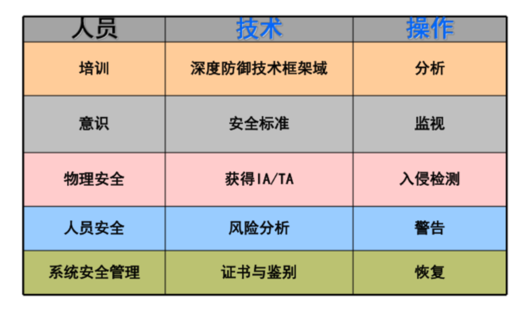

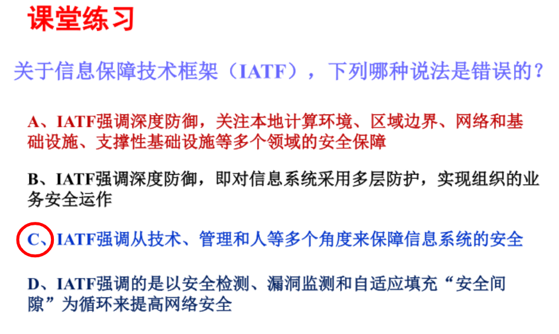

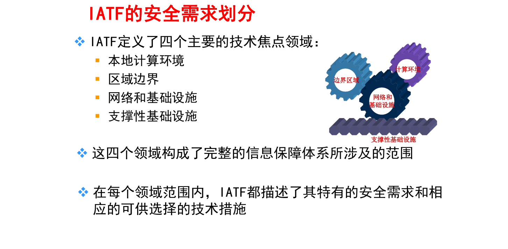

**四个技术焦点领域（必背，三保护一支撑）**

| 领域 | 目标 | 举例 |
|---|---|---|
| <span class="hl-green">保护本地计算环境</span> | 保护客户机和服务器的数据安全 | 主机入侵检测、防病毒 |
| <span class="hl-green">保护区域边界</span> | 控制与监视进出安全区域的数据流 | 防火墙、边界入侵检测 |
| <span class="hl-green">保护网络和基础设施</span> | 保证网络通信的可用性、防止数据非法泄露 | 骨干网可用性、VPN |
| <span class="hl-green">支撑性基础设施</span> | 为安全服务提供基础支撑 | 密钥管理基础设施、检测响应基础设施 |

在此基础上，对信息系统就可以做到多层防护，实现组织的任务/业务运作。这样的防护被称为 **"深度防护战略（Defense-in-Depth Strategy）"**。

成功的组织功能依赖于信息安全保障，通过深度防御战略，融合人、技术、操作三要素，并依托计算环境、区域边界、网络基础设施和支撑性基础设施四个焦点领域来实现。

#### 3.2.5 【应试背诵要点与预测考点】

- **名词解释**：CIA 三性、PPDR 模型、IATF 深度防御。
- **简答题**：
  - 简述 PDR 模型及其演变（PDRR、PPDR）。
  - 解释 PPDR 模型中 $P_t > D_t + R_t$ 公式的含义与安全意义。
  - 简述 IATF 深度防御的核心思想与四个技术焦点领域。
  - 列出网络安全事件的分级（四级）及参考标准。
- **论述/分析题**：结合 IATF 模型，论述如何从技术、管理、人员多个层面构建纵深防御体系。

### 3.3 第三部分：应急响应与事件管理

#### 3.3.1 计算机安全事件定义

由于自然或人为，以及软硬件本身缺陷或故障的原因，对信息系统造成危害，或在信息系统内发生对社会造成负面影响的事件。

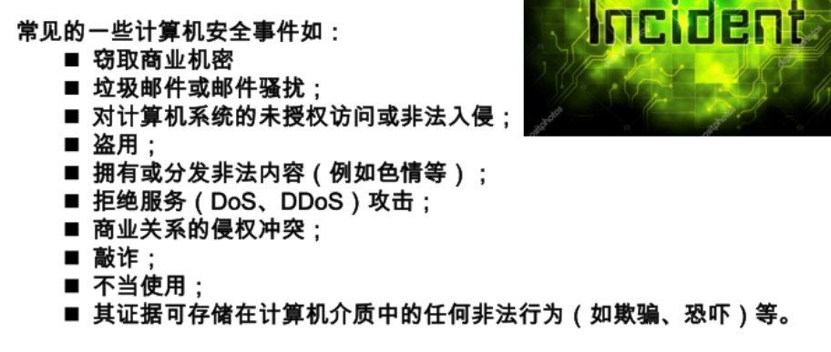

#### 3.3.2 事件分级（四级，背数字）

| 级别 | 判据 |
|---|---|
| 四级 / 一般 | 业务中断 < 10 分钟，无数据损坏 |
| 三级 / 较大 | 业务中断 10–30 分钟，无数据损坏 |
| 二级 / 重大 | 业务中断 30–60 分钟，或数据损坏但可恢复 |
| 一级 / 特别重大 | 业务中断 > 60 分钟，或数据无法恢复，或重要数据泄露 |

- 特殊时期（如重大活动），事件级别在原基础上**提升一级**（特别重大除外）。
- **10、30、60 是分割点**。

**计算机安全事件分类**

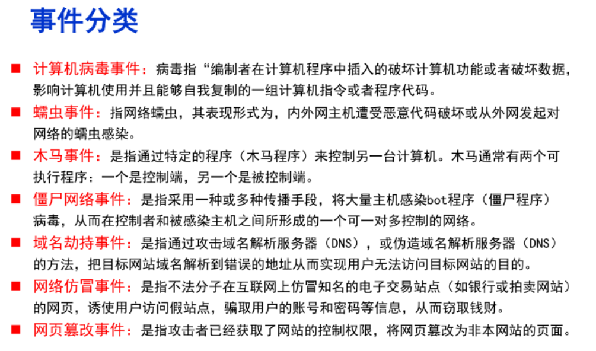

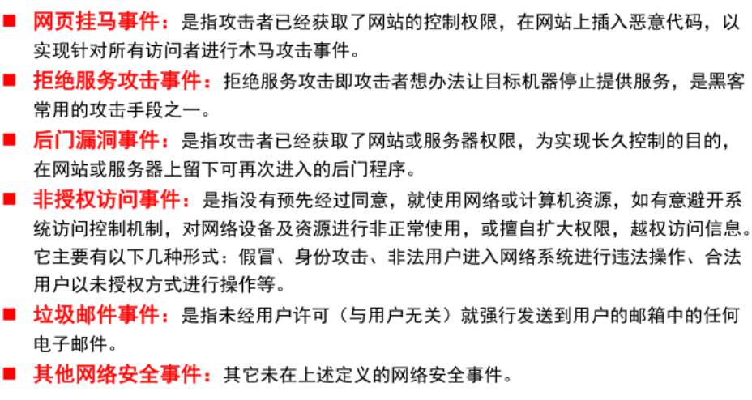

#### 3.3.3 应急响应概念和流程（6 阶段，重点）

通常是指一个组织为了应对各种意外事件的发生所做的准备以及在事件发生后所采取的措施。意义：**未雨绸缪 + 亡羊补牢**。

```text
准备 → 检测 → 抑制 → 根除 → 恢复 → 跟进
```

| 阶段 | 关键动作 |
|---|---|
| **<span class="hl-green">准备</span>** | 调研分析、定目标定范围、制定预案、工具准备、组建团队、建立预防预警机制。 |
| **<span class="hl-green">检测</span>** | 确定检测对象及范围、判断是否为安全事件、确定应急处理方案、明确检测规范。 |
| **<span class="hl-green">抑制</span>** | 限制事件影响范围和程度；隔离 / 切换备份系统；优先保证重要资产与最基本业务能力。 |
| **<span class="hl-green">根除</span>** | 定方案、明确风险、保留根除记录。 |
| **<span class="hl-green">恢复</span>** | 重建系统：数据备份 → 装新操作系统 → 配置基线及访问控制 → 数据恢复 → 上线测试 → 演练。 |
| **<span class="hl-green">跟进</span>** | 审计抑制与根除效果、确认未被再次入侵、定期复查、输出报告、改进预案与防护体系。 |

#### 3.3.4 常见应急事件

根据主机收到的攻击的表象可将木马病毒分为四类：

| 类型 | 特征 | 防御策略 |
|---|---|---|
| **勒索病毒**（也叫勒索木马） | 磁盘文件被加密，一旦完成勒索过程则无法恢复文件 | 以预防为主，安装杀毒软件，做好主机防黑工作，及时打补丁，对重要文件要及时隔离备份 |
| **挖矿木马** | CPU 和 GPU 异常占用过高，且有对矿池地址的解析 | 可有落地文件实现，也可通过 WMI 等无落地文件实现 |
| **远控木马** | 一直是 APT（高级持续性威胁）攻击的主流，复杂程度高 | 集成了攻击模块、控制模块、持久化模块等，且有 C2（命令与控制）服务器 |
| **普通木马** | 指除上述类型之外的其他木马类型 | — |

#### 3.3.5 恶意代码与攻击技术全景（跨章串讲）

**恶意代码分类**

| 类型 | 核心特征 |
|---|---|
| 病毒 | 依附文件、自我复制 |
| 蠕虫 | 网络自主传播、无需宿主 |
| 木马 | 伪装诱骗 + 远程控制 |
| 间谍软件 | 窃密、监控 |
| 广告软件 | 弹窗、劫持 |
| 勒索软件 | 加密文件、勒索赎金 |
| 挖矿木马 | 占用 CPU / GPU 挖矿 |
| 僵尸网络 | 批量控制肉鸡发起攻击 |
| Rootkit | 隐藏自身与恶意行为 |
| 键盘记录器 | 记录击键窃取口令 |

**Web 应用攻击（按 OWASP Top 10 组织）**

- **XSS**：反射型 / 存储型 / DOM 型；根因是输入验证不严格、输出未编码；后果包括会话劫持。防御：白名单校验、输出编码、CSP、HttpOnly。
- **SQL 注入**：预编译 / 参数化查询是首选；ORM 只能降低风险，不能完全替代安全编码。
- **CSRF**：利用已认证会话诱导用户发起非预期请求；OWASP Top 10 2021 将其归入访问控制类。防御：CSRF Token、SameSite Cookie、校验 Referer / Origin。
- **文件上传**：校验类型、内容、大小与存储路径，上传目录禁止执行脚本。
- **点击劫持**：用透明 iframe 诱导点击；防御：`X-Frame-Options` / CSP `frame-ancestors`。

**社会工程学攻击**

- 本质：利用人的信任与心理本能（权威、紧迫、好奇、贪婪、恐惧），而不是技术漏洞。
- 常见手法：钓鱼 / 鱼叉钓鱼、Vishing（语音钓鱼）、Smishing（短信钓鱼）、尾随、假身份牌、诱骗来电显示、搜索引擎恶意广告、Dumpster Diving（翻垃圾）。
- 防御：安全意识培训、多因素认证、上线回拨核验、邮件过滤与 DLP。

## 4. 网络空间安全技术体系与技术

### 4.1 考点 1：开放系统互连安全体系结构（OSI）

**安全机制**：用来保护或保障信息系统安全的一种或一类技术的总称。

**安全服务**：加强数据处理系统和信息传输安全性的一类服务，其目的在于利用一种或多种安全机制保障信息系统安全或信息系统安全可靠运行。

#### 4.1.1 五大安全服务（功能，做什么）

| 服务 | 目的 |
|---|---|
| <span class="hl-green">鉴别服务</span> | 提供对通信中对等实体和数据来源的鉴别，对抗假冒威胁 |
| <span class="hl-green">访问控制服务</span> | 提供保护以对抗开放系统互连可访问资源的非授权使用 |
| <span class="hl-green">数据机密性服务</span> | 对数据提供保护使之不被非授权地泄漏 |
| <span class="hl-green">数据完整性服务</span> | 针对有连接或无连接条件下，对数据进行完整性检验，防止非法篡改、插入、替换或删除 |
| <span class="hl-green">抗抵赖性服务</span> | 为通信双方提供证据，防止对已发生通信行为的否认 |

#### 4.1.2 八大安全机制（手段，对应服务，怎么做）

| 机制 | 说明 |
|---|---|
| <span class="hl-green">加密机制</span> | 提供机密性，是其他机制的基础 |
| <span class="hl-green">数字签名机制</span> | 完成签名与验证，实现鉴别、完整性和抗抵赖 |
| <span class="hl-green">访问控制机制</span> | 按权限控制资源访问 |
| <span class="hl-green">数据完整性机制</span> | 通过附加码验证数据是否被修改 |
| <span class="hl-green">鉴别交换机制</span> | 通过密码技术由发送方验证来实现鉴别；通过特定的"握手"协议防止鉴别"重放" |
| <span class="hl-green">通信业务填充机制</span> | 业务分析，特别是基于流量的业务分析是攻击通信系统的主要方法之一。通过通信业务填充来提供各种不同级别的保护（对抗流量分析） |
| <span class="hl-green">路由选择控制机制</span> | 针对数据单元的安全性要求，可以提供安全的路由选择方法 |
| <span class="hl-green">公证机制</span> | 通过可信第三方机构，实现对通信数据的完整性、原发性、时间和目的地等内容的公证。一般通过数字签名、加密机制来适应公证机构提供的公证服务 |

#### 4.1.3 安全服务与安全机制的联系与区别

在开发系统互连（OSI）安全体系结构中，**安全服务**定义了需要实现的安全目标（如机密性、完整性、身份认证等），而**安全机制**是实现这些安全目标的具体技术手段与方法（如加密、数字签名、访问控制等）。

- **联系**：安全机制是安全服务的实现基础，一种安全服务可能需要多种安全机制协同实现，而一种安全机制也可为多项安全服务提供支持。
- **区别**：安全服务是<span class="hl-orange">从功能与目标角度提出的抽象安全需求</span>，属于"做什么"；安全机制则是<span class="hl-orange">从技术实施角度给出的具体解决方案</span>，属于"怎么做"。
- 二者共同构成了一个从目标到实现、从抽象到具体的完整安全技术体系。

### 4.2 考点 2：信息系统安全体系框架


#### 4.2.1 总体框架构成

完整的信息系统安全体系由**技术体系、组织机构体系和管理体系**共同构建。

#### 4.2.2 技术体系、组织机构体系和管理体系

<span class="hl-red">**核心原则："三分技术，七分管理"，管理与技术并重。**</span>

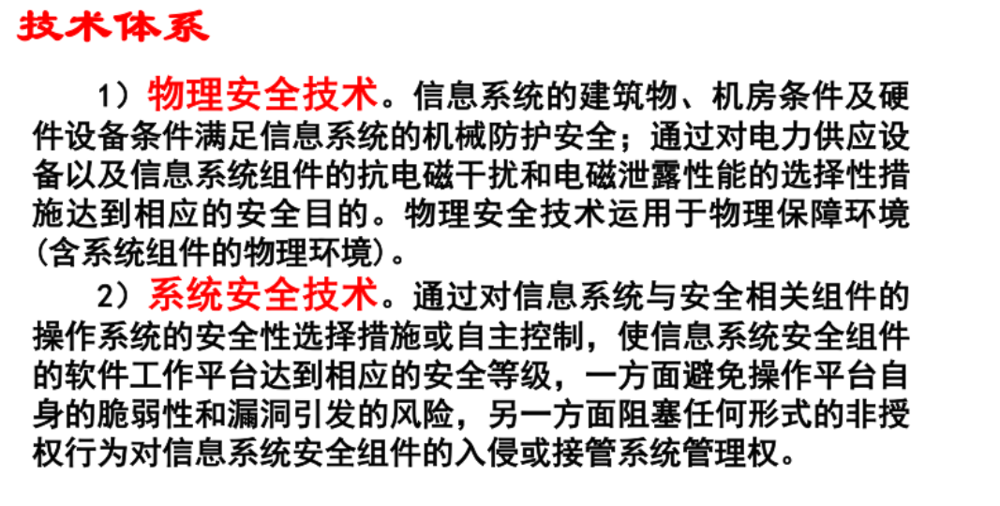

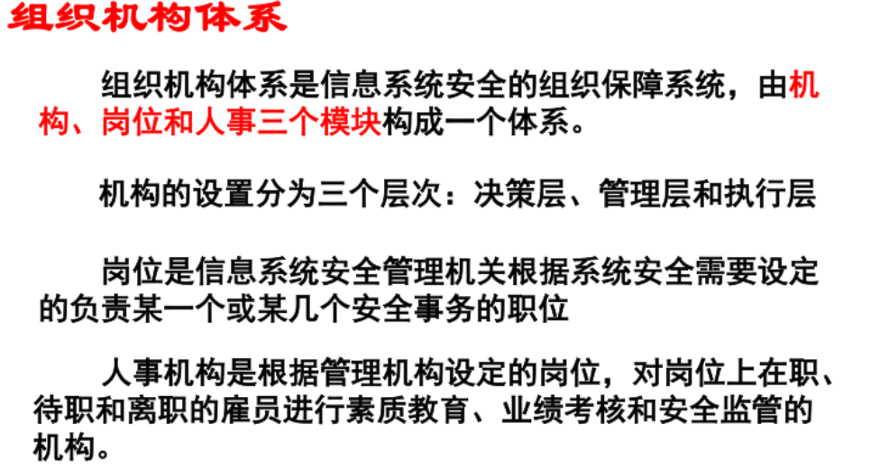

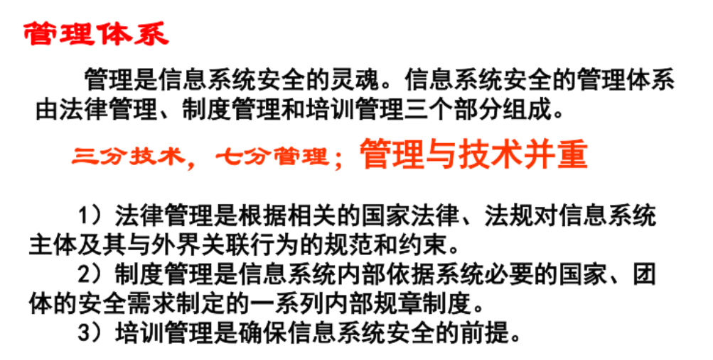

> 可能考名词解释，比如**法律管理**是什么？

#### 4.2.3 法律法规与合规义务（法律管理的落地）

上面管理体系中的**法律管理**，落地就是我国网络安全法律体系。当前以三部法律为骨架：

| 法律 | 施行时间 | 定位与核心 |
|---|---|---|
| **《网络安全法》** | **2017-06-01** | 网络安全领域的**基础性法律**，确立网络运行安全、**等级保护制度**、**关键信息基础设施（CII）保护**等基本制度 |
| **《数据安全法》** | **2021-09-01** | 确立**数据安全与发展并重**的原则，针对"数据处理活动"本身立法；搭建数据安全的基础，强调数据安全的保护，尤其注重重要数据和国家核心数据的保护，规制对象"数据"的载体不仅限于网络数据|
| **《个人信息保护法》** | **2021-11-01** | 专门规范**个人信息处理活动**，保护公民个人权益 |

**三部法律的高频红线（只记行为，不背罚则）**

- **《网络安全法》**：不得非法侵入他人网络、干扰网络正常功能、窃取网络数据；不得提供专门用于上述活动的程序、工具，或提供技术支持、广告推广、支付结算等帮助；不得非法获取、出售或向他人提供个人信息。
- **《数据安全法》**：不得危害国家安全、公共利益或他人合法权益；重要数据出境须依法安全评估；向外国司法或执法机构提供境内数据须经主管机关批准。
- **《个人信息保护法》**：不得非法收集、使用、加工、传输、买卖、提供或公开个人信息。

> 刑事责任衔接：上述行为构成犯罪的，常见对应《刑法》第 285 条（非法侵入/获取数据/非法控制/提供工具）、第 286 条（破坏计算机信息系统）、第 253 条之一（侵犯公民个人信息）。

**《网络安全法》第二十一条：网络运营者的安全保护义务**

"**网络运营者**"是法定主体，包括网络的所有者、管理者和网络服务提供者。第二十一条规定，国家实行网络安全等级保护制度；网络运营者应按该制度履行安全保护义务，保障网络免受干扰、破坏或未经授权的访问，防止网络数据泄露、被窃取或篡改。具体包括：

1. 制定内部安全管理制度和操作规程，确定网络安全负责人，落实网络安全保护责任；
2. 采取防范计算机病毒和网络攻击、网络侵入等危害网络安全行为的技术措施；
3. 采取监测、记录网络运行状态及网络安全事件的技术措施，并按规定**留存相关网络日志不少于六个月**；
4. 采取数据分类、重要数据备份和加密等措施；
5. 履行法律、行政法规规定的其他义务。

> 注：网络安全事件应急预案及演练属于《网络安全法》第二十五条规定的相关义务，不属于第二十一条上述列举项。

**《网络安全法》第三十一条：关键信息基础设施的重点保护**

> 国家对公共通信和信息服务、能源、交通、水利、金融、公共服务、电子政务等重要行业和领域，以及其他一旦遭到破坏、丧失功能或者数据泄露，可能严重危害国家安全、国计民生、公共利益的关键信息基础设施，**在网络安全等级保护制度的基础上，实行重点保护**。关键信息基础设施的具体范围和安全保护办法由国务院制定。国家鼓励关键信息基础设施以外的网络运营者自愿参与关键信息基础设施保护体系。

**考点关系**：关键信息基础设施保护不是替代等级保护，而是在等级保护基础上实施重点保护。

**关键信息基础设施（CII）运营者的特别义务**：单独设置安全管理机构和安全管理负责人；采购网络产品和服务可能影响国家安全的，须通过**国家安全审查**。

**《数据安全法》：数据全生命周期安全**
- 意义：
**一是明确监管体制**，确立数据安全工作的协调与统筹机制；
**二是确立核心制度**，建立数据分类分级保护制度和国家核心数据管理制度，实现与网络安全等级保护制度的衔接；
**三是强化跨境管控**，明确重要数据出境安全管理制度，严格规范向境外司法、执法机构提供数据；
**四是规范政务数据**，对政务数据的收集、使用、保密与开放作出规定；
**五是兼顾发展与安全**，明确数据处理活动不应排除、限制竞争，并专章规定支持技术创新、标准建设、数据交易与人才培养；
**六是明确法律责任**，设定数据处理者义务及相应处罚（第45条、第48条）。
总之，它搭建了我国数据安全的基础，尤其注重重要数据和国家核心数据的保护，规制对象不限于网络数据。
- 基本原则：**数据安全与发展并重**（统筹协调安全与发展）
- 基本制度：**数据分类分级保护制度**；建立数据安全风险评估、监测预警、信息共享、事件报告等机制
- 主体义务：开展数据处理活动应建立健全**全流程**数据安全管理制度、组织落实数据安全教育培训、采取相应技术措施；**重要数据**处理者应明确数据安全负责人和管理机构
- 全生命周期：收集、存储、使用、加工、传输、提供、公开——**每个环节都要落实安全措施**

**《个人信息保护法》：三大基本原则**

| 原则 | 要求 |
|---|---|
| **告知—同意** | 处理个人信息前须明示处理目的、方式和范围，并取得个人同意 |
| **最小必要** | 只收集与处理目的**直接相关、影响最小**的个人信息，不得过度收集 |
| 单独同意 | **敏感个人信息**（生物识别、宗教信仰、医疗健康、金融账户、行踪轨迹等）须取得单独同意 |

>*对于公安公开他人大头照分情形判断*

>**1. 有明确法律依据的公开：合法**

>典型如刑事**通缉令**附照片。《公安机关办理刑事案件程序规定》明确要求通缉令“附被通缉人近期照片”，服务于追逃与公共安全目的，属于**履行法定职责所必需**，符合《个人信息保护法》第13条第1款第3项的合法性基础。

>**2. 无具体授权的“曝光”：通常违法**

>对一般治安违法者（如卖淫嫖娼、闯红灯）公开大头照，处罚种类本身不包含“向社会曝光”。公权力**法无授权不可为**，缺乏《个人信息保护法》第34条要求的“法律、行政法规规定的权限与程序”，构成违法。

**等级保护制度（等保 2.0）**

《网络安全法》确立了**国家实行网络安全等级保护制度**，要求网络运营者按制度履行安全保护义务。等保测评的产出即**合规性**证明，与 §2.1.3 的风险评估并列，是做合规性评估的两条主线。

**安全事件的责任主体认定**

| 主体 | 承担的责任 |
|---|---|
| **网络运营者（单位）** | 承担**主体责任**——未履行安全保护义务导致安全事件的，依法承担相应法律责任 |
| **直接负责的主管人员和其他直接责任人员** | 依法承担相应责任（单位内部追责 + 行政处罚） |
| 攻击者 / 实施违法犯罪行为的个人或组织 | 依《刑法》《治安管理处罚法》等追究刑事责任 |

> 问"安全事件的责任主体"时，标准答案是**网络运营者**（而不是笼统说"公司"或"个人"）；只有当行为人构成违法犯罪时，才转向追究个人刑责。

**网络管理者应履行的职责清单（可按序整体作答）**

1. **建制度**——制定内部安全管理制度、操作规程与安全责任制，确定网络安全负责人
2. **定等级**——按等级保护制度开展定级、备案、测评与整改
3. **防威胁**——部署防范病毒木马、入侵检测、防火墙、访问控制等技术措施
4. **管数据**——数据分类分级、重要数据备份与加密、个人信息最小必要处理
5. **留证据**——开启日志记录并按规定留存网络日志（不少于六个月）
6. **重应急**——制定应急预案并定期演练；事件发生后及时处置、**向上级主管部门报告**并配合调查
7. **重培训**——开展全员安全意识培训与考核

> 写的时候按这个顺序往下走：**制度 → 定级 → 技术 → 数据 → 取证 → 应急 → 培训**。七条下来覆盖完整，不容易漏。

### 4.3 考点 3：网络空间安全技术层次分类

**五层（和网络空间安全的四层次模型区分开！）**

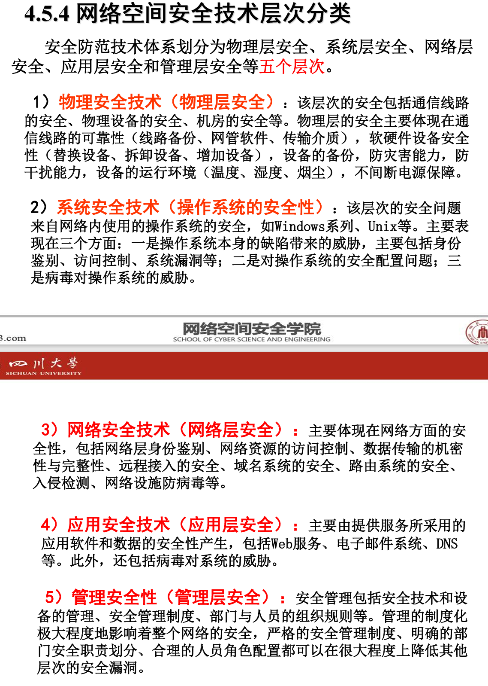

### 4.4 考点 4：核心安全技术机制详解

#### 4.4.1 加密机制

| 类型 | 说明 |
|---|---|
| 对称加密（如 AES） | 加解密使用**同一密钥**，速度快 |
| 非对称加密（公钥密码，如 RSA） | 使用公钥（$K_U$）和私钥（$K_R$）对 |

> RSA 中：公钥 $K_U=(e,n)$，私钥 $K_R=(d,n)$。

> **公钥密码与置换**：RSA 这类公钥加密的数学基础是**单向陷门置换**（模 $n$ 的幂运算），所以“代换 / 置换”二选一时选**置换**；代换与置换本是古典密码的两类基本变换，现代分组密码两者兼用（S 盒 + P 盒）。

- **公钥**：可公开，用于加密数据以实现机密性，或验证签名。
- **私钥**：必须保密，用于解密数据，或生成数字签名。

**非对称加密的适用边界（高频易错点）**

非对称密码的运算代价是**大数模幂**，比对称密码慢好几个数量级，因此它**<span class="hl-red">不能用来直接加密大块数据</span>**。它的真正用途只有三类：

| 用途 | 说明 |
|---|---|
| **数字签名** | 用私钥签名、公钥验证，担保完整性与抗抵赖（见 §4.4.3） |
| **密钥分发** | 加密会话密钥，在不可信信道上安全协商出共享密钥 |
| **加密少量关键数据** | 只对小尺寸数据（如会话密钥）直接使用 |

**混合加密（实际系统的通行做法）**：用非对称加密安全地传递**对称会话密钥**，再用对称加密传输**实际的大块数据**——既拿到了非对称的密钥分发便利，又拿到了对称的高效率。这也是"TLS/HTTPS 握手用非对称、传输内容用对称"的原理。

> 题目问"非对称加密（如 RSA）的**目的不包括**什么"时，标准答案就是"**直接加密大量数据**"。凡涉及"大块数据 / 长消息 / 高带宽传输"，一律排除非对称方案。

**基于公钥密码的鉴别过程**

1. 发送方用自己的私钥对消息（或摘要）签名。
2. 接收方用发送方的公钥验证签名。
3. 若验证成功，则证明消息来源真实且未被篡改，实现了身份鉴别和数据完整性验证。

#### 4.4.2 消息鉴别

**目的**：验证消息来源的真实性和内容的完整性。三种方式：

| 方式 | 鉴别标识 |
|---|---|
| 消息加密 | 以整个消息的密文作为鉴别标识 |
| 哈希函数 | 生成消息的散列值（摘要）作为鉴别标识 |
| 消息鉴别码（MAC） | 一个公开函数加上共享密钥生成一个固定长度的值（密码校验和）作为鉴别标识 |

**消息鉴别码（MAC）特点**：使用共享密钥生成，提供鉴别和完整性保护，但**不提供机密性**；MAC 函数不需要可逆特性。

> **术语界定**：MAC 是这一类鉴别机制的统称，HMAC 是基于散列函数构造的具体算法，TLS 采用 RFC 2104 定义的 HMAC。二者的能力边界与 SSL 记录协议中的具体计算见安全 02 篇 §10.6.1。

#### 4.4.3 数字签名机制（基于 RSA）

**签名过程**

1. 对消息 $M$ 计算哈希值 $H(M)$。
2. 用发送者私钥 $d$ 加密哈希值：$s = H(M)^d \bmod n$，$s$ 即为签名。

**验证过程**

1. 用发送者**公钥 $(e, n)$** 验签：$H_1 = s^e \bmod n$。
2. 独立计算收到消息的哈希值 $H(M)$。
3. 比较 $H_1 = H(M)$，相等则验证成功。

**作用**：具有不可伪造性、抗抵赖性，并保证消息完整性。

**完整传输时序（签名附在消息后）**

1. 发送方 A 对消息 $M$ 计算摘要 $H(M)$。
2. A 用**自己的私钥** $d_A$ 对摘要签名：$s=H(M)^{d_A}\bmod n_A$。
3. A 把**消息 $M$ 与签名 $s$ 拼接**后发送：`M || s`；接收方需要 A 的公钥，实际常同时附上 A 的证书 `Cert_A`。
4. B 收到后拆出 $M$ 和 $s$，用 A 的公钥 $(e_A,n_A)$ 计算 $H_1=s^{e_A}\bmod n_A$。
5. B 独立计算收到消息的 $H(M)$，比较 $H_1=H(M)$；相等则接受，否则丢弃。

> 签名附在消息后**不会隐藏 $M$**；若还要保密，按“先签名后加密”：用 B 的公钥加密 $M\parallel s$ 后再发送，B 先解密再验签。

**数字证书与 PKI 验证链**

- **数字证书**：由 CA 签发的数据结构，把**主体身份**与**公钥**绑定，通常包含主体名、公钥、有效期、用途、颁发者、CA 签名等（X.509）。
- **本质**：证书的核心是 CA 对“这个公钥属于这个主体”的**数字签名**，解决公钥分发中“公钥是谁的”问题。
- **验证链**：叶子证书（服务器/用户）→ 中间 CA → 根 CA（信任锚）。逐级用上一级 CA 的公钥验证下一级证书上的 CA 签名，直到受信任的根证书；同时检查有效期、域名/用途、吊销状态（CRL / OCSP）。
- **作用**：防止攻击者用自己的公钥替换服务器公钥；证书链建立信任后，签名/加密才敢使用证书里的公钥。
- **与 HTTPS 的关系**：见安全 02 篇 §10.9.1 的 SSL 中间人攻击与 PKI 证书链。

**数字签名与加密的三点根本区别（高频易错辨析）**

| 对比项 | 加密 | 数字签名 |
|---|---|---|
| **目的** | **机密性**——防别人看 | **完整性 + 身份鉴别 + 抗抵赖**——防篡改、防否认 |
| **密钥方向** | 公钥加密 → 私钥解密 | 私钥签名 → 公钥验证 |
| **用谁的私钥** | **接收方**的私钥 | **发送方**的私钥 |

**<span class="hl-red">结论：数字签名不提供机密性</span>。** 签名是对**消息摘要**做的运算，而摘要是公开可算的——任何人拿到原消息都能自行算出摘要，再用发送方公钥验证。签名的作用是证明"**是谁发的、内容没被改**"，而不是"不让别人看见内容"。签了名并不隐藏原文。

**若既需要抗抵赖又需要保密**，课件正文给出的方案是**先签名后加密**：A 先用自己的私钥对消息 $M$ 签名，记作 $E_{A}(M)$（下标 A 表示签名者 A 的私钥）；再用 B 的公钥加密，得到 $E_{B}(E_{A}(M))$ 后发送。B 收到后先用自己的私钥解密，再用 A 的公钥验签，得到 $M$。

> 课件并没有把“必须先签名后加密”当成结论，而是把反向顺序留作讨论题：**“先加密后签名如何？（是否遵守交换律？可能出现篡改签名吗？）”** 两种顺序在数学上不可交换，各有攻击面（先签后加有重加密 / 收件人替换风险，先加后签有转发欺骗风险），**不存在唯一“必须”的顺序**。同章 MAC 三种用法图还画出了“(c) 鉴别绑定到密文：先加密，再对密文算 MAC”，说明“先加密再上保护”在课件体系里也是合法方案。若考试考到，按课件方案答 sign-then-encrypt 即可，但不要写“否则签名不覆盖密文”这个理由——课件没有这个论断。

> 看到"**加密**"和"**签名**"同时出现在否定选项里，优先考虑签名，因为签名本来就不是为保密设计的。（参见 §4.4.2，MAC 同样**不提供机密性**。）

**例题（选择题陷阱）**

> 以下哪项不能保证链路信息不被窃取？  
> A. 一次性口令　B. 加密　C. 数字签名　D. 指纹识别  
> **答案：C（数字签名）**。加密直接提供机密性；数字签名只提供完整性、身份鉴别、抗抵赖，不隐藏报文内容。

> 严格说，一次性口令和指纹识别本身也不提供链路机密性；本题按“数字签名不提供机密性”这一课程口径选 C。

#### 4.4.4 【应试背诵要点与预测考点】

- **名词解释**：安全服务、安全机制、数字签名、MAC、抗抵赖性。
- **简答题**：
  - 列出 OSI 安全体系结构的五种安全服务及其基本目的。
  - 解释"公钥加密，私钥解密"与"私钥签名，公钥验证"的区别与用途。
  - 简述消息鉴别的三种基本方式。
  - 阐述"三分技术，七分管理"的含义及管理体系的三个组成部分。
- **流程描述题**：描述基于 RSA 的数字签名生成与验证步骤。
- **对比题**：对比对称加密与非对称加密的特点；对比数字签名与消息鉴别码（MAC）的功能异同。

## 5. 鉴别机制与技术

> 学习目标：掌握鉴别的基本概念；掌握鉴别机制与各类鉴别技术。

### 5.1 鉴别的需求和目的

#### 5.1.1 鉴别需求与目的

**问题的提出**：身份欺诈。

**鉴别需求**：<span class="hl-blue">某一成员（声称者）提交一个主体的身份并声称它是那个主体</span>。

**鉴别的定义**：确认一个实体（如用户、进程）就是它所声明的身份。这是最重要的安全服务之一，其他安全服务都依赖于它。

**目的**：解决身份欺诈问题，让验证者获得对声称者所声称身份的信任。

**辨析：鉴别（Authentication） vs 认证（Certification）**

| 术语 | 英文 | 含义 |
|---|---|---|
| **鉴别** | Authentication | <span class="hl-orange">验证所传输数据的完整性（尤其消息），以及在用户开始使用系统时确认其身份；包括消息鉴别与实体鉴别</span> |
| **认证** | Certification | <span class="hl-orange">为鉴定某一计算机系统或网络的设计与实现满足预定安全要求的程度而进行的技术评估</span> |

> CH5 中的“双因素认证”等是习惯说法，实际指身份鉴别

#### 5.1.2 鉴别与其它安全机制的关系

| 机制 | 与鉴别的关系 |
|---|---|
| 访问控制 | 依赖确知的身份来控制访问 |
| 数据完整性 | 可与数据完整性机制结合，提供数据起源鉴别 |
| 审计机制 | 为审计记录提供确知的身份，支持责任认定 |

#### 5.1.3 身份鉴别的协议基础

**身份鉴别的协议基础**：身份鉴别协议是通信参与者为完成相互身份鉴别或识别而采用的规程、约定、约束和交换信息的总和。

- **双向鉴别协议**：通信双方相互鉴别对方的身份。
- **单向鉴别协议**：只鉴别一方（如 HTTPS 的服务端单向鉴别，见[网络安全（下）](/posts/872-sec-02-defense-device-vpn/) §10.9）。

#### 5.1.4 知识扩展：被动攻击与主动攻击

| 类型 | 含义 |
|---|---|
| 被动攻击 | 如窃听，仅监听或监控数据传输，**不对数据进行篡改**；难检测 |
| 主动攻击 | 如阻断、伪造、重放、拒绝服务（DoS / DDoS），涉及对数据流的篡改或创建虚假数据流 |

主动攻击改变系统状态、消耗资源，**难预防、相对易检测**。以 DoS 为例：通过耗尽带宽、CPU、内存、连接数使合法服务不可用；常见手法包括资源耗尽型、SYN Flood、UDP / ICMP Flood、CC / HTTP Flood、反射放大、僵尸网络。

### 5.2 实体鉴别系统的组成

#### 5.2.1 系统四方

| 角色 | 英文 | 说明 |
|---|---|---|
| **<span class="hl-blue">示证者</span>** | P（Prover），又称声称者 | 出示证件的人 |
| **<span class="hl-blue">验证者</span>** | V（Verifier） | 检验证件的正确性和合法性，决定是否满足要求 |
| **<span class="hl-blue">可信赖者</span>** | TP（Trusted third party） | 参与调解纠纷 |
| **<span class="hl-red">攻击者</span>** | — | 可以窃听或伪装声称者骗取验证者信任 |

#### 5.2.2 对身份鉴别系统的要求

**（1）–（6）必须要求**

1. 验证者正确识别合法申请者的概率极大化。
2. 不具有可传递性（Transferability）。
3. 攻击者伪装成申请者欺骗验证者成功的概率要小到可以忽略的程度。
4. 计算有效性。
5. 通信有效性。
6. 秘密参数能安全存储。

**（7）–（10）增量需求**

7. 交互识别。
8. 第三方的实时参与。
9. 第三方的可信赖性。
10. 可证明的安全性。

#### 5.2.3 网络环境下的鉴别需求

- **唯一身份标识**：<span class="hl-green">uid、uid@domain、DN</span>。
- **抗被动威胁**：<span class="hl-green">窃听、口令不明码传输</span>。
- **抵抗主动威胁**：<span class="hl-green">阻断、伪造、重放，鉴别信息不可重用</span>。

#### 5.2.4 实现身份鉴别的三条途径

**设计依据**：安全水平、系统通过率、用户可接受性、成本等。

| 途径 | 含义 | 举例 |
|---|---|---|
| <span class="hl-blue">基于你所知道的（What you know）</span> | 知识 | 口令、密码 |
| <span class="hl-blue">基于你所拥有的（What you have）</span> | 持有物 | 智能卡、令牌、身份证、钥匙、信用卡 |
| <span class="hl-blue">基于你的个人特征（What you are）</span> | 生物特征 | 其假设是每个人的生理特征具有唯一性；如指纹、虹膜、声音、手型、脸型、笔迹签名等 |
| <span class="hl-blue">双因素/多因素认证</span> | 结合以上多种途径，安全性更高 | RSA SecurID 双因素口令由用户 PIN 码和令牌生成的动态码组合构成 |

**RSA SecurID 双因素口令**：<span class="hl-green">PASSCODE = PIN + 令牌码</span>；令牌码通常每 60 秒变化一次，内部有唯一的 128 位种子；PIN 码在首次使用令牌时设定。

### 5.3 鉴别技术分类：按保护等级（0–4 级）

#### 5.3.1 0–4 级保护能力对照

| 级别 | 机制 | 抗泄露 | 抗重放范围 |
|---|---|---|---|
| **<span class="hl-green">0 级</span>**（无保护） | 直接发送可辨别标识符和申请鉴别信息（AI） | ✗ | ✗（易暴露和受重放攻击） |
| **<span class="hl-green">1 级</span>**（抗泄露保护） | 发送经变换函数处理后的结果（如单向函数散列值），不直接传输申请 AI | ✓ | ✗（仍怕重放） |
| **<span class="hl-green">2 级</span>**（抗泄露 + 防对不同验证者重放） | 在变换函数输入中加入"验证者标识"，防止攻击者将交互信息重放给其他验证者 | ✓ | 不同验证者 ✓ / 同一验证者 ✗ |
| **<span class="hl-green">3 级</span>**（抗泄露 + 防对同一验证者重放） | 在变换函数输入中加入"唯一数"（如随机数、时间戳），防止攻击者将信息重放给同一个验证者 | ✓ | ✓（防对同一验证者重放） |
| **<span class="hl-green">4 级</span>**（抗泄露 + 防对任何验证者重放） | 目标最强。常用质询-应答机制实现 | ✓ | ✓（任何验证者） |

**<span class="hl-green">4 级质询-应答机制</span>**：验证者发送一个随机质询（挑战）给声称者，声称者用其秘密信息（如密钥）对该质询进行变换（如加密、计算 MAC）后作为响应返回，验证者校验响应是否正确。此过程确保每次鉴别交换信息都不同，有效抵抗重放。

#### 5.3.2 4 级的四种实现方案

| 方案 | 机制 | 说明 |
|---|---|---|
| **<span class="hl-green">4A</span>** | 惟一数机制 | 数据项中包含对预期验证者唯一的特征，作为变换函数输入，其余与 3 级相同 |
| **<span class="hl-green">4B</span>** | 质询机制 | 对抗重放；验证者以带唯一值的数据项向申请者发出质询，申请者用函数对质询信息与申请 AI 变换后返回；可用于数据源和实体鉴别 |
| **<span class="hl-green">4C</span>** | 专用加密质询机制 | 适用于实体鉴别，但返回的质询不适用于数据源鉴别 |
| **<span class="hl-green">4D</span>** | 计算响应机制 | 发送带供选择值和身份信息的鉴别请求；发出质询指出验证者选中的值；响应包含变换后的惟一数、质询或计算响应选中的值以及申请 AI |

#### 5.3.3 易错点

- **2 级与 3 级的分界**：<span class="hl-red">2 级只防"对不同验证者"的重放，3 级才防"对同一验证者"的重放</span>。
- **数据源鉴别 vs 实体鉴别**：0 级与 4B 可用于数据源和实体鉴别；<span class="hl-red">4C 只能用于实体鉴别，其返回的质询不适用于数据源鉴别</span>。
- **4 级不是只有质询-应答**：<span class="hl-orange">4 级有 4A–4D 四种实现，质询-应答只是其中最常用的一种</span>（完整流程见 §5.5.1 B）。

### 5.4 鉴别技术分类：按机制配置（方案 A–H）

#### 5.4.1 可信第三方的介入模型

- **涉及可信第三方的模型**：阶段模型、使用初始化信息知识的模型。
- **第三方介入方式**：联机（在线委托）与脱机。

#### 5.4.2 方案 A–H 对照表

| 方案 | AI 来源 | 验证方式 |
|---|---|---|
| **<span class="hl-green">A</span>** | A 与 TP 交换后从 TP 得到申请 AI | B 从 TP 得验证 AI，本地验证（实际应用不多，要求高实时） |
| **<span class="hl-green">B</span>** | A 从 TP 得到申请 AI | B 把收到的交换 AI 提交 TP 验证 |
| **<span class="hl-green">C</span>** | A 从 TP 得到申请 AI 及 B 本地验证必需的验证 AI | A 侧获得验证能力 |
| **<span class="hl-green">E</span>** | A 本地生成交换 AI | B 从 TP 得验证 AI，本地验证 |
| **<span class="hl-green">F</span>** | A 本地生成交换 AI | B 提交 TP 验证 |
| **<span class="hl-green">G</span>** | A 本地生成并提交 TP | TP 向 B 发送鉴别证书及验证 AI（在线委托） |
| **<span class="hl-green">H</span>** | A 本地生成并提交 TP | TP 向 B 发出"A 的身份已被验证"通知（在线委托） |

> 课件中未出现"方案 D"。

#### 5.4.3 记忆抓手

只看两个维度——**<span class="hl-green">谁生成鉴别信息（Authentication Information）/谁验证</span>**。

### 5.5 鉴别机制

**总分类**：<span class="hl-blue">非密码的鉴别机制；基于密码算法的鉴别（对称密码 / 公开密码 / 密码校验函数）；零知识证明协议</span>。

#### 5.5.1 非密码的鉴别机制

涵盖：<span class="hl-blue">基于口令、基于生物特征、基于个人令牌、Kerberos 身份鉴别协议</span>（Kerberos 的五步流程见 §5.5.3）。

##### A. 口令机制

- <span class="hl-blue">最广泛研究和使用的身份鉴别法，长度通常 6~8 字符</span>；选择原则：易记、难猜、抗分析能力强。
- 系统事先保存用户二元组（身份信息 + 口令），口令为明文或仅经简单加密/变换。
- PAP 鉴别一般在通信连接建立阶段进行，数据传输阶段不进行 PAP 鉴别。

PPP 中的 PAP 协议（了解层级）：PPP 是最常用的借助串行线或 ISDN 建立拨入连接服务的协议，是对串行链路数据进行 IP 封装的标准；由 LCP（链路控制协议）和 NCP（网络控制协议）组成；链路建立后、进入网络层协议阶段前，PPP 提供可选择的鉴别阶段；PAP 中连接请求端不停发送 ID/Password 直到被响应或连接终止。

PAP 帧格式（PPP 帧的一种类型）：

| 字段 | 长度 | 内容 |
|---|---|---|
| 类型码 | — | 鉴别请求 / 确认 / 否认 |
| 标识符 | 1 字节 | 匹配请求与应答 |
| 长度 | 2 字节 | — |
| 数据 | 0 或多字节 | ID / Password |

**口令机制的五个脆弱点与对应措施**

| 脆弱点 | 对应措施 |
|---|---|
| **<span class="hl-red">外部泄露</span>** | 教育/培训；严格组织管理办法和执行手续；口令定期改变；一口令一人；输入不回显；易记不写纸上 |
| **<span class="hl-red">口令猜测</span>** | 教育培训；严格限制非法登录次数；验证中插入实时延迟；限制最小长度（至少 6~8 字符以上）；防止用户特征相关口令；口令定期改变；及时更改预设口令；使用机器产生的口令 |
| **<span class="hl-red">线路窃听</span>** | 引入散列函数；加盐（Salt）机制；一次性口令（OTP） |
| **<span class="hl-red">危及验证者</span>** | 基本措施是使用单向函数 |
| **<span class="hl-red">重放攻击</span>** | 一次性口令（OTP）；质询-应答 |

**加盐（Salt）机制**：<span class="hl-blue">使用单向函数保护口令时，攻击者可构造 q 与 p 对应的表形成字典攻击</span>；<span class="hl-green">解决办法是在口令后加随机串 Salt，把 Salt 与口令混合（以特定符号间隔）加密得出散列值，使字典攻击实施困难</span>。

> <span class="hl-red">该方案主要缺陷</span>：只能保护"在多台计算机上使用相同口令"或"同一计算机上不同用户使用同一口令"的情形。
> （危及验证者指攻击者获得 q 的情况；没有 salt 时攻击者可用彩虹表反推原始值进而假冒。）工程侧的口令存储底线见 §5.6.2。

##### B. 一次性口令机制（OTP）

- **定义与目的**：<span class="hl-blue">确保每次认证所用口令不同，以对付重放攻击</span>。
- **相关参数**：<span class="hl-blue">dsv（设备安全值）、ts（时戳）</span>。

**确定口令的三种方法**

1. <span class="hl-green">两端共有一串随机口令，在某位置保持同步</span>；
2. <span class="hl-green">两端共用随机序列生成器，在初态保持同步</span>；
3. <span class="hl-green">使用时戳，两端维持同步时钟</span>。

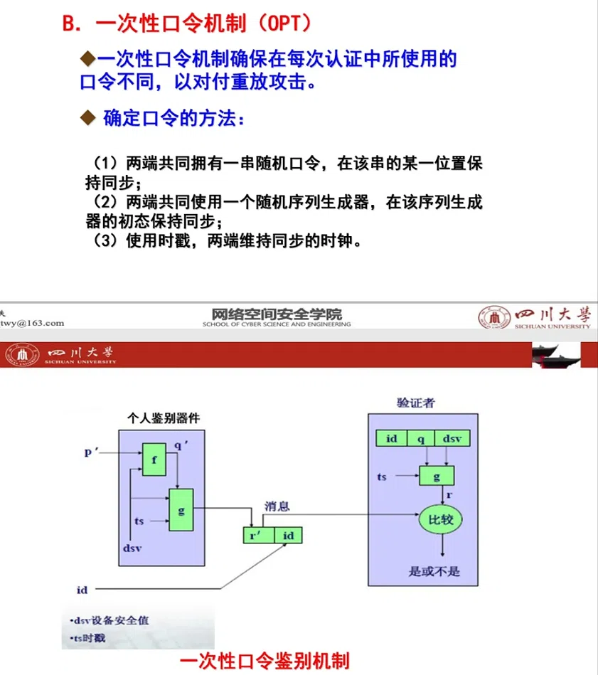

**图解要点**

- **器件侧**（个人鉴别器件）持有 $p'$ 与 $dsv$：先用 $f$ 把 $p'$ 变成 $q'$，再由 $g$ 把 $q'$、$ts$、$dsv$ 合成响应 $r'$。
- **验证者侧**只存 $id$、$q$（$p'$ 的单向变换结果）与 $dsv$，**不存 $p'$**；由 $q$、$ts$、$dsv$ 同样算出 $r$，与收到的 $r'$ 比较，一致即通过。
- **$ts$（时戳）每次不同**，所以 $r$ 与 $r'$ 每次都不同，重放的旧响应对不上新算出的 $r$——这就是 OTP 抗重放攻击的落点。
- 图中的 $ts$ 与本节末尾质询-应答过程的随机质询 $n$ 对应，$q$ 对应验证者数据库里的预存值。

**OTP 安全性分析**（4 点）

| 情形 | 结论 |
|---|---|
| 没有器件而知道 p | <span class="hl-green">不构成简单攻击</span> |
| 有器件而不知道 p | <span class="hl-green">不构成简单攻击</span> |
| 攻击者也能时间同步 | <span class="hl-green">除非攻击者也能时间同步，否则重放不是简单攻击</span> |
| 知道 q（如浏览验证者系统文件）而不知道 dsv | <span class="hl-green">不构成简单攻击</span> |

**S/Key 一次性口令身份鉴别协议**

阶段一：初始化与注册

- 选散列函数 $h(\cdot)$，如 MD5 或 SHA-1；用户 U 注册时 AS 创建用户信息条目并生成随机种子 seed 发给客户端；客户端选整数 N（迭代值），对 seed 与口令 pw 做 N 次散列 $h^N(pw\Vert seed)$（$\Vert$ 表示连接），把结果传给 AS。
- AS 保存：用户身份标识 ID、种子 seed、当前迭代值 M（初始 $N-1$）、当前鉴别口令 $OTP_M$（初始 $OTP_{N-1}=h^N(pw\Vert seed)$）。

阶段二：身份鉴别（交互示意）

| 步 | AS | 声称者 U |
|---|---|---|
| 1 | 验证 ID 有效性，不正确则拒绝登录请求 | — |
| 2 | 按 ID 查 seed 和当前迭代值 M（第 1 次 N−1，第 2 次 N−2，依次递减，M=0 时终止并要求重新注册），传给客户端 | — |
| 3 | — | 输入 pw，客户端计算一次性口令 $OTP_{M-1}=h^M(pw\Vert seed)$ 传给 AS |
| 4 | 对传来口令再做一次散列 $h(OTP_{M-1})=h(h^M(pw\Vert seed))$，与存储的 $OTP_M$ 比较；通过则更新 $OTP_M \leftarrow OTP_{M-1}$ | — |

**S/Key 的缺陷**：<span class="hl-red">不能防止小数攻击；缺乏完整性保护机制</span>，无法抵御注入虚假信息、修改传输中的鉴别数据、修改口令文件等主动攻击；实际应用还需进一步完善。

**小技巧：验证码**

- **定义**：<span class="hl-blue">将随机产生的数字或符号生成图片并加入干扰像素</span>，用户肉眼识别后输入表单验证，成功才可使用某项功能。
- **目的**：防止机器人自动注册、登录、灌水；防止特定注册用户用特定程序暴力破解不断登录尝试。

**基于质询—应答的身份鉴别**

- 验证者向声称者发送确定值（质询消息），该值参与鉴别信息运算；非重复质询消息完全由验证者决定，使每次传输的鉴别信息不同，能很好地防口令窃听和重放，但需额外通信花销。
- 产生非重复值的能力完全掌握在验证者手中，提供了很好的重放检测能力。
- 附加的复杂协议意味着该机制不能与传统的简单口令协议结合使用。
- 安全性取决于散列函数的安全性；因是单向鉴别，还存在验证者的假冒和重放攻击，可通过双向鉴别或时间戳解决。

**质询-应答的完整过程（对应 §5.3 的 4B）**

这是**第四级身份鉴别**。

**过程描述**

1. 验证者生成一个质询消息 $n$（随机值，challenge）发送给声称者。
2. 声称者收到质询 $n$ 后，结合自身身份标识 $id$ 和与验证者共享的秘密 $p'$，先通过函数 $f$ 计算中间值，再经哈希函数 $h$ 生成响应 $r'$。
3. 声称者将响应 $(r', id)$ 返回给验证者。
4. 验证者根据接收到的 $id$ 查询数据库中对应的预存值 $q$（通常为 $h(p')$ 或相关派生值），结合原始质询 $n$，使用相同的哈希函数 $h$ 计算期望响应 $r$，若 $r = r'$ 则鉴别成功，否则拒绝。

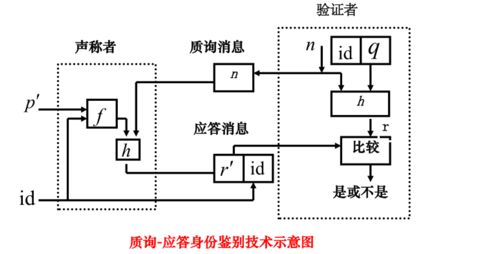

**安全性**：依赖于质询的不可预测性和不重复性，能有效防止口令窃听和重放攻击。

##### C. 基于地址的机制

- 假定声称者的可鉴别性以呼叫源地址为基础；验证者对每个主体保持一份合法呼叫地址文件。
- 最大困难是在临时环境里维持连续的主机和网络地址联系（地址转换频繁、质询—转发或重定向带来问题）。
- **结论**：<span class="hl-green">基于地址的机制自身不能被作为鉴别机制，但可作为其它机制的有用补充</span>。

##### D. 基于个人生理特征的机制

基于"每个人生理特征具有唯一性"的假设，包括指纹、视网膜、声音、虹膜、语音、面部、签名等。

| 手段 | 依据 |
|---|---|
| **<span class="hl-blue">指纹</span>** | 曲线、分叉及微小特征；提取部分特征存储以节省资源、快速查询 |
| **<span class="hl-blue">手掌手型</span>** | 折痕、起皱、凹槽，以及手的长度、宽度、手指所表示的几何特征 |
| **<span class="hl-blue">视网膜扫描</span>** | 扫描眼球后方视网膜上的血管图案 |
| **<span class="hl-blue">虹膜扫描</span>** | 虹膜是瞳孔周围一圈彩色部分，有独有图案、分叉、颜色、环状、光环和皱褶 |
| **<span class="hl-blue">语音识别</span>** | 记录时读若干单词，识别系统混杂后让其再次读出（鸡尾酒效应、嗅觉专注） |
| **<span class="hl-blue">面部扫描</span>** | 不同的骨骼结构、鼻梁、眼眶、额头和下颚形状 |

**指纹识别原理**：<span class="hl-green">通过光电扫描与计算机图像处理技术</span>，对指纹采集、分析和比对，自动迅速准确认证身份；过程是把数据库中的模板指纹调出，与用户输入指纹匹配，确定是否同一指纹。

##### E. 个人鉴别令牌

- 物理特性支持认证"某人拥有某东西"，通常与口令或 PIN 结合；应有存储功能，常有键盘、显示器等界面部件，更复杂的可支持一次性口令、嵌入处理器和网络通信设备（如智能卡），还常利用其它密码鉴别方法。

IC 卡分类（了解层级）：

| 分类维度 | 取值 |
|---|---|
| 按接口类型 | 接触式 IC 卡 / 非接触式 IC 卡 / 双界面卡 |
| 按嵌入芯片的形式和类型 | 非加密存储卡 / 逻辑加密卡 / CPU 卡（又称智能卡） |

| 层面 | 要点 |
|---|---|
| **<span class="hl-blue">硬件</span>** | 与外界通信前先完成智能卡与终端间认证；加安全传感器防读写时被修改；异常时复位或置标志位使操作系统响应；存储器加密不保存明文 |
| **<span class="hl-blue">软件</span>** | 使用需通过双因素认证进入安全状态；信息以文件系统保存，依类型或密钥提供不同访问操作；支持 DES、3DES 和 RSA 等算法 |

#### 5.5.2 零知识证明与身份鉴别技术

**零知识证明思想**：在密码学中，希望一个鉴别协议能够在声称者向验证者证明他身份的同时，没有泄露任何信息。

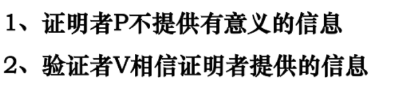

**零知识证明三原则**【最常考，务必背熟】

| 原则 | 口诀 | 含义 |
|---|---|---|
| **<span class="hl-green">完备性</span>** | 真的假不了 | 如果声称者确实拥有所声称的知识（是真的），那么诚实的验证者最终会被说服 |
| **<span class="hl-green">合理性</span>** | 假的真不了 | 如果声称者不拥有所声称的知识（是假的），那么他欺骗验证者接受的概率极低 |
| **<span class="hl-green">零知识性</span>** | 只知结果不知秘密 | 在整个证明过程中，验证者除了知道"声称者拥有该知识"这一事实外，不能获得任何关于该知识本身的额外信息 |

**直接证明 vs 间接证明**【选择题高频】

| 方式 | 做法 | 泄漏量 |
|---|---|---|
| **直接证明** | 出示或直接说出秘密本身 | **<span class="hl-red">最大泄漏证明</span>**——秘密一旦说出即完全暴露 |
| **间接证明** | 用**数学方法**证明自己知道秘密 | **<span class="hl-green">零知识</span>**——零知识证明属于间接证明 |

看到"哪种证明会泄漏秘密"→ 直接证明（最大泄漏）；看到"零知识证明属于哪种"→ 间接证明。

**经典例子**（记原理即可，无需背细节）

| 例子 | 原理 |
|---|---|
| **山洞（洞穴）问题** | 秘密是"能否打开 C、D 之间的暗门"，用反复随机指路来验证（唯一需要算，见下） |
| 色盲验证红绿双球 | 声称者靠**语言**描述手中球的颜色（不看球），只有真色盲能描述对 |
| 皇帝的新衣 | 全场只有真看不见的人敢说"我没看见"——不敢说即暴露 |
| 数独问题 | 只证明自己填出了正确解，不泄露解法 |
| 地图三色问题 | 只证明存在三染色方案，不泄露具体着色 |
| 阿里巴巴与四十大盗 | ZKP 的**动机来源**（纯故事案例，一般不考） |

**山洞（洞穴）问题**【本节唯一需要算的点】

```text
        A
     ┌──┴──┐
     C     D
     └─暗门─┘
```

协议：① 验证者 V 站在 A 点，声称者 P 进入洞中走到 C 或 D（V 不知道是哪个）② V 走到 B 点，**随机**喊"从左通道出"或"从右通道出" ③ P 按要求从对应通道走出 ④ 重复 $n$ 轮。

| 情况 | $n$ 轮全对的概率 |
|---|---|
| P **知道**暗门位置 | $1$（每轮必对） |
| P **不知道**（纯蒙） | $(1/2)^n$ |

$P = (1/2)^n$，取 $n = 16$ 时 $P = 1/65536 \approx 1.5 \times 10^{-5}$——蒙对概率已低到可忽略，故 P 几乎必然知道暗门位置。注意验证者**始终不知道**暗门在哪，只知道"P 知道"，这正是零知识性的体现。

**延伸**（了解层级，可能出名词解释）

- **NPC 归约**：任意数学命题（如哥德巴赫猜想）都可转换为 **NPC 问题**（如三染色问题），因此**证明了三染色即证明了原命题成立**。
- **典型零知识鉴别协议**：基于计算模 $n$ 平方根困难性的 **Fiat-Shamir**、**Fiege-Fiat-Shamir** 协议；基于离散对数困难性的 **Needham-Schroeder** 协议——均属**质询-应答**框架的变体，可与本篇 §5.5.1 B 联记。

#### 5.5.3 采用对称密码的鉴别机制

- 基于对称密码算法的鉴别依靠一定协议下的数据加密处理；通信双方共享一个密钥（通常存于硬件），该密钥在质询—应答协议中处理或加密信息交换。
- 鉴别和密钥交换协议的核心问题有两个：保密性与时效性；为防止伪装和暴露会话密钥，基本鉴别与会话密码信息必须以保密形式通信；第二个问题涉及防止消息重放。

**常见消息重放攻击形式**（4 种）

| 形式 | 说明 |
|---|---|
| **<span class="hl-red">简单重放</span>** | 攻击者复制消息后重发 |
| **<span class="hl-red">可被日志记录的复制品</span>** | 在合法有效时间窗内重放带时间戳的消息 |
| **<span class="hl-red">不能被检测到的复制品</span>** | 原始信息被拦截未达目的地，只有重放信息到达 |
| **<span class="hl-red">反向重放</span>**（不做修改） | 向消息发送者重放；采用传统对称加密时可能，因为发送者不能简单识别收发消息在内容上的区别 |

**抗重放：非重复值的使用**

- 针对不同验证者的重放：用验证者的标识符。
- 针对同一验证者的重放：用非重复值。
- 三种非重复值：<span class="hl-green">① 序列号——双方须保持上次消息序号；② 时间戳——要求各参与者时钟同步；③ 验证者发送随机值（如质询）——不可预测、不重复</span>。

> 时间戳的难处：分布式网络时钟同步不易；同步失败要么协议不能正常服务影响可用性、造成拒绝服务（DoS），要么放大时钟窗口造成攻击机会；时间窗大小应按消息时效性确定。

> 质询/应答方式：A 先发随机值 challenge，B 变换后送回，A 验证 response 含该随机值；不适合非连接性应用，因为传输前先握手会抵消无连接通信的主要特点。（完整过程见 §5.5.1 B）

**鉴别协议体系**

- 无可信第三方参与：单向鉴别（仅一方被鉴别）、双向鉴别。
- 有可信第三方参与。
- **相互鉴别协议**：<span class="hl-green">理论上可由两个单向鉴别协议组合，但组合可能易受窃听重放攻击</span>（如 WAPI 想国产化替代 WiFi）；也可设计消息数远少于两倍的相互鉴别协议；出于安全和性能考虑，相互鉴别协议必须专门设计。
- 课件还给出了无可信第三方参与的两次传送鉴别、三次传送鉴别，及含 TP 的五次传送鉴别等协议流；非对称密码侧则涉及 $Cert_A\Vert Token_{AB}$ 的单向、双向及"两次传递并行机制"。

**符号约定**

| 符号 | 含义 |
|---|---|
| A / B / TP | 可区分标识符 |
| $K_{XY}$ | X、Y 共享的对称密钥 |
| $S_X$ | X 的私有签名密钥 |
| $N_X$ | 顺序号 |
| $R_X$ | 随机数 |
| $T_X$ | 时变参数（时间标记或顺序号 $R_X N_X$） |
| $Y\Vert Z$ | 拼接 |
| $e_K(Z)$ | 对称加密结果 |
| $f_K(Z)$ | 密码校验值 |
| $Cert_X$ | TP 签发的证书 |
| $Token_{XY}$ | X 发给 Y 的权标 |
| TVP | 时变参数 |

**Kerberos 身份鉴别协议**

MIT 为 Athena 项目开发的身份鉴别协议，"Kerberos"本意是希腊神话中守护地狱之门的守护者；提供网络环境下的身份鉴别框架，涉及鉴别（Authentication）、记账（Accounting）、审计（Auditing）。

五步流程：

| 步 | 动作 |
|---|---|
| ① | <span class="hl-green">请求票据许可票据</span> |
| ② | <span class="hl-green">票据许可票据（身份验证，得到 TGT，ticket-granting ticket）</span> |
| ③ | <span class="hl-green">请求服务器票据</span> |
| ④ | <span class="hl-green">服务器票据（申请验证，得到 ticket）</span> |
| ⑤ | <span class="hl-green">请求服务</span> |

Session Key 用于 Service 对 Client 的身份鉴别；Ticket 包括用户名、用户地址(IP)、服务名、有效期、时间戳等。

**课件思考题**

1. 假设通信 A 和 B 双方需身份鉴别，设计一个可对抗字典攻击的鉴别方案。
2. 下列不属于身份鉴别协议的是——A. S/Key 协议　B. 口令鉴别　C. S/MIME　D. Kerberos（<span class="hl-green">答案 C</span>）。

### 5.6 补充：工程实践

> 【非课件原文】§5.5 讲的是各类鉴别机制（口令、一次性口令、零知识、对称密码）。本节补最基础、也最常出事的一段：**口令在服务器端怎么存**、**登录接口怎么防爆破**。

#### 5.6.1 MAC 的计算方法与校验

**MAC（消息鉴别码）**：用于验证消息的完整性和来源。

**计算方法**：使用一个带密钥的密码校验函数 $f$，对消息 $Z$ 和共享密钥 $K$ 进行计算，得到密码校验值 $f_K(Z)$。

**具体实现**：MAC 的计算可以基于 Hash 算法（如 HMAC）、对称密钥算法或公开密钥算法。

**校验过程**：接收方使用相同的密钥 $K$ 和函数 $f$ 对收到的消息重新计算 MAC，并与收到的 MAC 值比较。若相同，则消息未被篡改且来自合法发送方。

#### 5.6.2 口令存储的三条底线

| 做法 | 是否可接受 | 原因 |
|---|---|---|
| 明文存储 | **禁止** | 一旦库泄露，所有口令直接可用；还会被用于撞库其它站点 |
| 可逆加密存储 | **禁止** | 密钥一旦泄露即可还原；系统本身不需要知道明文口令 |
| <span class="hl-red">无盐快速哈希（MD5 / SHA-1 / SHA-256）</span> | **不可接受** | 可被彩虹表预先计算，GPU 每秒可尝试数十亿次 |
| **<span class="hl-green">加盐 + 慢哈希（bcrypt / scrypt / Argon2 / PBKDF2）</span>** | **推荐** | 盐使彩虹表失效，慢哈希抬高离线爆破成本 |

要点：

- **盐（salt）**：每个用户独立随机生成，与口令一起参与哈希，随哈希值一同存储；盐不需要保密，作用是让相同口令产生不同结果。
- **慢哈希**：通过可调的计算代价（迭代次数 / 内存开销）降低爆破速度；参数随硬件发展上调。
- **pepper（可选）**：全局密钥参与哈希并与数据库分开存放，增加“拖库但未拿到密钥”时的难度。
- 校验时用**恒定时间比较**，避免通过响应时间逐字节猜测哈希值。

> 一句话：**只存哈希不存明文、盐要唯一、哈希要慢、校验只做比对。**

#### 5.6.3 登录接口的常见攻击与防护

| 攻击 | 表现 | 防护 |
|---|---|---|
| **暴力破解** | 对同一账号反复试口令 | 失败计数、阈值锁定或渐进延迟、限速 |
| **撞库 / 凭据填充** | 用其它站点泄露的账号口令批量尝试 | 异常登录检测、设备/地域风控、强制 MFA |
| **用户枚举** | 依据“用户不存在 / 口令错误”的不同提示筛选账号 | **统一错误提示**（如“账号或口令错误”）、统一响应时间 |
| **验证码绕过 / 短信轰炸** | 自动化调用验证码接口 | 图形或行为验证码、发送频率限制、一次性有效 |
| **会话固定** | 攻击者预置会话 ID 诱导受害者登录 | 登录成功后**重新生成会话 ID** |
| **中间人窃取** | 明文 HTTP 传输口令 | 全站 HTTPS / TLS，禁止口令出现在 URL 与日志中 |

配套要求：

- 登录失败、锁定、解锁、异地登录都要**记入审计日志**（六要素见下篇 §11.9.2）。
- 口令策略：长度优先于复杂度、禁止弱口令与常见口令、限制历史重用；**不强制定期改口令**（易导致弱变体），改为发现泄露时强制重置。
  - 注：这是 NIST SP 800-63B 的现代口径；若课程按传统“定期更换口令”作答，考试以课件口径为准。
- 高价值系统在口令之外叠加 **MFA**（§5.2.4 的多因素思路），口令只作为其中一因素。

> 收口：口令安全 = **存储侧不可逆 + 登录侧可限速 + 全链路加密 + 全过程留痕**。它与本篇 §6.10 的最小权限、下篇 §11.9 的审计共同构成账号安全的闭环。
## 6. 访问控制

### 6.1 访问控制的概念与目标

**访问控制概念**：针对越权使用资源的防御措施。

**目标**：防止对任何资源（计算、通信、信息资源）进行未授权的访问，使资源在授权范围内使用，决定用户及其程序能做什么。

**最小授权原则**：是访问控制思想的体现，指只授予主体（用户、程序）完成其任务所必需的最小权限，避免权限过度扩散。

**未授权访问**：包括未经授权的使用、泄露、修改、销毁信息以及颁发指令等。两个具体实例：非法用户对系统资源的使用、合法用户对系统资源的非法使用。

### 6.2 访问控制的两个重要过程

| 步骤 | 作用 |
|---|---|
| 第一步：**鉴别** | 检验主体的合法身份 |
| 第二步：**授权** | 限制用户对资源的访问权限 |

**关系**：身份鉴别是访问控制的前提。

### 6.3 核心概念

| 概念 | 定义 |
|---|---|
| <span class="hl-blue">主体 (Subject)</span> | 发起操作的主动实体，如用户、程序、进程 |
| <span class="hl-blue">客体 (Object)</span> | 被操作的被动实体，即需要保护的资源，如文件、数据库 |
| <span class="hl-blue">访问 (Access)</span> | 主体对客体的操作，如读、写、修改、删除 |
| 授权 | 规定主体可以对客体执行的操作（如读、写、执行、拒绝访问） |

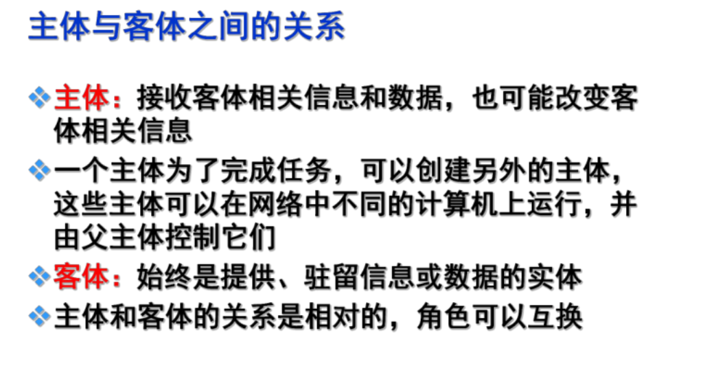

### 6.4 访问控制模型分类

主要分为：自主访问控制模型、强制访问控制模型、基于角色的访问控制模型。

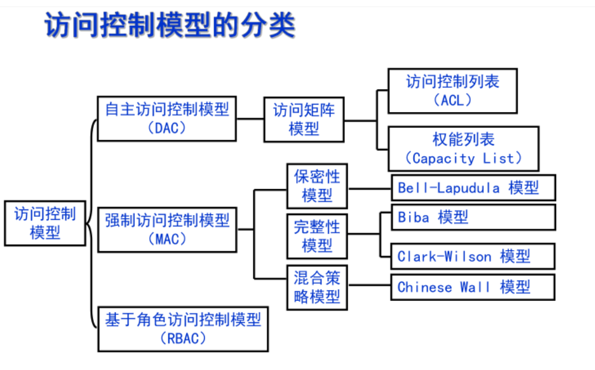

> 这三类模型与防火墙的能力边界（防火墙能实现哪几类访问控制、哪几类即使加插件也做不到）见[网络安全（下）](/posts/872-sec-02-defense-device-vpn/) §7.9。

### 6.5 自主访问控制模型（DAC）

**是什么**：<span class="hl-green">允许客体的属主（创建者）自主决定其他主体对该客体的访问权限</span>。是一种**分布式授权管理模式**。

**应用场景**：常用于商业系统。

**优点**

- a. 根据主体的身份和访问权限进行决策
- b. 具有某种访问能力的主体能够自主地将访问权的某个子集授予其它主体
- c. 灵活性高，易用性和可扩展性好，被大量采用

**缺点**

- 安全性不高。
- **无法控制信息流动**：权限可能被传递，使不具备权限的用户获得访问权。
- 面临**特洛伊木马**威胁：木马可能利用用户的权限进行非法操作。

**实现机制与方法**：基于访问控制表/矩阵。

| 方法 | 关联对象 | 特点 |
|---|---|---|
| 访问控制表 | 与客体关联，列出可访问它的主体及权限 | 便于管理客体权限，但查看主体所有权限困难 |
| 访问能力表 | 与主体关联，列出该主体可访问的客体及权限 | 便于查看主体权限，但管理客体权限困难 |
| 访问控制矩阵 | 从数学上描述主体、客体和访问权限的关系 | 矩阵的行是能力表，列是访问控制表 |

#### 6.5.1 访问控制矩阵与实现方法

**访问三元组**：`(S, O, A)`——主体 Subject、客体 Object、访问操作 Access（Read / Write / Exec）。

**访问控制矩阵**：$M: S \times O \rightarrow 2^A$，矩阵元素是主体对客体可执行的操作集合。

- **行 = 主体**：第 $i$ 行对应主体 $s_i$，横向看是 $s_i$ 的**能力表**（Capability List），列出它能访问哪些客体、各能做什么。
- **列 = 客体**：第 $j$ 列对应客体 $o_j$，纵向看是 $o_j$ 的**访问控制表**（ACL），列出哪些主体能访问它、各能做什么。
- **单元格 = 权限集合**：第 $i$ 行第 $j$ 列的 $M[s_i,o_j] \subseteq A$，表示主体 $s_i$ 对客体 $o_j$ 允许的操作集合；空格或“—”表示无权限。

**例**：

| 主体 \ 客体 | file1 | file2 |
|---|---|---|
| Alice | rw | r |
| Bob | r | — |

> Alice 行 = Alice 的能力表；file1 列 = file1 的 ACL（Alice: rw，Bob: r）。

**五种实现方法**：ACL、能力表、访问控制矩阵、授权关系表、访问控制安全标签。

> “锁与钥匙”是访问控制的比喻，不是第六种矩阵实现方法。

**ACL 表示法**：$O_j: s_0.r\ s_1.e\ s_2.rw$。

- 引入用户组后，主体标识写成“主体.组名”：`Fang.INFO.rw`、`*.INFO.rw`、`*.*.rw`。

**ACL 与能力表（CL）对照**

| 对比项 | ACL | 能力表 CL |
|---|---|---|
| 保存位置 | 客体 | 主体 |
| 查“某客体谁能访问” | 容易 | 困难 |
| 查“某主体能访问什么” | 困难 | 容易 |
| 权限传递 | 困难 | 容易 |
| 权限回收 | 容易 | 困难 |
| 适用 | 集中式 | 分布式 |

### 6.6 强制访问控制模型（MAC）

**是什么**：<span class="hl-green">主体对客体的访问由系统强制控制，客体的属主无权决定</span>。主体和客体被分配固定的安全属性（安全级别/标签），只有满足特定规则时才允许访问。可与自主访问控制结合使用。

**应用场景**：军事等安全要求较高的系统。

**强制型访问控制（MAC）特点**：将主体和客体分级，根据主体和客体的级别标记来决定访问模式。其访问控制关系分为：上读/下写（完整性），下读/上写（机密性）。通过**梯度安全标签**实现单向信息流通模式。

#### 6.6.1 信息流向规则（核心重点）

**"写"操作代表了信息的流动方向。**

| 规则 | 约束 | 保证的属性 | 典型模型 |
|---|---|---|---|
| <span class="hl-red">**下读 / 上写**（rd, wr）</span> | 主体级别**高于**客体时可读；主体级别**低于**客体时可写。信息流只能从低级别流向高级别 | <span class="hl-green">机密性</span> | <span class="hl-red">Bell-LaPadula（BLP）模型</span> |
| <span class="hl-red">**上读 / 下写**（ru, wd）</span> | 主体级别**低于**客体时可读；主体级别**高于**客体时可写 | <span class="hl-green">完整性</span> | <span class="hl-red">Biba 模型</span> |

> 选择题会考保证了机密性还是保证了完整性、哪个是机密性哪个是完整性。**速记：机密性怕泄露——<span class="hl-red">禁“上读”（低看高）、禁“下写”（高写低）</span>，所以允许“下读、上写”；完整性怕污染——<span class="hl-red">禁“下读”（高读低）、禁“上写”（低写高）</span>，所以允许“上读、下写”。两者互为镜像，记住一个取反即可。**

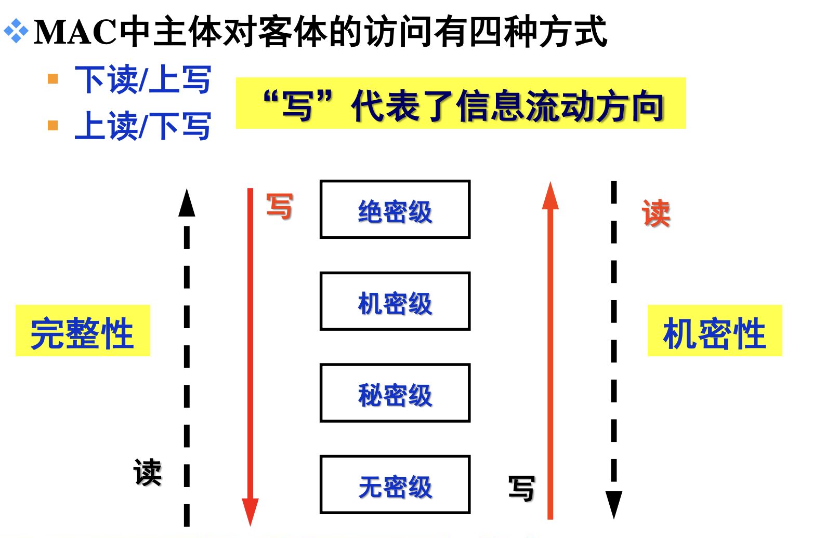

**两个必考应用（信息流方向别记反）**

| 场景 | 级别设置 | 采用规则 | 允许 / 禁止 |
|---|---|---|---|
| BLP 用于防火墙 | 内部网络 = 机密（高），Internet = 公开（低） | 下读 / 上写（不上读、不下写） | 允许内部读取外部低密级数据；禁止内部高密级数据写到外部。连接可由内部发起，但受保护数据只能**外部 → 内部**流动，敏感数据不外流。 |
| Biba 用于 Web 服务器 | 服务器资源 = 高完整性，Internet 用户 = 低完整性 | 上读 / 下写（不下读、不上写） | 允许低完整性用户读取高完整性网页；禁止其改写服务器资源，保证 Web 数据完整性。 |

> BLP 只管机密性：它允许“写向上”，所以不能防低密级数据污染高密级系统；完整性要靠 Biba 补。

#### 6.6.2 四种 MAC 策略规定

- **下读**：用户级别大于文件级别的读操作。
- **上写**：用户级别低于文件级别的写操作。
- **下写**：用户级别大于文件级别的写操作。
- **上读**：用户级别低于文件级别的读操作。

**方向判断**：主体级别高于客体叫“下读/下写”，低于客体叫“上读/上写”；再套模型——BLP 允许“下读、上写”，Biba 允许“上读、下写”。

#### 6.6.3 常见强制访问控制模型的特点

| 模型 | 年份与提出者 | 特点 |
|---|---|---|
| **Lattice 模型** | 1976，Denning | 主体的安全级别高于客体的安全级别才能访问；下读、下写 |
| **BLP 模型** | 1973，Bell-LaPadula | 多级安全模型，通过"下读/上写"规则防止信息从高安全级流向低安全级，保证**机密性** |
| **Biba 模型** | 1977，Biba | 通过"上读/下写"规则防止低完整性信息污染高完整性信息，保证**完整性** |
| **Clark-Wilson 模型** | 1987，Clark & Wilson | 以事务处理为核心的完整性模型，应用于商业系统 |
| **Chinese Wall 模型** | 1989，Brewer & Nash | 解决商业利益冲突的安全策略模型 |

> **Lattice 行的口径说明**：课件原文确为“主体的安全级别高于客体的安全级别才能访问；下读、下写”，且该页未标注保证机密性还是完整性。按同章四操作定义，`下写` 会让高密级信息流向低密级，与机密性方向相反，因此“下读、下写”实际是 BLP 的读方向拼 Biba 的写方向，不属于任何一个标准模型；下一页 BLP 专页的括号记法“下读/不下写”也支持“‘下写’前脱了‘不’字”的推测。**应试默写按课件原文“下读、下写”；理解、判断题按 BLP 的“下读/不下写”保机密来判断**。Denning 的 Lattice 本身只规定“安全类 + 支配关系”的通用框架，不固定读/写方向，不要硬套成 Biba。

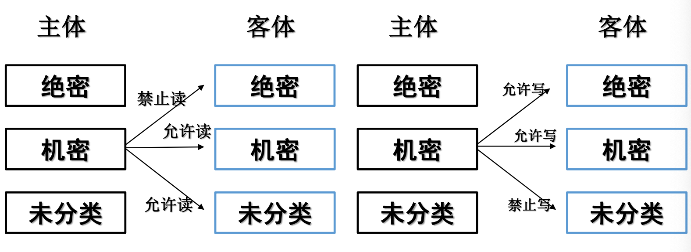

### 6.7 基于角色的访问控制（RBAC）

#### 6.7.1 基本思想

<span class="hl-green">根据用户所担任的角色来决定用户在系统中的访问权限</span>。用户必须扮演并激活某种角色，才能访问对象或执行某种操作。

**核心是"用户 — 角色 — 权限"三层抽象关系**

```
用户(User)  ←──多对多──→  角色(Role)  ←──多对多──→  权限(Permission)
```

| 层次 | 含义 | 举例 |
|---|---|---|
| **用户** | 系统中的具体自然人或进程，是安全活动的主体 | 张三 |
| **角色** | **一组职责的集合**，代表职位 | 财务主管、审计员 |
| **权限** | 对客体的具体操作授权 | 读文件、写数据库、批准付款 |

- **用户 ↔ 角色：多对多**。一个用户可同时被授予多个角色；一个角色也可赋予多个用户。
- **角色 ↔ 权限：多对多**。一个角色对应一组权限，同一个权限也可被多个角色共享。
- **权限可继承**：角色可以继承其他角色的权限，权限逐级累加。
- **对应关系动态可调**：系统运行期间可随时调整用户与角色、角色与权限的映射；新增用户时只需挂到已有角色，不必逐条重新授权——这正是 RBAC 相对传统 ACL 的核心优势。

#### 6.7.2 特点

- 便于**授权管理**，如系统管理员需要修改系统设置等内容时，必须有几个不同角色的用户到场方能操作，增强了安全性
- 便于**处理工作分级**，如文件等资源分级管理
- **利于安全约束**，容易实现各种安全策略，如最小特权、职责分离等
- 便于**任务分担**，不同角色完成不同的任务

**两大核心安全属性**

- **<span class="hl-green">最小特权（Least Privilege）</span>**：每个用户只被授予完成其职责所**必需的最小权限集**，权限随职务变动而及时收回。
- **<span class="hl-green">职责分离（Separation of Duty, SoD）</span>**：把**不相容的职责拆给不同角色**，使任何单一用户都无法独立完成敏感操作。例如"发起付款"与"批准付款"分属两个角色，必须两个角色配合才能生效——即使某个账号被盗，单点也无法造成资金损失。

> 简答主干：RBAC 就是在用户和权限之间**插入"角色"这一层**，把要管理的对象从"给每个人单独授权"变成"给角色授权"。好处是人员进出只需改角色，不必逐条重设权限，从而低成本地实现最小特权和职责分离。

#### 6.7.3 RBAC0/1/2/3 与运行步骤

**RBAC96 四层模型**（课件口径：Ferraiolo 等在 20 世纪 90 年代提出、NIST 推动，1996 年形成 RBAC96；学术上 RBAC96 论文作者为 Sandhu 等，Ferraiolo & Kuhn 1992 提出 RBAC 思想）

| 模型 | 组成 | 关键点 |
|---|---|---|
| **RBAC0** | 用户、角色、权限、会话 | 核心模型：用户经角色获得权限 |
| **RBAC1** | RBAC0 + 角色继承（RH） | 一般继承是偏序关系；受限继承是树结构 |
| **RBAC2** | RBAC0 + 约束 | 静态责任分离（授权阶段角色互斥）、动态责任分离（会话阶段不能同时激活）、角色基数限制 |
| **RBAC3** | RBAC1 + RBAC2 | 完整模型：继承 + 约束 |

**组成要素**：UA（用户分配）、PA（权限分配）、激活角色、会话（一次会话对应一个用户，可激活多个角色）；许可 = 操作 + 客体。

**运行五步**

1. 用户登录鉴别。
2. 检索用户被授权的角色集。
3. 选择本次会话的活跃角色集。
4. 创建会话（体现为授权菜单、按钮）。
5. 管理员改动在会话结束或终止时生效。

**银行实例**：出纳员（改账户记录）、分行管理者（改记录 + 创建/终止账户）、顾客（查自己账户）、系统管理者（启停系统但不能读改用户账户）、审计员（可读任何数据但不能改）。

**改进 RBAC**：既对角色授权，又允许对用户单独授权；授权状态用 `int`（32 位）表示，后 4 位表示 CRUD 操作，1/0 表示允许/不允许。

### 6.8 其他没那么重点但可能考的

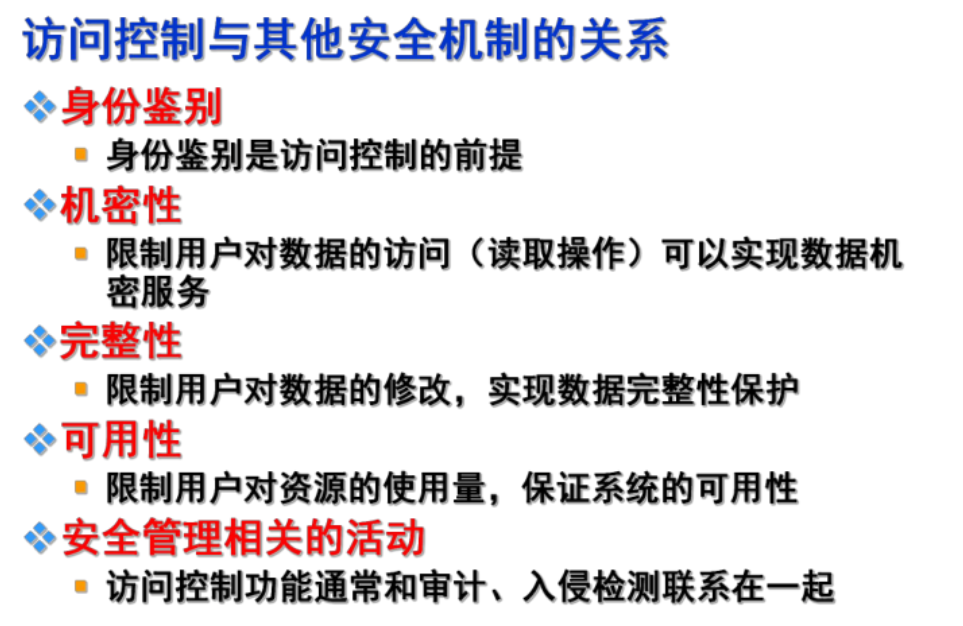

**零信任（Zero Trust）**【本系列课件未设专章，按通用定义记三条核心原则即可】

| 核心原则 | 含义 |
|---|---|
| **永不信任，始终验证**（Never Trust, Always Verify） | 默认**不信任**任何内外部用户与设备，一律先验证后访问 |
| **最小权限访问** | 按需授权——与本篇 §6.1 最小授权原则、§6.7 最小特权（Least Privilege）本就是同一考点 |
| **持续验证与动态访问控制** | 不是登录一次就放行，全程持续评估身份、设备与行为 |

- **易混提醒**：可信计算中的"**信任根、信任链**"属于**可信计算**概念，与零信任"默认不信任"的方向**正好相反**，两者别混为一谈。
- **与网络准入控制（NAC）的关系**：NAC 是零信任的前身与特例——NAC 只解决"能否进入网络"这一次鉴权，零信任把它泛化为"**每一个访问请求都重新鉴权**"，见[网络安全（下）](/posts/872-sec-02-defense-device-vpn/) §9.5。

### 6.9 操作系统中的访问控制与安全评估标准

#### 6.9.1 Windows 的访问控制

- **LSA**（Local Security Authority）：本地安全权威，负责安全策略、登录与审计。
- **WinLogon**：交互式登录过程，负责收集凭据并调用 LSA。
- **SAM**：安全账户管理器数据库，保存本地用户/组账户信息。
- **SRM**（Security Reference Monitor）：安全引用监视器，负责访问检查。
- **安全描述符**：包含所有者 SID、组 SID、DACL（自主访问控制表）、SACL（系统访问控制表）。
- **访问令牌**：包含用户 SID、组 SID、特权等信息。

**访问检查流程**：进程发起访问 → SRM 取出进程的访问令牌 → 与对象安全描述符中的 DACL 逐条比较 → 允许或拒绝。

#### 6.9.2 Linux 的访问控制

- 权限表示：字母式 `rwx` 或 8 进制（r=4、w=2、x=1）。
- 普通权限分三类：**所有者 owner、所属组 group、其他 other**；`root` 是特权用户，不受普通权限检查限制，不是第四类权限。
- 示例：`drwxr-x--x 2 Fang work ... text`
  - `d`：目录；后面 9 位分三组。
  - 所有者 `rwx`；所属组 `r-x`；其他 `--x`。

#### 6.9.3 集中访问控制与域

- 集中访问控制协议：**RADIUS、TACACS、TACACS+、Diameter**。
- 非集中方式：**域**。域是信任范围，跨域访问需要建立**单向信任**或**双向信任**。

#### 6.9.4 安全评估标准沿革

| 标准 | 时间 | 要点 |
|---|---|---|
| **TCSEC**（桔皮书） | 1983/1985 | 美国国防部标准；**四类七级**：D、C1、C2、B1、B2、B3、A1；通用系统多为 **C2** |
| **彩虹系列** | 20 世纪 80–90 年代 | TCSEC 的配套解释文件集合 |
| **ITSEC** | 1991 年发布，1998 年后逐步停用 | 欧洲标准，强调功能与保证分离 |
| **CC** | 1998 年五国采用，2005 年取代 TCSEC | 通用准则；ISO/IEC 15408，我国等同采用为 **GB/T 18336** |

**CC 的 EAL1–EAL7**：

- EAL1：功能测试
- EAL2：结构测试
- EAL3：系统地测试和检查
- EAL4：系统地设计、测试和复查
- EAL5：半形式化设计和测试
- EAL6：半形式化验证的设计和测试
- EAL7：形式化验证的设计和测试

### 6.10 安全设计原则与访问控制的落地层次（横向补充）

> 【补充·非课件原文】§6.1–§6.9 是课件原文的访问控制模型与系统实现。本节把"最小权限 / 职责分离"还原为更上位的一般设计原则，并补一张"从模型到落地"的层次图，供综合题、场景题推导使用；编号排在章末，不按教材顺序。

#### 6.10.1 八条经典安全设计原则

访问控制模型回答"用什么机制"，设计原则回答"为什么这样设计"。经典八原则（Saltzer & Schroeder）加一条职责分离：

| 原则 | 含义 | 落地时问自己 |
|---|---|---|
| **最小权限** | 只给完成任务所必需的最小权限，且随职责变动收回 | 这个账号/进程真的需要这个权限吗 |
| **职责分离（SoD）** | 不相容职责拆给不同主体，单人无法独立完成敏感操作 | 一个人能不能既操作又审批、既删数据又删日志 |
| **完全仲裁** | **每一次**访问都要经过授权检查，不能因"已登录"就放行 | 有没有绕过检查的旁路接口、缓存授权会不会失效 |
| **失败安全 / 默认拒绝** | 未明确允许即拒绝；出错时进入安全状态而不是放行 | 异常分支是 return 还是放行 |
| **最小公共机制** | 共享的资源与通道越少越好，避免横向影响与隐蔽信道 | 业务、日志、备份该不该挤在同一台机器/同一个账号下 |
| **权限分离**（Separation of Privilege） | 访问敏感资源需同时满足多个独立条件（如两把钥匙），单一权限不足以完成 | 有没有"一把钥匙就能开到底"的特权操作 |
| **经济机制** | 机制越简单越容易验证，复杂设计本身即风险 | 这套规则还有人能说清吗 |
| **开放设计** | 安全性只依赖密钥，不依赖设计保密 | 有没有把"别人不知道"当安全措施 |
| **心理可接受性** | 安全措施不能妨碍正常业务，否则会被绕过 | 太麻烦用户会不会直接关掉 |

> 课件把最小权限、职责分离写成 RBAC 的两个"特点"（§6.7.2），容易让人以为它们只属于 RBAC。**实际上它们是独立原则，RBAC 只是实现手段之一**；数据库账号、日志权限、运维流程同样要遵循。
>
> 辨析：**职责分离**管"人和职责"——不相容的职务不能给同一个人；**权限分离**管"机制"——完成一次敏感操作要凑齐多个独立条件。两者常配合使用（如双人授权 = 职责分离 + 权限分离）。

**四问推导法**（场景题可用）：谁能访问（主体）→ 访问什么（客体）→ 允许做什么（操作）→ 每次是否检查（仲裁）。四问任一答不上来，就是一个权限缺口。

#### 6.10.2 访问控制的四个落地层次与粒度

同一套"主体—客体—操作"，在不同层由不同机制实现：

| 层次 | 典型机制 | 粒度 | 归谁管 |
|---|---|---|---|
| **网络层** | 防火墙 ACL、安全域、VLAN、VPN | IP / 端口 / 协议 | 网络管理员 |
| **主机 / 系统层** | 文件权限、ACL、SELinux / AppArmor、Windows DACL | 文件 / 目录 / 进程 / 服务 | 系统管理员 |
| **数据库层** | 系统权限 / 对象权限、角色、视图、存储过程、行级安全 | 库 / 表 / 行 / 列 | DBA |
| **应用层** | 功能权限（菜单 / 按钮）、数据权限（本人 / 本部门 / 全部）、RBAC / ABAC | 接口 / 记录 / 字段 | 应用与业务 |

> **粒度越细，越靠近客体，越必须由客体所在系统实现**——这正是下篇 §7.9"防火墙管不了字段级权限"的原因。
>
> 很多权限事故的本质是**层次错配**：把应用层该做的数据权限交给数据库超级账号兜底；把审计层该独立保存的记录交给业务账号管理；把网络层该隔离的业务与日志塞进同一台主机。

#### 6.10.3 权限治理：原则怎么落到账号上

- **账号生命周期**：申请 → 审批 → 开通 → 使用 → 变更 → **定期复核** → 回收。离职、转岗、项目结束必须同步收权，否则产生**权限膨胀**。
- **特权账号**：单独管理、最小化授予、临时提权、双人授权（四眼原则）、操作全程留痕；禁止日常业务使用超级账号。
- **三权分立**：系统管理员（管系统）、安全管理员（管策略）、审计管理员（管审计）互相制约；**审计员只读，不能改记录**。
- **服务 / 应用账号**：不共享、不硬编码、只授业务必需的增删改查，禁止 DDL 与授权权限。
- **权限复核**：定期比对"实际权限"与"岗位需要"，输出差异清单并整改。

> 收口：原则（为什么）→ 层次（在哪做）→ 治理（谁负责、怎么持续）。设备侧的能力边界见下篇 §7.9，数据与审计的落地见下篇 §11.8、§11.9。

---

**网络安全（上）完**。下一篇：[网络安全（下）——防火墙、入侵检测、VPN 与系统安全](/posts/872-sec-02-defense-device-vpn/)