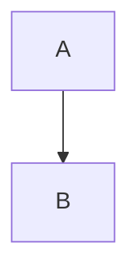

# Build-time Mermaid renderer

Mermaid diagrams are rendered to static SVG during the Jekyll build. The
browser never downloads Mermaid, and the Markdown source keeps normal
```` ```mermaid ```` fences.

## How it works

- `_plugins/mermaid_prerender.rb` collects every Mermaid fence from `_posts`.
- It calls `render.mjs` once with all diagrams.
- `render.mjs` starts a single headless Chromium and renders each diagram for
  the `default` (light) and `dark` themes.
- SVGs are written to `assets/img/mermaid/` and cached by content hash.
- A `:post_convert` hook replaces each code block with a `<figure>` containing
  the light/dark SVGs.

Generated SVGs are not committed; GitHub Actions caches them between builds.

## Local setup

```bash
cd tools/mermaid
npm ci
npx puppeteer browsers install chrome
```

On Linux, install a CJK font if diagrams contain Chinese labels:

```bash
sudo apt-get update
sudo apt-get install -y fonts-noto-cjk
```

Then build or serve the site as usual:

```bash
bundle exec jekyll serve
```

## Skipping the renderer

For a quick local build without Node/Chromium:

```bash
MERMAID_RENDER=0 bundle exec jekyll serve
```

In that mode the diagrams remain as plain code blocks. In production
(`JEKYLL_ENV=production`) a renderer failure fails the build instead of
silently publishing code blocks.

## Adding a diagram

Just write a normal Mermaid fence:

````markdown

````

No `mermaid: true` front matter is needed. Do **not** add it back, otherwise
Chirpy will load the client-side Mermaid bundle again.

## Optional accessible titles

Mermaid's `accTitle` directive is used as the image `alt` text:

```mermaid
accTitle: TCP 三次握手
sequenceDiagram
  A->>B: SYN
```
